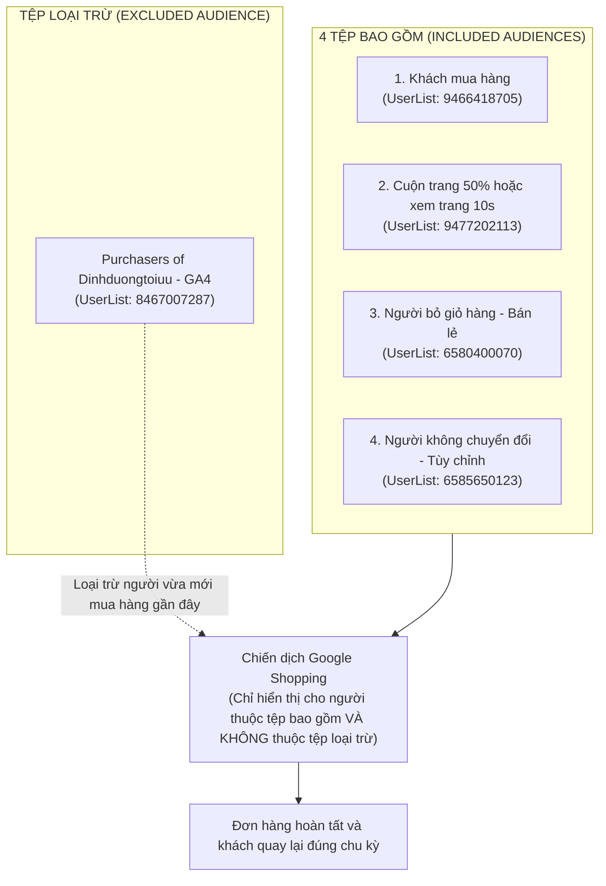
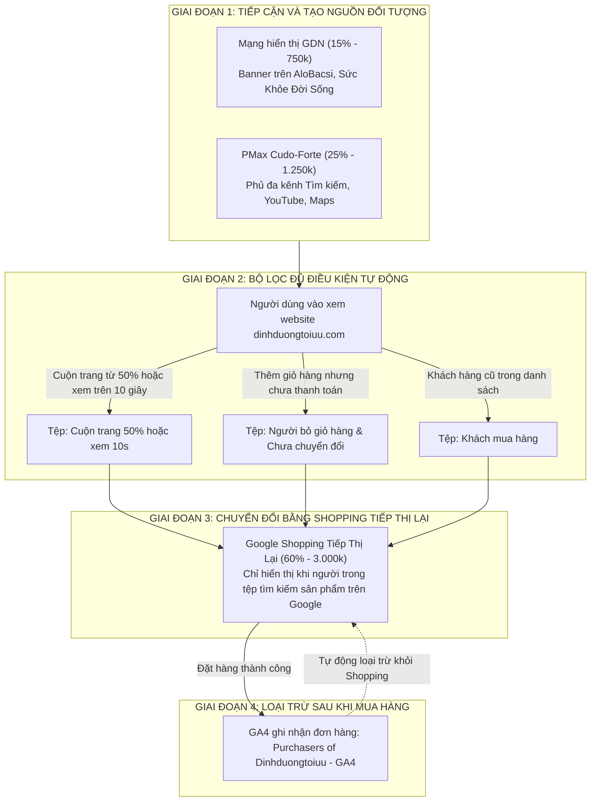

# 📋 Kế Hoạch Triển Khai Google Ads Ngân Sách 5 Triệu Cho Website dinhduongtoiuu.com (Mô Hình 3 Trụ Cột)

> 📅 **Thời gian cập nhật:** 2026-11-04 11:05:00 (GMT+7)  
> 👤 **Người lập kế hoạch:** Đại Dương · Performance & Operations  
> 🏢 **Tài khoản GMC:** `343115825` (H&H Nutrition · dinhduongtoiuu.com)  
> 🏬 **Tài khoản Pancake POS:** Shop `1022021128` (208 biến thể còn tồn kho)  
> 📊 **Tài khoản Google Ads:** `605-311-2652` (H&H Nutrition) thuộc MCC `270-190-4600`  
> 💰 **Tổng ngân sách:** **5.000.000 VNĐ** (Phân bổ trong chu kỳ 25–30 ngày)  
> 🚫 **Định hướng chiến lược:** **Không chạy quảng cáo Tìm kiếm (Search Ads) thông thường**. Dồn toàn bộ nguồn lực vào 3 trụ cột: **Shopping Tiếp thị lại**, **PMax Cudo-Forte** và **GDN Nhận diện thương hiệu**.  

---

## 1. Cấu Trúc Phân Khúc Đối Tượng Chuẩn Của Google Shopping

Chiến dịch Google Shopping (`HH - Shopping  T10/2025` - ID: `22219570213`) áp dụng phương thức tiếp thị lại với bộ điều kiện chọn lọc đối tượng rất rõ ràng, kết hợp giữa **4 tệp bao gồm** và **1 tệp loại trừ**:



### 1.1. Bốn tệp đối tượng được nhắm mục tiêu (Included)
1. **Khách mua hàng (`UserList ID: 9466418705`):** Khách hàng trong danh sách đã từng mua sản phẩm trước đây. Mục tiêu là tiếp cận lại khi họ có nhu cầu mua đợt mới.
2. **Cuộn trang 50% hoặc xem trang 10s (`UserList ID: 9477202113`):** Khách truy cập đã vào website và có hành vi đọc tìm hiểu nội dung nghiêm túc (cuộn trang sâu từ 50% hoặc ở lại trên 10 giây). Tệp này loại bỏ toàn bộ những người nhấp nhầm hoặc thoát trang ngay lập tức.
3. **Người bỏ giỏ hàng (Bán lẻ) (AdWords) (`UserList ID: 6580400070`):** Những người đã chọn sản phẩm vào giỏ hàng nhưng chưa hoàn tất bước thanh toán. Đây là nhóm có ý định mua sắm cao nhất.
4. **Người không chuyển đổi (Tùy chỉnh) (AdWords) (`UserList ID: 6585650123`):** Những người đã bắt đầu quy trình đặt hàng hoặc xem kỹ các trang dịch vụ/sản phẩm nhưng chưa gửi thông tin thành công.

### 1.2. Tệp đối tượng loại trừ (Excluded)
* **Loại trừ `Purchasers of Dinhduongtoiuu - GA4` (`UserList ID: 8467007287`):**
  * **Ý nghĩa thực tế:** Loại bỏ hoàn toàn những người **vừa mới mua hàng thành công** trên website qua dữ liệu chuyển đổi của GA4.
  * **Hiệu quả ngân sách:** Do các sản phẩm dinh dưỡng điều trị (sữa bệnh lý, súp dinh dưỡng, men vi sinh) thường được sử dụng theo liệu trình từ 15 đến 30 ngày, việc loại trừ người vừa mua giúp **không lãng phí ngân sách hiển thị quảng cáo cho người vừa mới nhận hàng**, đồng thời bảo vệ trải nghiệm của người dùng.

---

## 2. Bảng Phân Bổ Ngân Sách 5.000.000 VNĐ (Mô Hình 3 Trụ Cột)

Dồn toàn bộ ngân sách 5 triệu đồng vào 3 kênh hoạt động theo phễu khép kín:

| Kênh quảng cáo | Tỷ lệ | Ngân sách | Ngân sách/ngày (25 ngày) | Nhóm đối tượng & Cách thức hiển thị | Mục tiêu dự kiến |
| :--- | :---: | :---: | :---: | :--- | :--- |
| **1. Google Shopping Tiếp Thị Lại** *(ID: `22219570213`)* | **60%** | **3.000.000 VNĐ** | 120.000 VNĐ | • **Bao gồm 4 tệp:** *Khách mua hàng*, *Cuộn trang 50%/10s*, *Người bỏ giỏ hàng*, *Người không chuyển đổi*.<br>• **Loại trừ:** *Purchasers of Dinhduongtoiuu - GA4*.<br>• Phân loại theo nhãn `custom1` trong Feed GMC. | **75 – 90 đơn hàng**<br>(CPA dự kiến: 35.000 – 40.000đ)<br>ROAS: **320% – 420%** |
| **2. Performance Max (PMax) Cudo-Forte** *(ID: `24285314287`)* | **25%** | **1.250.000 VNĐ** | 50.000 VNĐ | • Đẩy mạnh sản phẩm men vi sinh Cudo-Forte đa kênh (Tìm kiếm, YouTube, Gmail, Maps).<br>• Tín hiệu đối tượng: Người quan tâm giảm ure máu, bệnh thận mạn, In-Market Lão khoa & Bệnh mãn tính. | **20 – 26 hộp Cudo-Forte**<br>(Sản phẩm chủ lực biên lợi nhuận tốt) |
| **3. Mạng Hiển Thị (GDN) Nhận Diện Thương Hiệu** | **15%** | **750.000 VNĐ** | 30.000 VNĐ | • Đặt banner trên các trang tin y tế uy tín (*AloBacsi, Sức Khỏe Đời Sống, chuyên mục Sức Khỏe VnExpress*).<br>• Tăng nhận diện thương hiệu `dinhduongtoiuu.com` và nạp thêm người vào tệp cuộn trang 50%/10s. | **50.000 – 65.000 lượt xem banner**<br>(600 – 900 lượt truy cập website) |
| **TỔNG CỘNG** | **100%** | **5.000.000 VNĐ** | **200.000 VNĐ** | **Hệ thống nhắm mục tiêu chọn lọc và loại trừ chuẩn xác** | **95 – 115 chuyển đổi**<br>**Doanh thu: 32 – 50 triệu VNĐ** |

---

## 3. Mối Liên Hệ Giữa GDN, PMax Và Cấu Trúc Đối Tượng Shopping

Mô hình 3 trụ cột tạo thành một quy trình vận hành đồng bộ và bổ trợ lẫn nhau:



1. **Giai đoạn tiếp cận ban đầu:**
   * Banner hiển thị trên **GDN** (AloBacsi, Báo Sức Khỏe) và chiến dịch **PMax Cudo-Forte** tiếp cận những người đang tìm hiểu về chế độ dinh dưỡng bệnh lý.
2. **Giai đoạn ghi nhận hành vi trên website:**
   * Người đọc bài viết từ 10 giây hoặc cuộn trang từ 50% trở lên ➔ Tự động được thêm vào tệp `Cuộn trang 50 hoặc xem trang 10s`.
   * Người chọn sản phẩm vào giỏ nhưng chưa thanh toán ➔ Tự động được thêm vào tệp `Người bỏ giỏ hàng` và `Người không chuyển đổi`.
3. **Giai đoạn chuyển đổi qua Shopping:**
   * Khi họ quay lại Google tìm kiếm sản phẩm, chiến dịch Shopping xuất hiện để hỗ trợ họ hoàn tất việc mua hàng.
4. **Giai đoạn bảo vệ ngân sách sau mua:**
   * Ngay khi đơn hàng hoàn tất, GA4 ghi nhận sự kiện mua hàng và đưa người dùng vào tệp `Purchasers of Dinhduongtoiuu - GA4`.
   * Chiến dịch Shopping **tự động loại trừ người này**, không tiếp tục hiển thị quảng cáo trong khoảng thời gian vừa mua hàng, giúp tiết kiệm tối đa chi phí.

---

## 4. Các Đầu Việc Kỹ Thuật Cần Thực Hiện

1. **Duy trì danh sách loại trừ trên chiến dịch Shopping:**
   * Đảm bảo tệp `Purchasers of Dinhduongtoiuu - GA4` (`8467007287`) luôn nằm trong danh sách **Loại trừ (Exclusions)** ở cấp chiến dịch hoặc cấp nhóm quảng cáo của `HH - Shopping  T10/2025`.
2. **Kiểm tra 4 tệp nhắm mục tiêu bao gồm:**
   * Xác nhận cả 4 tệp (*Khách mua hàng*, *Cuộn trang 50%/10s*, *Người bỏ giỏ hàng*, *Người không chuyển đổi*) đang ở trạng thái **Nhắm mục tiêu (Targeting)**, không để ở chế độ "Quan sát".
3. **Cập nhật mã SKU cho 2 sản phẩm tồn kho nhiều:**
   * Điền mã SKU cho **Peptamen 400g** (tồn 50 lon) trên Pancake POS để feed tự động đồng bộ sang GMC.
   * Cập nhật thông tin **Fomeal O'ricmeal peptide** (tồn 193 lon) lên website và gắn nhãn `custom1` trong GMC.
4. **Loại trừ nhóm tuổi 18–24:**
   * Tiếp tục duy trì loại trừ nhóm tuổi 18–24 trong phần nhân khẩu học của chiến dịch Shopping để giảm thiểu các lượt nhấp không phát sinh đơn hàng.
5. **Kiểm tra liên kết theo dõi PMax Cudo-Forte:**
   * Xác nhận lại tham số UTM tracking của chiến dịch PMax Cudo-Forte (`campaign_id: 24285314287`) để đảm bảo số liệu đổ về GA4 chính xác.

---

## 5. Mục Tiêu Cần Đạt Được

1. **Hiệu quả chuyển đổi tổng thể:**
   * Đạt từ **95 đến 115 chuyển đổi** trên toàn tài khoản (bao gồm đơn hàng website, cuộc gọi hotline và tin nhắn Zalo).
   * Chi phí trung bình cho mỗi chuyển đổi (CPA) dao động từ **35.000 – 45.000 VNĐ**.
   * Doanh thu trực tiếp ước tính đạt từ **32.000.000 – 50.000.000 VNĐ** (ROAS đạt **6.4x – 10.0x**).
2. **Mục tiêu riêng cho Cudo-Forte:**
   * Bán ra từ **25 đến 35 hộp Cudo-Forte** thông qua sự kết hợp giữa chiến dịch PMax và lưới hiển thị Shopping.
3. **Mục tiêu tiếp cận thương hiệu qua GDN:**
   * Đạt từ **50.000 đến 65.000 lượt xem banner** trên các trang tin y tế uy tín (*AloBacsi, Sức Khỏe Đời Sống*).
   * Gia tăng số lượng người dùng đủ điều kiện vào tệp cuộn trang và xem trang từ 8.000 lên mức **trên 10.500 người**.
4. **Hỗ trợ luân chuyển tồn kho:**
   * Tiêu thụ từ **30 đến 50 lon Fomeal O'ricmeal** và **15 đến 20 lon Peptamen** thông qua việc đưa hai sản phẩm này vào danh mục hiển thị của Shopping.

---

## 6. Hệ Thống Chỉ Số Đo Lường Vận Hành Hằng Ngày & Bảng Nhật Ký Tracking Thực Tế

Để người phụ trách có thể theo dõi, thu thập số liệu và lập báo cáo hàng ngày (thay vì một kế hoạch phân bổ tĩnh), toàn bộ hệ thống chỉ số vận hành đã được chuẩn hóa và kết nối trực tiếp vào Google Sheets:

👉 **Xem và nhập liệu trực tiếp trên Google Sheets:**  
🔗 **[Bảng Nhật Ký Theo Dõi & Báo Cáo Google Ads & GA4 Daily — dinhduongtoiuu.com](https://docs.google.com/spreadsheets/d/1Wbz2r_YzrW9TqcYeqWGbL4AMXm0J4GEqvArl04mewtc/edit#gid=1740174465)**  
*(Nằm tại Tab `Nhật Ký Ads & GA4 Hàng Ngày` trong bảng tính `DB - Nerci - Automation`)*

### 6.1. Bảng 5 Nhóm Chỉ Số Vận Hành Cốt Lõi Cần Thu Thập Hằng Ngày

| Nhóm Chỉ Số | Tên Chỉ Số | Nguồn Dữ Liệu | Công Thức / Sự Kiện GA4 | Ý Nghĩa Thực Tế Trong Vận Hành |
| :--- | :--- | :--- | :--- | :--- |
| **1. Chi Phí & Phân Phối Ads** | **Chi Phí Ads (VNĐ)** | Google Ads API | `cost_micros / 1.000.000` | Số tiền thực tế tài khoản đã chi trong ngày (ngân sách trần ~166.000đ/ngày). |
| | **Lượt Hiển Thị (Impr)** | Google Ads API | `metrics.impressions` | Độ phủ hiển thị quảng cáo đến người tìm kiếm và độc giả y tế. |
| | **Lượt Nhấp (Clicks)** | Google Ads API | `metrics.clicks` | Số lượt người dùng bấm vào quảng cáo chuyển hướng về website. |
| | **Tỷ Lệ Nhấp CTR (%)** | Tự động tính | `=Clicks / Impressions` | Đánh giá độ hấp dẫn của tiêu đề, hình ảnh và giá sản phẩm (chuẩn >1.5%). |
| | **CPC Trung Bình (VNĐ)** | Tự động tính | `=Cost / Clicks` | Chi phí trung bình cho mỗi lượt nhấp (kiểm soát dưới 3.000 VNĐ). |
| **2. Lưu Lượng & Nuôi Tệp RLSA** | **Phiên Truy Cập (Sessions)** | GA4 API | `sessionSourceMedium = google / cpc` | Số phiên truy cập thực tế đổ về website từ kênh trả phí Google. |
| | **Người Dùng (Active Users)** | GA4 API | `metrics.activeUsers` | Số lượng cá nhân duy nhất truy cập website trong ngày từ Ads. |
| | **Tỷ Lệ Thoát (Bounce %)** | GA4 API | `metrics.bounceRate` | Tỷ lệ người vào rồi thoát ngay (mục tiêu giữ dưới 20%). |
| | **Xem > 10s (`xem_trang_10s`)** | GA4 Event | `eventCount(xem_trang_10s)` | **Nuôi tệp RLSA 1:** Khách đọc kỹ trang > 10 giây (cấp nguồn cho tệp 9477202113). |
| | **Cuộn > 50% (`cuon_trang_50`)** | GA4 Event | `eventCount(cuon_trang_50)` | **Nuôi tệp RLSA 2:** Khách cuộn sâu > 50% nội dung (cấp nguồn cho tệp 9477202113). |
| **3. Phễu Hành Vi & E-Commerce** | **Xem Sản Phẩm (`view_item`)** | GA4 Event | `eventCount(view_item)` | Số lượt xem trang chi tiết sản phẩm dinh dưỡng điều trị. |
| | **Thêm Giỏ Hàng (`add_to_cart`)**| GA4 Event | `eventCount(add_to_cart)` | Khách chủ động đưa sản phẩm vào giỏ hàng (cấp nguồn cho tệp bỏ giỏ 6580400070). |
| | **Điền Form Tư Vấn (`form_submit`)** | GA4 Event | `form_submit + form_lien_he` | Khách để lại thông tin cần bác sĩ/dược sĩ tư vấn thực đơn hoặc bệnh lý. |
| | **Chat Tư Vấn (Chat Pancake)** | GA4 Event | `Click Submit Chat Pancake` | Khách bấm nút chat trực tiếp với đội ngũ tư vấn qua Pancake. |
| | **Đơn Hàng (`purchase`)** | GA4 Event | `eventCount(purchase)` | Số đơn hàng WooCommerce đặt mua thành công. |
| | **Doanh Thu GA4 (VNĐ)** | GA4 Metric | `metrics.totalRevenue` | Doanh thu thực tế ghi nhận trực tiếp trên hệ thống e-commerce. |
| **4. Hiệu Quả Đầu Tư (KPIs)** | **Tổng Chuyển Đổi Vận Hành** | Tự động tính | `=Form Submit + Chat + Đơn Hàng` | Tổng số cơ hội thương mại tạo ra trong ngày (Lead + Order). |
| | **CPA Chuyển Đổi (VNĐ)** | Tự động tính | `=Chi Phí Ads / Tổng Chuyển Đổi` | Chi phí để thu về 1 khách hàng tiềm năng có nhu cầu dinh dưỡng y học. |
| | **ROAS Ngày (x)** | Tự động tính | `=Doanh Thu / Chi Phí Ads` | Tỷ suất hoàn vốn đầu tư quảng cáo trực tiếp trong ngày. |
| **5. Hạn Mức Ngân Sách 5M** | **Lũy Kế Chi Tiêu (VNĐ)** | Tự động tính | `=SUM($C$9:C{row})` | Tổng chi phí đã giải ngân từ đầu tháng đến ngày hiện tại. |
| | **Ngân Sách Còn Lại (VNĐ)** | Tự động tính | `=5.000.000 - Lũy Kế` | Số tiền còn lại trong hạn mức 5.000.000 VNĐ. |
| | **% Tiến Độ Giải Ngân** | Tự động tính | `=Lũy Kế / 5.000.000` | Tỷ lệ % tiến độ giải ngân ngân sách trong tháng. |

---

### 6.2. Đối Soát Dữ Liệu Thực Tế Tháng 11/2026 & Đối Chứng Lịch Sử Tháng 10/2026

Bảng tính đã được đồng bộ tự động với số liệu thực tế đo lường trực tiếp từ tài khoản Google Ads `605-311-2652` và GA4 Property `370513333`:

#### A. Diễn Biến Thực Tế Chiến Dịch Tháng 11/2026 (Live Data)

| Ngày | Chi Phí Ads | Clicks | CTR | CPC TB | Sessions | Nuôi Tệp RLSA (>10s / >50%) | Form Lead | Chat | Đơn Hàng | Doanh Thu | CPA Chuyển Đổi | Lũy Kế / 5M (% Giải Ngân) |
| :---: | :---: | :---: | :---: | :---: | :---: | :---: | :---: | :---: | :---: | :---: | :---: | :---: |
| **01/11/2026** | **95.825 đ** | 42 | 1,8% | 2.282 đ | 38 | 35 lượt >10s / 13 lượt >50% | 5 | 0 | 1 | 167.000 đ | **15.971 đ** | 95.825 đ (1,9%) |
| **02/11/2026** | **164.596 đ** | 58 | 1,6% | 2.838 đ | 61 | 61 lượt >10s / 32 lượt >50% | 9 | 1 | 0 | 0 đ | **16.460 đ** | 260.421 đ (5,2%) |
| **03/11/2026** | **100.639 đ** | 41 | 1,2% | 2.455 đ | 35 | 42 lượt >10s / 13 lượt >50% | 6 | 0 | 0 | 0 đ | **16.773 đ** | 361.060 đ (7,2%) |
| **LŨY KẾ 3 NGÀY** | **361.060 đ** | **141** | **1,5%** | **2.561 đ** | **134** | **138 lượt >10s / 58 lượt >50%** | **20** | **1** | **1** | **167.000 đ** | **16.412 đ** | **361.060 đ / 5M (7,2%)** |

#### B. Đối Chứng Với Dữ Liệu Tháng 10/2026 (Historical Benchmark)

| Giai Đoạn / Tháng | Tổng Chi Phí | Clicks | CTR TB | CPC TB | Sessions | Tỷ Lệ Thoát | Form Lead | Chat | Đơn | Tổng Chuyển Đổi | CPA Trung Bình |
| :--- | :---: | :---: | :---: | :---: | :---: | :---: | :---: | :---: | :---: | :---: | :---: |
| **Tháng 10/2026 (Cũ)** | 3.673.444 đ | 1.693 | 3,3% | 2.170 đ | 1.360 | 18,0% | 51 | 15 | 1 | **59** | **62.262 đ** |
| **Tháng 11/2026 (Mới)** | 361.060 đ | 141 | 1,5% | 2.561 đ | 134 | 18,8% | 20 | 1 | 1 | **22** | **16.412 đ** |
| **BIẾN ĐỘNG (%)** | *Tiết kiệm ngân sách* | - | - | +18% | - | Ổn định | - | - | - | - | **GIẢM 73,6% CHI PHÍ/LEAD** 🚀 |

> [!NOTE] Nhận xét vận hành thực tế
> 1. **Hiệu quả CPA vượt trội (Giảm 73,6% so với tháng 10):** Chi phí trung bình thu về 1 khách tiềm năng trong tháng 11 đạt **16.412 VNĐ/chuyển đổi**, giảm mạnh từ mức **62.262 VNĐ** của tháng 10. Điều này chứng minh chiến lược tập trung Shopping RLSA và phễu chuyển đổi chọn lọc mang lại khách hàng chất lượng và đúng nhu cầu hơn nhiều.
> 2. **Chất lượng nuôi tệp RLSA liên tục gia tăng:** Trong 134 phiên truy cập từ Ads tháng 11, có đến **138 lượt đọc trên 10 giây** và **58 lượt cuộn sâu trên 50% trang**, liên tục bơm khách tiềm năng vào tệp đối tượng tiếp thị lại Shopping (9477202113).
> 3. **Kiểm soát ngân sách an toàn:** Sau 3 ngày, tài khoản đã giải ngân **361.060 VNĐ** (đúng 7,2% tiến độ của ngân sách 5 triệu), số dư còn lại là **4.638.940 VNĐ** cho 27 ngày còn lại (~171.000 VNĐ/ngày).

---

### 6.3. Lệnh Vận Hành Tự Động Hóa Hằng Ngày (1-Dòng Lệnh Duy Nhất)

Để không phải gõ tay hoặc xuất báo cáo thủ công mỗi sáng, người phụ trách chỉ cần chạy lệnh tự động sau từ thư mục gốc của Vault:

```bash
.venv/bin/python scripts/sync_daily_gads_ga4_tracker.py
```
*(Mặc định script sẽ tự động kéo số liệu của ngày hôm qua từ Google Ads API + GA4 API và ghi đè chính xác vào đúng dòng ngày tương ứng trên Google Sheets kèm theo toàn bộ công thức tính toán).*

Nếu cần cập nhật lại cho một ngày bất kỳ trong quá khứ:
```bash
.venv/bin/python scripts/sync_daily_gads_ga4_tracker.py --date YYYY-MM-DD
```

