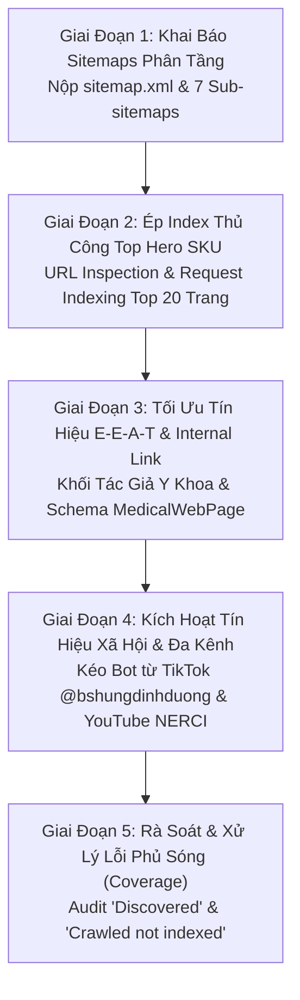

# 🎯 Kế Hoạch Lập Chỉ Mục Google Search Console (GSC) Toàn Diện Cho Website dinhduongtoiuu.com

> 📅 **Thời gian thiết lập:** 2026-10-23 15:03:30 (GMT+7)  
> 👤 **Người lập kế hoạch:** Đại Dương · Performance & Operations  
> 🌐 **Domain triển khai:** `https://dinhduongtoiuu.com/` (Website Dinh Dưỡng Y Học & Bán Lẻ Thuộc H&H Nutrition & NERCI)  
> 🗄️ **Lark Base Quản Trị:** [Quản Trị Dự Án Website dinhduongtoiuu.com](https://ajpi82edbxhs.jp.larksuite.com/base/Ur4zbNbJiaGt3OsdOI5jHsPnpNh)  
> 📊 **Bảng Tracker 29 URLs GSC:** [10_GSC_URL_Index_Tracker](https://ajpi82edbxhs.jp.larksuite.com/base/Ur4zbNbJiaGt3OsdOI5jHsPnpNh?table=tblgSApnFCmnJ343&view=vewvPnOS2g)  
> 🎯 **Bảng Chiến Lược SEO:** [08_SEO_Action_Plan_2026](https://ajpi82edbxhs.jp.larksuite.com/base/Ur4zbNbJiaGt3OsdOI5jHsPnpNh?table=tblqjf0xiDEBbDgu&view=vewUdlTS9S)  
> ⚡ **Bảng Phân Công Việc:** [04_Action_Items](https://ajpi82edbxhs.jp.larksuite.com/base/Ur4zbNbJiaGt3OsdOI5jHsPnpNh?table=tbluGWSS3Kh9Pqi3&view=vewWp5lLgP)  
> 🔗 **Tình trạng kết nối:** Đã xác minh quyền sở hữu tài sản (Verified Property) trong Google Search Console  
> 📊 **Quy mô dữ liệu cần index:** **336 SKU Sản phẩm** • **27 Danh mục sản phẩm** • **801 Bài viết y khoa** • **48 Chuyên mục tin tức** • **6 Tác giả chuyên gia**  
> 🩺 **Đặc thù ngành:** YMYL (Your Money Your Life) — Tiêu chuẩn E-E-A-T y khoa nghiêm ngặt của Google  

---

## 🗺️ I. TỔNG QUAN HIỆN TRẠNG KỸ THUẬT (AUDIT CRAWL & SITEMAP)

Hệ thống đã kiểm tra trực tiếp cấu hình máy chủ và sơ đồ trang web thời gian thực của `dinhduongtoiuu.com`:

| Thành phần | Đường dẫn thực tế | Trạng thái hiện tại | Đánh giá kỹ thuật |
| :--- | :--- | :---: | :--- |
| **Robots.txt** | `https://dinhduongtoiuu.com/robots.txt` | `HTTP 200` | ✅ Chuẩn: Đã chặn đúng các trang giỏ hàng, thanh toán, API (`/gio-hang`, `/dat-hang`, `/thanh-toan/`, `/api/`, `/*?*q=`) và khai báo sitemap. |
| **Sitemap Index** | `https://dinhduongtoiuu.com/sitemap.xml` | `HTTP 200` | ✅ Chuẩn: Phân tách thành 7 sơ đồ con chuyên biệt, hỗ trợ Googlebot đọc cực nhanh. |
| **Sitemap Trang Tĩnh** | `sitemap-pages-1.xml` | `HTTP 200` | Trang chủ, chính sách, giới thiệu, liên hệ. |
| **Sitemap Tác Giả** | `sitemap-authors-1.xml` | `HTTP 200` | 🌟 Cực kỳ quan trọng cho E-E-A-T (Hồ sơ TS.BS Đặng Ngọc Hùng & đội ngũ Dược sĩ). |
| **Sitemap Danh Mục SP**| `sitemap-product_cats-1.xml` | `HTTP 200` | 27 danh mục bệnh lý (Ung thư, Tiểu đường, Thận, Nhi, v.v.). |
| **Sitemap Sản Phẩm** | `sitemap-products-1.xml` | `HTTP 200` | 336 SKU sản phẩm y khoa kèm thẻ `<image:image>`. |
| **Sitemap Bài Viết** | `sitemap-news-1.xml` | `HTTP 200` | 801 bài viết kiến thức y học và hướng dẫn điều trị. |
| **Sitemap Chuyên Mục** | `sitemap-news_cats-1.xml` | `HTTP 200` | 48 chuyên mục bệnh học. |

---

## 🚀 II. LỘ TRÌNH 5 GIAI ĐOẠN LẬP CHỈ MỤC TỐC ĐỘ CAO (INDEXATION ROADMAP)

---

### GIAI ĐOẠN 1: KHAI BÁO & KÍCH HOẠT SITEMAPS TRONG GSC (NGAY HÔM NAY)

Do website đã có cấu trúc **Sitemap Index**, bạn không chỉ nộp 1 tệp tổng mà cần nộp theo thứ tự ưu tiên luồng Crawl của Googlebot:

1. **Bước 1.1: Truy cập Google Search Console** ➔ Chọn tài sản `dinhduongtoiuu.com` ➔ Chọn mục **Sơ đồ trang web (Sitemaps)** ở menu bên trái.
2. **Bước 1.2: Nộp Sơ đồ trang web chính:**
   - Nhập: `sitemap.xml` ➔ Bấm **Gửi (Submit)**.
3. **Bước 1.3: Nộp bổ sung từng Sub-sitemap theo thứ tự ưu tiên chiến lược:**
   - `sitemap-pages-1.xml` (Kích hoạt bộ khung uy tín website).
   - `sitemap-authors-1.xml` (*Cốt lõi E-E-A-T: Google cần nhận diện danh tính Bác sĩ trước*).
   - `sitemap-product_cats-1.xml` (Khai báo 27 phễu danh mục).
   - `sitemap-products-1.xml` (Khai báo 336 SKU bán lẻ).
   - `sitemap-news_cats-1.xml` (Khai báo 48 chuyên mục).
   - `sitemap-news-1.xml` (Khai báo 801 bài viết tin tức).
4. **Tiêu chí thành công:** Trạng thái chuyển sang màu xanh **Thành công (Success)** và hiển thị đúng số lượng URL được phát hiện.

---

### GIAI ĐOẠN 2: ÉP LẬP CHỈ MỤC THỦ CÔNG TOP 20 TRANG HERO (DAY 1 - DAY 3)

Google Search Console cho phép dùng tính năng **Kiểm tra URL (URL Inspection)** để gửi lệnh **Yêu cầu lập chỉ mục (Request Indexing)** trực tiếp với hạn ngạch khoảng 10–20 URL/ngày. Ta sẽ tập trung cho các trang sinh ra doanh thu và traffic lớn nhất:

#### Nhóm 1: Hồ sơ Tác giả & Giới thiệu E-E-A-T (Ưu tiên số 1)
- `https://dinhduongtoiuu.com/` (Trang chủ)
- `https://dinhduongtoiuu.com/gioi-thieu` (Chứng minh pháp nhân H&H Nutrition & NERCI)
- `https://dinhduongtoiuu.com/tac-gia/ts-bs-dang-ngoc-hung` (Trang chuyên gia hạt nhân)

#### Nhóm 2: Top 10 Hero SKU Doanh Thu Cao & Đang Có Lực Tìm Kiếm (GSC Impressions cao)
1. `https://dinhduongtoiuu.com/chi-tiet-san-pham/dam-thuy-phan-protimedic` (ProtiMedic - Đạm thủy phân cho bệnh nhân ung thư/hồi sức)
2. `https://dinhduongtoiuu.com/chi-tiet-san-pham/sua-bot-danh-cho-nguoi-tieu-duong-nepro-1-gold-900g` (Nepro 1 Gold - Dành cho người suy thận chưa lọc máu)
3. `https://dinhduongtoiuu.com/chi-tiet-san-pham/sua-bot-fortimel-powder-duc-vanilla` (Fortimel - Sữa năng lượng cao Đức)
4. `https://dinhduongtoiuu.com/chi-tiet-san-pham/nutricare-kidney-2` (Nutricare Kidney 2 - Suy thận lọc máu)
5. `https://dinhduongtoiuu.com/chi-tiet-san-pham/bot-enaz-whey-protein-300g-300g-1-hop` (Enaz Whey Protein)
6. `https://dinhduongtoiuu.com/chi-tiet-san-pham/mequib-2-bo-sung-vitamin-d3-k2` (MeQuib 2 D3 K2)
7. `https://dinhduongtoiuu.com/chi-tiet-san-pham/olymdiges-gold` (Olymdiges Gold tiêu hóa)
8. `https://dinhduongtoiuu.com/chi-tiet-san-pham/thuc-pham-dinh-duong-delisoup` (DeliSoup soup uống y học)
9. `https://dinhduongtoiuu.com/chi-tiet-san-pham/peginpol-100g-tri-tao-bon-cho-tre` (PEGinpol trị táo bón trẻ em)
10. `https://dinhduongtoiuu.com/chi-tiet-san-pham/high-potency-vitamin-d3-puritan-pride` (Vitamin D3 Puritan's Pride)

#### Quy trình ép index từng URL:
1. Dán URL vào thanh tìm kiếm trên cùng của GSC ➔ Nhấn Enter.
2. Chờ GSC kiểm tra dữ liệu từ chỉ mục Google.
3. Nhấp vào nút **Kiểm tra URL trực tiếp (Test Live URL)** để xác minh Googlebot đọc được HTML, không bị chặn bởi thẻ `noindex`.
4. Bấm **Yêu cầu lập chỉ mục (Request Indexing)**.

---

### GIAI ĐOẠN 3: TỐI ƯU HÓA ON-PAGE ĐỂ CHỐNG LỖI "ĐÃ THU THẬP - CHƯA LẬP CHỈ MỤC"

Trong ngành YMYL, Google thường quét nội dung (Crawl) nhưng **từ chối index** nếu trang có các dấu hiệu sau:
- Nội dung mỏng (Thin Content): Chỉ có tên sản phẩm và giá, không có hướng dẫn lâm sàng, đối tượng chỉ định, bảng thành phần dinh dưỡng.
- Không có thẩm định chuyên môn: Thiếu khối "Thẩm định y khoa bởi Dược sĩ / Bác sĩ Đặng Ngọc Hùng".

#### Hành động kỹ thuật cần đảm bảo:
1. **Thẻ Canonical Tự Trỏ:** Mọi trang sản phẩm và bài viết phải có thẻ `<link rel="canonical" href="https://dinhduongtoiuu.com/chi-tiet-san-pham/slug-chuan" />`. Tuyệt đối không để tham số URL phân trang hoặc lọc biến thành canonical.
2. **Khai báo Dữ liệu Cấu trúc (Schema Markup JSON-LD):**
   - Sản phẩm: Schema `Product` + `Offer` + `AggregateRating` + `MedicalAudience` (Bệnh nhân chỉ định).
   - Bài viết: Schema `MedicalWebPage` hoặc `Article` với trường `author` liên kết về `https://dinhduongtoiuu.com/tac-gia/ts-bs-dang-ngoc-hung` và `reviewedBy`.
3. **Liên kết Nội bộ (Internal Linking) dạng Topic Cluster:**
   - Ở mỗi bài viết tin tức (801 bài), đặt từ 1–2 liên kết tự nhiên trỏ trực tiếp về trang chi tiết sản phẩm điều trị liên quan (ví dụ: bài viết về suy thận trỏ về Nepro 1 Gold).
   - Điều này tạo thành "đại lộ" dẫn đường cho Googlebot len lỏi vào quét sâu toàn bộ 336 sản phẩm.

---

### GIAI ĐOẠN 4: KÍCH HOẠT TÍN HIỆU ĐA KÊNH ĐỂ KÉO GOOGLEBOT (OMNICHANNEL CRAWL PING)

Thuật toán Google phát hiện và ưu tiên lập chỉ mục các URL có tín hiệu người dùng thực (Real User Signals) từ môi trường bên ngoài:

1. **Kênh TikTok (@bshungdinhduong - Hơn 3.900 clicks Google Search):**
   - Đặt liên kết trang giải pháp trong bài ghim hoặc cây Link-in-bio (dẫn về các trang sản phẩm/danh mục chủ lực).
2. **Kênh YouTube NERCI (96.500 views):**
   - Cập nhật mô tả video các clip triệu view (clip Đu đủ đực, clip Hạt chia, clip Dinh dưỡng ung thư): Chèn URL bài viết và URL sản phẩm tương ứng trên `dinhduongtoiuu.com`.
3. **Mạng xã hội NERCI & H&H Fanpage:**
   - Đăng bài chia sẻ trích đoạn kiến thức kèm link gốc website để thu hút lượt click và referral traffic đầu tiên.

---

### GIAI ĐOẠN 5: KIỂM TOÁN VÀ XỬ LÝ LỖI PHỦ SÓNG (GSC COVERAGE AUDIT)

Sau 7 – 14 ngày kể từ khi nộp Sitemap, truy cập mục **Trang (Pages)** trong GSC để theo dõi phân loại:

| Phân loại trong GSC | Nguyên nhân kỹ thuật | Hướng xử lý dứt điểm |
| :--- | :--- | :--- |
| **Đã thu thập dữ liệu - hiện chưa được lập chỉ mục** *(Crawled - currently not indexed)* | Googlebot đã vào đọc nội dung nhưng đánh giá chất lượng trang chưa đủ sâu hoặc trùng lặp với trang khác. | • Bổ sung thêm 200–300 từ phân tích y khoa. • Thêm bảng thành phần dinh dưỡng. • Chèn schema `MedicalWebPage` & tác giả. |
| **Đã phát hiện - hiện chưa được lập chỉ mục** *(Discovered - currently not indexed)* | Googlebot đã biết URL (qua sitemap) nhưng chưa có đủ thời gian hoặc Crawl Budget để ghé thăm. | • Tăng cường Internal Link từ Trang chủ hoặc các bài viết cũ có traffic. • Kiểm tra tốc độ phản hồi server (TTFB). |
| **Trang có lệnh chuyển hướng** *(Page with redirect)* | Có thể do URL cũ thời điểm migration chưa được cấu hình 301 sạch sẽ. | Cập nhật lại sitemap để loại bỏ các URL bị redirect. |
| **Bị loại trừ bởi thẻ 'noindex'** | Kiểm tra nhầm lẫn trong code header PHP. | Gỡ bỏ meta `noindex` nếu là trang sản phẩm/tin tức hợp lệ. |

---

## 📅 BẢNG TIẾN ĐỘ THỰC THI (CHECKLIST THEO DÕI)

- [x] **Ngày 1 (23/10/2026 15:16):** Xóa toàn bộ 5 sitemaps cũ năm 2021 và nộp mới thành công 8 Sơ đồ trang web (`sitemap.xml` & 7 sub-sitemaps) qua GSC API (0 lỗi, tiếp nhận 100%).
- [x] **Ngày 1 (23/10/2026 15:53):** Chạy kiểm toán tự động URL Inspection API cho 29 URLs cốt lõi (14 URLs đã index `PASS` - 48.3%, 2 URLs đã phát hiện chờ quét - 6.9%, 13 URLs mới nộp chờ xếp lịch crawl - 44.8%). Xem chi tiết tại [[2026-10-23-DinhDuongToiUu-GSC-Index-Action-Report]].
- [ ] **Ngày 1 - 2:** Kiểm tra URL và Yêu cầu lập chỉ mục bổ trợ thủ công trên giao diện Web GSC cho 3 URLs mũi nhọn: `dam-thuy-phan-protimedic`, `sua-bot-danh-cho-nguoi-tieu-duong-nepro-1-gold-400g`, `tac-gia/ts-bs-dang-ngoc-hung`.
- [ ] **Ngày 3 - 5:** Rà soát On-page: Đảm bảo thẻ Canonical tự trỏ chính xác 100% trên template sản phẩm PHP.
- [ ] **Ngày 7:** Kiểm tra báo cáo "Trang (Pages)" lần 1: Ghi nhận số lượng URL đã chuyển sang màu xanh **Đã lập chỉ mục (Indexed)**.
- [ ] **Ngày 14:** Xử lý triệt để các URL rơi vào nhóm *Crawled not indexed* bằng cách làm giàu nội dung y khoa và liên kết nội bộ.
- [ ] **Hàng tuần:** Theo dõi báo cáo **Hiệu suất (Performance)** để nắm bắt các truy vấn đầu tiên xuất hiện impressions và clicks.
