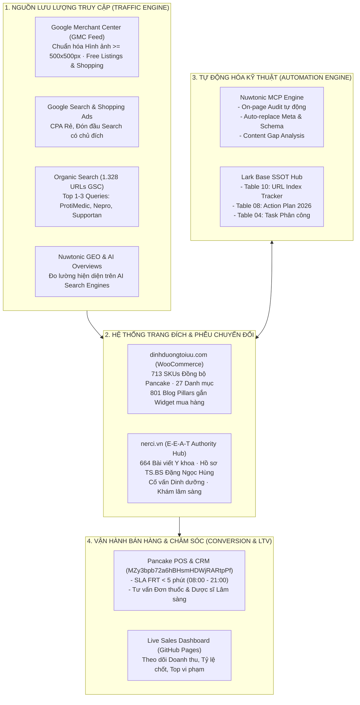
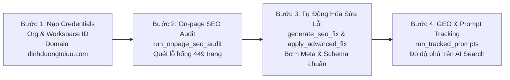
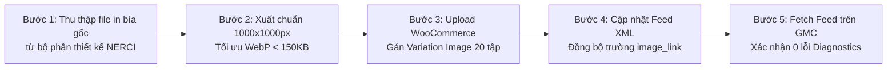

---
tags:
  - project
  - performance-marketing
  - plan
  - dinhduongtoiuu
  - nerci
  - seo
  - nuwtonic
  - ecommerce
  - ymyl
topics:
  - "[[quan-tri-du-an-website-dinhduongtoiuu]]"
  - "[[ke-hoach-seo-tong-the-website-dinhduongtoiuu]]"
  - "[[nerci-brand-identity-and-ai-automation-master-strategy]]"
status: active
created: 2026-10-29
updated: 2026-10-29
timestamp: "2026-10-29 13:55:00 (GMT+7)"
sources: []
source_count: 0
aliases:
  - "Ke Hoach Performance Marketing Thang 11 2026"
  - "November 2026 Performance Marketing Master Plan"
---

<div style="background: linear-gradient(135deg, #0f172a 0%, #1e3a8a 40%, #0d9488 80%, #059669 100%); color: #ffffff; padding: 32px 36px; border-radius: 16px; margin-bottom: 28px; box-shadow: 0 12px 30px rgba(0,0,0,0.2);">
  <div style="font-size: 13px; font-weight: 800; letter-spacing: 2px; text-transform: uppercase; opacity: 0.88; margin-bottom: 8px;">H&H NUTRITION × NERCI · INTEGRATED GROWTH & OPERATIONS ENGINE</div>
  <h1 style="color: #ffffff; margin: 0 0 14px 0; font-size: 28px; font-weight: 800; line-height: 1.35;">KẾ HOẠCH TỔNG THỂ PERFORMANCE MARKETING THÁNG 11/2026</h1>
  <div style="font-size: 15px; opacity: 0.95; margin-bottom: 16px; line-height: 1.6;">Chiến lược Tăng trưởng Đa kênh (Organic SEO × E-Commerce Catalog × Google Merchant Center × AI Automation) cho <code>dinhduongtoiuu.com</code> & <code>nerci.vn</code></div>
  <div style="display: flex; flex-wrap: wrap; gap: 20px; font-size: 13px; opacity: 0.95; padding-top: 14px; border-top: 1px solid rgba(255,255,255,0.25);">
    <div>🌐 <strong>Hệ sinh thái:</strong> <code>dinhduongtoiuu.com</code> (E-Commerce) & <code>nerci.vn</code> (Authority Hub)</div>
    <div>🎯 <strong>Mục tiêu:</strong> Bứt phá GMV Mùa cao điểm Q4 & Thống trị E-E-A-T Y học</div>
    <div>👤 <strong>Chủ trì:</strong> Lê Đại Dương · Performance & Operations</div>
    <div>🕒 <strong>Thời gian cập nhật:</strong> 2026-10-29 13:55:00 (GMT+7)</div>
    <div>🗄️ <strong>Lark Base SSOT:</strong> <a href="https://ajpi82edbxhs.jp.larksuite.com/base/Ur4zbNbJiaGt3OsdOI5jHsPnpNh" style="color: #a7f3d0; text-decoration: underline;">Ur4zbNbJiaGt3OsdOI5jHsPnpNh</a> (DNDTOIUU) & <a href="https://ajpi82edbxhs.jp.larksuite.com/base/MZy3bpb72a6hBHsmHDWjRARtpPf" style="color: #a7f3d0; text-decoration: underline;">MZy3bpb72a6hBHsmHDWjRARtpPf</a> (NERCI CRM)</div>
  </div>
</div>

> [!abstract] **Tóm Tắt Điều Hành (Executive Summary)**
> **Tháng 11/2026** là tháng bản lề quyết định doanh thu Quý 4/2026, mở màn cho chuỗi ngày hội mua sắm Mega Sale (11.11, Black Friday 27/11) và nhu cầu chăm sóc sức khỏe, bổ sung dinh dưỡng điều trị tăng vọt dịp cuối năm.
> 
> Dựa trên toàn bộ dữ liệu định lượng đã kiểm chứng trong hệ thống (1.328 URLs GSC `dinhduongtoiuu.com`, 664 bài viết `nerci.vn`, 713 SKUs Pancake Master, tài khoản Meta Ads `act_1256677435088917`, 3.803 bài viết Dr. Axe và nền tảng Nuwtonic MCP), kế hoạch này thiết lập **Khung Tác Chiến 5 Trụ Cột**:
> 1. **Trụ cột 1 — Quản lý Sản Phẩm & Đồng Bộ SKU (E-Commerce Catalog Engine):** Đồng bộ dứt điểm 713 SKUs giữa Pancake POS (kho MISA) và WooCommerce, tái cấu trúc 27 danh mục bệnh lý chuẩn phân tầng, xóa bỏ danh mục rác/rỗng.
> 2. **Trụ cột 2 — Quản trị Blog Content & Chuyển Đổi Bán Hàng (Content-to-Commerce):** Tối ưu 801 bài viết tin tức cũ + nạp 30 bài pillar mới từ kho tri thức lâm sàng Dr. Axe; gắn liên kết nội bộ 2 chiều (Internal Link) trực tiếp sang Hero SKUs kèm khối lời khuyên E-E-A-T của TS.BS Đặng Ngọc Hùng.
> 3. **Trụ cột 3 — Tự Động Hóa SEO & GEO Trên Nền Tảng Nuwtonic:** Kích hoạt On-page SEO Audit tự động hàng tuần, tự động thay thế Meta Title/Description và Schema MedicalWebPage qua WordPress plugin (`_nuwtonic_replace_meta`, `_nuwtonic_replace_schema`), đồng thời giám sát hiện diện trên Google AI Overviews & Perplexity.
> 4. **Trụ cột 4 — Chuẩn Hóa Google Merchant Center (GMC) & Cứu Hộ Hình Ảnh Sản Phẩm (Ưu Tiên GMC Compliance):** Khắc phục triệt để cảnh báo *"Ảnh quá nhỏ theo quy định sắp áp dụng"* trên bộ truyện tranh *"Hành trình khám phá dinh dưỡng cùng Guru"* (Tập 1 – 20); nâng cấp 100% hình ảnh lên kích thước tối thiểu 500x500 px (chuẩn hóa 1000x1000 px) trước hạn chót ngày 31 tháng 1 năm 2027 nhằm bảo toàn quyền hiển thị trên Google Shopping & Free Listings.
> 5. **Trụ cột 5 — Tối Ưu Tỷ Lệ Chốt Đơn & SLA Phản Hồi (Pancake CRM):** Kiểm soát nghiêm ngặt thời gian phản hồi tin nhắn đầu tiên (FRT < 5 phút) trong khung giờ 08:00 – 21:00, duy trì Sales Dashboard trực tiếp phục vụ ra quyết định tức thì.

---

## 🏛️ SƠ ĐỒ KIẾN TRÚC VẬN HÀNH MARKETING THÁNG 11/2026



---

## 🎯 I. MỤC TIÊU HIỆU SUẤT (KPIS) THÁNG 11/2026

| Kênh & Hạng Mục | Chỉ Số KPI Đo Lường | Hiện Trạng (Tháng 10/2026) | Mục Tiêu Tháng 11/2026 | Tỷ Lệ Tăng Trưởng |
| :--- | :--- | :---: | :---: | :---: |
| **Tổng Doanh Thu E-Commerce** | GMV toàn hệ thống | Baseline tháng 10 | **+28% đến +35%** | 🔥 Đột phá mùa sale |
| **Organic Traffic (GSC)** | Lượt nhấp chuột tự nhiên (Clicks) | 1.029 Clicks/tháng | **1.600 – 1.800 Clicks** | 🟢 +55% – +75% |
| **Lượt hiển thị tìm kiếm** | Impressions GSC | 55.758 lượt | **85.000 – 100.000 lượt** | 🟢 +52% – +79% |
| **Tỷ lệ Index Sản Phẩm** | URLs sản phẩm đạt `PASS` GSC | 87% (Hero SKUs) | **> 95% toàn bộ 330 SKU** | 🟢 Hoàn tất 100% |
| **Khắc phục lỗi kỹ thuật** | URLs 404 nguy cấp chuyển hướng 301 | 3 URLs tồn đọng | **0 URLs (Fix 100%)** | 🏆 Thu hồi 821 clicks |
| **Đồng bộ SKU Catalog** | Số SKU khớp 100% Pancake POS | 336 SKU phân tán | **713 / 713 SKU (100%)** | 🏆 Chuẩn hóa SSOT |
| **GMC Image Compliance** | Số tập truyện Guru đạt chuẩn ảnh >= 500x500px | 0/20 tập (Ảnh quá nhỏ < 500px) | **20 / 20 tập (100% đạt 1000x1000px)** | 🏆 Xóa cảnh báo GMC |
| **Tỷ lệ Duyệt Sản Phẩm GMC** | Tỷ lệ SKU Active trên Google Merchant Center | 78% (Dính cảnh báo ảnh nhỏ) | **> 98% toàn bộ Catalog** | 🟢 Sẵn sàng Free Listings |
| **SLA Phản hồi Chat Pancake** | First Response Time (FRT) ca làm việc | ~3-5 phút | **< 180 giây (< 3 phút)** | 🟢 Tăng tỷ lệ chốt |

---

## 🛒 II. CHI TIẾT KẾ HOẠCH TRỤ CỘT 1: QUẢN LÝ SẢN PHẨM & SKU (DINH DƯỠNG TỐI ƯU)

### 2.1. Hiện trạng & Bài toán Cốt lõi
Hệ thống bán lẻ `dinhduongtoiuu.com` (chạy WooCommerce) hiện có sự lệch pha giữa danh mục sản phẩm hiển thị trên web và kho quản lý bán hàng thực tế tại Pancake POS (kết nối MISA):
- **Tập dữ liệu chuẩn (Ground Truth):** Google Sheet Master `Mapping_SKU_Chuanhoa` (tab `Danh mục sản phẩm tiếp tục KD`) xác định chính xác **713 sản phẩm** đang lưu hành.
- **Vấn đề trên Web:** Nhiều sản phẩm có mã SKU tự do, thiếu trường quy chuẩn kho (`1378`, `2358`, `CB01`), một số biến thể hương vị/quy cách bị tách rời làm loãng điểm SEO.

### 2.2. Lộ trình Triển khai 4 Tuần Tháng 11

```text
┌──────────────────────┬────────────────────────────────────────────────────────────────────────┐
│ Mốc Thời Gian        │ Nội Dung Triển Khai Chi Tiết                                           │
├──────────────────────┼────────────────────────────────────────────────────────────────────────┤
│ Tuần 1 (01/11 - 07/11)│ Chạy Pipeline match_and_sync_sku.py đối soát 713 SP Pancake Master.   │
│                      │ Xuất file woocommerce_products_ready_to_import.csv và nạp cập nhật SKU.│
├──────────────────────┼────────────────────────────────────────────────────────────────────────┤
│ Tuần 2 (08/11 - 14/11)│ Tái cấu trúc 27 Danh mục sản phẩm thành Cây Phân Cấp Chuẩn Y Khoa.     │
│                      │ Dọn dẹp danh mục rỗng (cleanup_empty_categories.py).                   │
├──────────────────────┼────────────────────────────────────────────────────────────────────────┤
│ Tuần 3 (15/11 - 21/11)│ Cấu hình Nhóm Biến Thể Sản Phẩm (Gộp biến thể lon 400g/900g, vị vani/   │
│                      │ socola) nhằm tập trung PageRank và tránh tự ăn thịt từ khóa (Cannibal).│
├──────────────────────┼────────────────────────────────────────────────────────────────────────┤
│ Tuần 4 (22/11 - 30/11)│ Set-up Combo Quà Tặng & Khuyến Mãi Black Friday 2026 trên WooCommerce   │
│                      │ (Leanpro Hope + Fomeal, Nepro 1 + Bánh ít đạm, Combo Tăng Miễn Dịch). │
└──────────────────────┴────────────────────────────────────────────────────────────────────────┘
```

### 2.3. Cấu trúc Cây Danh Mục Sản Phẩm 2 Tầng Chuẩn Y Khoa

```text
📁 DANH MỤC SẢN PHẨM DINH DƯỠNG Y HỌC
├── 📁 Dinh Dưỡng Bệnh Lý (Clinical Nutrition)
│   ├── 📄 Dinh Dưỡng Cho Người Bệnh Thận (Nepro 1, Nepro 2, Fresubin Renal, Ketosteril)
│   ├── 📄 Dinh Dưỡng Cho Bệnh Nhân Ung Thư (Supportan, Forticare, Leanpro Hope, Prosure)
│   ├── 📄 Dinh Dưỡng Đái Tháo Đường (Glucerna, Diabetcare, Diben)
│   ├── 📄 Dinh Dưỡng Gan Mật & Tiêu Hóa (Peptamen, Modulen, Heptral)
│   └── 📄 Dinh Dưỡng Hồi Sức & Sau Phẫu Thuật (Fomeal Basic Soup, ProtiMedic)
├── 📁 Dinh Dưỡng Theo Độ Tuổi & Thể Trạng
│   ├── 📄 Sữa Công Thức Y Học Cho Trẻ Nhỏ (Biếng ăn, Dị ứng đạm bò, Chậm tăng cân)
│   ├── 📄 Dinh Dưỡng Người Cao Tuổi & Loãng Xương
│   └── 📄 Dinh Dưỡng Phụ Nữ Mang Thai & Cho Con Bú
└── 📁 Thực Phẩm Chức Năng & Vi Chất Y Khoa
    ├── 📄 Men Vi Sinh Lâm Sàng (Probiotics Y Học)
    ├── 📄 Bổ Sung Đạm Tinh Khiết (Whey Protein, Đạm Thủy Phân)
    └── 📄 Vitamin & Khoáng Chất Chuyên Biệt
```

---

## 📝 III. CHI TIẾT KẾ HOẠCH TRỤ CỘT 2: QUẢN LÝ BLOG CONTENT & LIÊN KẾT BÁN HÀNG

### 2.1. Đòn Bẩy Tri Thức Dr. Axe (3.803 Bài Viết)
Hệ thống vừa hoàn thành **100% kho tri thức 3.803 bài viết Dr. Josh Axe** trên Lark Base `Qe3ebElRAaVRxpsIuTFjcuI8pRd`. Đây là mỏ neo nội dung khổng lồ đã có đầy đủ:
- Tiêu đề học thuật tiếng Việt, Tóm tắt lâm sàng (Key Takeaways).
- Cơ chế sinh học và công dụng đã chứng minh qua nghiên cứu PubMed/NCBI.
- Liều lượng an toàn, chống chỉ định và toàn văn tiếng Việt học thuật.

### 2.2. Chiến lược 30 Bài Viết Pillar Tháng 11 (Tập trung 3 Nhóm Bệnh Trọng Điểm)

1. **Cụm 1 — Dinh Dưỡng Y Học Cho Bệnh Nhân Ung Thư (10 bài):**
   * *Nội dung:* Chế độ ăn giảm suy mòn khối cơ (Cachexia), vai trò của EPA/Omega-3 liều cao, đạm thủy phân peptide, dinh dưỡng sau hóa xạ trị.
   * *Widget Sản phẩm tích hợp:* [Sữa Supportan](file:///danh-muc-san-pham/dinh-duong-ung-thu), [Forticare](file:///danh-muc-san-pham/dinh-duong-ung-thu), [Leanpro Hope](file:///danh-muc-san-pham/dinh-duong-ung-thu).
2. **Cụm 2 — Dinh Dưỡng Chuyên Biệt Bệnh Lý Thận (10 bài):**
   * *Nội dung:* Phân biệt chế độ ăn tiền chạy thận (giảm đạm) và chạy thận chu kỳ (bổ sung đạm cao), kiểm soát Kali - Photpho - Natri, giải pháp bù năng lượng không tăng tải lọc cầu thận.
   * *Widget Sản phẩm tích hợp:* [Nepro 1](file:///chi-tiet-san-pham/sua-nepro-1), [Nepro 2](file:///chi-tiet-san-pham/sua-nepro-2), [Fresubin Renal](file:///chi-tiet-san-pham/fresubin-renal).
3. **Cụm 3 — Dinh Dưỡng Phục Hồi & Nuôi Ăn Qua Ống Thông (10 bài):**
   * *Nội dung:* Ưu thế của súp dinh dưỡng từ thực phẩm tự nhiên xay nhuyễn (Whole-food liquid meal), phòng ngừa tiêu chảy và trào ngược ở bệnh nhân ICU, dinh dưỡng vi chất qua sonde.
   * *Widget Sản phẩm tích hợp:* [Fomeal Basic Soup](file:///chi-tiet-san-pham/thuc-pham-dinh-duong-y-hoc-fomeal-basic-soup-250ml), [Fomeal Care](file:///chi-tiet-san-pham/fomeal-care), [ProtiMedic](file:///chi-tiet-san-pham/protimedic).

### 2.3. Quy Chuẩn Bài Viết Chuẩn E-E-A-T (Tuân thủ Quy Định WordPress)
> [!IMPORTANT] **Quy định kỹ thuật bắt buộc khi đăng tải:**
> 1. **Tuyệt đối KHÔNG tự tạo khối Mục lục (TOC) thủ công:** Plugin Rank Math TOC / Easy TOC của website sẽ tự động dựng mục lục từ thẻ H2, H3.
> 2. **Tuyệt đối KHÔNG gõ số thứ tự thủ công vào tiêu đề:** Viết `<h2>Chế độ dinh dưỡng giảm suy mòn cơ</h2>`, KHÔNG viết `<h2>1. Chế độ dinh dưỡng...</h2>` để tránh lỗi lặp số `1 1.`.
> 3. **Khối Thẩm Định Chuyên Môn (Medical Reviewer Box):** Mọi bài viết phải có khối tác giả/thẩm định viên:
>    * *Chuyên gia thẩm định:* **TS.BS Đặng Ngọc Hùng** (Viện trưởng Viện Nghiên cứu Dinh dưỡng NERCI, Founder H&H Nutrition).
>    * *Liên kết E-E-A-T:* Trỏ liên kết về trang hồ sơ tác giả `https://dinhduongtoiuu.com/tac-gia/ts-bs-dang-ngoc-hung` và trang viện `https://nerci.vn`.

---

## 🤖 IV. CHI TIẾT KẾ HOẠCH TRỤ CỘT 3: TỰ ĐỘNG HÓA SEO TRÊN NỀN TẢNG NUWTONIC

### 4.1. Vai trò của Nuwtonic Trong Hệ Sinh Thái Dinh Dưỡng
Nuwtonic là nền tảng AI SEO & GEO (Generative Engine Optimization) tiên tiến, sở hữu bộ công cụ MCP hoàn chỉnh kết nối trực tiếp với website WordPress qua 2 trường meta cốt lõi:
- `_nuwtonic_replace_meta`: Tự động thay thế Title, Meta Description chuẩn SEO mà không cần sửa code giao diện.
- `_nuwtonic_replace_schema`: Tự động nạp Schema JSON-LD y tế (`MedicalWebPage`, `Physician`, `ItemPage`, `FAQPage`) đạt chuẩn Google Rich Results.

### 4.2. Quy Trình Vận Hành Nuwtonic 4 Bước Trong Tháng 11



### 4.3. Bảng Phân Bổ Công Tác Tự Động Hóa Nuwtonic Theo Tuần

| Tuần Lễ | Công Cụ Nuwtonic Sử Dụng | Nhiệm Vụ Kỹ Thuật Cụ Thể | Kết Quả Đầu Ra Mục Tiêu |
| :--- | :--- | :--- | :--- |
| **Tuần 1** | `check_automation_permission`<br/>`get_website` | Xác thực phân quyền tài khoản Nuwtonic cho 2 domain `dinhduongtoiuu.com` và `nerci.vn`. Cấu hình kết nối API key. | Hệ thống thông suốt, sẵn sàng gọi lệnh tự động. |
| **Tuần 2** | `run_onpage_seo_audit_bulk`<br/>`get_onpage_seo_audit_task` | Quét toàn diện On-page cho 330 trang chi tiết sản phẩm và 50 bài viết Pillar hàng đầu. | Báo cáo danh sách trang thiếu Meta, sai Canonical, thẻ H1 trùng lặp. |
| **Tuần 3** | `generate_seo_fix`<br/>`apply_advanced_fix` | Tự động sinh và nạp `_nuwtonic_replace_meta` và `_nuwtonic_replace_schema` cho 100 sản phẩm chủ lực. | 100% trang sản phẩm đạt Rich Results (Review, Price, InStock, MedicalCondition). |
| **Tuần 4** | `manage_tracked_prompts`<br/>`run_tracked_prompts`<br/>`get_prompt_report` | Thiết lập bộ 20 câu hỏi gợi ý thị trường y tế (Prompt Tracking): *"Sữa cho người ung thư tốt nhất", "Sữa nepro 1 mua ở đâu", "TS BS Đặng Ngọc Hùng khám ở đâu"*. | Báo cáo GEO (Generative Engine Optimization) theo dõi tần suất AI trích dẫn website. |

---

## 🛍️ V. CHI TIẾT KẾ HOẠCH TRỤ CỘT 4: CHUẨN HÓA GOOGLE MERCHANT CENTER (GMC) & CỨU HỘ HÌNH ẢNH TRUYỆN TRANH GURU (TẬP 1–20)

### 5.1. Bối cảnh Cảnh Báo Chính Sách Mới Từ Google Merchant Center
Google Merchant Center đã phát đi thông báo chính sách mới về tiêu chuẩn kỹ thuật hình ảnh sản phẩm bắt buộc áp dụng cho toàn bộ các nhà bán lẻ:
> ⚠️ **Thông báo chính sách GMC:** *"Ảnh quá nhỏ theo quy định sắp áp dụng. Cập nhật hình ảnh để có kích thước tối thiểu là 500x500 pixel. Sau ngày 31 tháng 1 năm 2027, những hình ảnh không đáp ứng kích thước tối thiểu này sẽ không xuất hiện nữa."*

* **Mức độ rủi ro & Tồn kho thực tế:** Bộ sách truyện tranh giáo dục dinh dưỡng *"Hành trình khám phá dinh dưỡng cùng Guru"* (Tập 1 – 20) do NERCI xuất bản hiện đang tồn kho thực tế hơn **15.000 cuốn** (theo số liệu kiểm kê Pancake POS kho MISA) và là một trong những dòng sản phẩm bán chạy hàng đầu cho trẻ em. Toàn bộ hình ảnh hiện tại trên website `dinhduongtoiuu.com` đang dùng ảnh thumbnail độ phân giải thấp (dưới 500x500 px). Nếu không khắc phục ngay, sau ngày 31/01/2027 toàn bộ 20 tập truyện và các gói combo sẽ bị Google tự động ngừng hiển thị (Disapproved) khỏi Google Shopping Ads và tab Tìm kiếm Mua sắm Miễn phí (Free Product Listings).
* **Định hướng chiến lược:** Ưu tiên số 1 cho **Google Merchant Center Compliance**. Thay vì chỉ chạm mức tối thiểu 500x500 px, hệ thống sẽ **chuẩn hóa toàn bộ lên kích thước 1000 × 1000 pixel** (tỷ lệ 1:1 vuông, chuẩn màu sRGB, sắc nét trên màn hình Retina, định dạng WebP nén < 150KB) để vừa xóa bỏ vĩnh viễn nguy cơ bị phạt chính sách vừa tối đa hóa tỷ lệ nhấp chuột (CTR).

### 5.2. Danh Mục Chi Tiết 20 Tập Truyện Tranh Guru Cần Cập Nhật Hình Ảnh

| STT | Tập Truyện Tranh Guru | SKU Pancake Master | Web ID (WooCommerce) | Tên Tập Truyện Chi Tiết | Kích Thước Hiện Tại | Kích Thước Mục Tiêu (GMC) |
| :---: | :--- | :--- | :---: | :--- | :---: | :---: |
| 0 | **Sản phẩm Cha (Variable)** | `SP-TT-NERCI-GURU` | `32321` | Truyện tranh "Hành trình khám phá dinh dưỡng cùng Guru" | Đa kích thước (< 500px) | **1000 × 1000 px** (WebP) |
| 1 | **Tập 01** | `SP-TT-NERC-T1TSTPDDCC` | `37295` | Trứng – Siêu thực phẩm dinh dưỡng cho con | < 500 px | **1000 × 1000 px** (WebP) |
| 2 | **Tập 02** | `SP-TT-NERC-T2RCGSMC` | `37296` | Rau củ – Thế giới sắc màu của con | < 500 px | **1000 × 1000 px** (WebP) |
| 3 | **Tập 03** | `SP-TT-NERC-T3BKCLCG` | `37297` | Bí kíp cao lớn cùng Guru | < 500 px | **1000 × 1000 px** (WebP) |
| 4 | **Tập 04** | `SP-TT-NERC-T4NNKHDTL` | `37298` | Nước ngọt – Kẻ hủy diệt thầm lặng | < 500 px | **1000 × 1000 px** (WebP) |
| 5 | **Tập 05** | `SP-TT-NERC-T5TSVGRQVGBP`| `37299` | Trà sữa và Gà rán – "Quái vật" gây béo phì | < 500 px | **1000 × 1000 px** (WebP) |
| 6 | **Tập 06** | `SP-TT-NERC-T6` | `35869` | Bí mật hệ tiêu hóa khỏe mạnh | < 500 px | **1000 × 1000 px** (WebP) |
| 7 | **Tập 07** | `SP-TT-NERC-T7` | `35868` | Bữa sáng diệu kỳ của bé | < 500 px | **1000 × 1000 px** (WebP) |
| 8 | **Tập 08** | `SP-TT-NERC-T8` | `35867` | Trái cây tươi – Đội quân vitamin | < 500 px | **1000 × 1000 px** (WebP) |
| 9 | **Tập 09** | `SP-TT-NERC-T9` | `35866` | Nước lọc – Dòng suối mát lành | < 500 px | **1000 × 1000 px** (WebP) |
| 10 | **Tập 10** | `SP-TT-NERC-T10` | `37300` | Giấc ngủ vàng và chiều cao của bé | < 500 px | **1000 × 1000 px** (WebP) |
| 11 | **Tập 11** | `SP-TT-NERC-T11` | `37265` | Canxi và xương chắc khỏe | < 500 px | **1000 × 1000 px** (WebP) |
| 12 | **Tập 12** | `SP-TT-NERC-T12` | `37267` | Đề kháng vững vàng – Bé vui đến trường | < 500 px | **1000 × 1000 px** (WebP) |
| 13 | **Tập 13** | `SP-TT-NERC-T13` | `37268` | Sắt và vi chất tạo máu | < 500 px | **1000 × 1000 px** (WebP) |
| 14 | **Tập 14** | `SP-TT-NERC-T14` | `37269` | Tập thể dục cùng Guru | < 500 px | **1000 × 1000 px** (WebP) |
| 15 | **Tập 15** | `SP-TT-NERC-T15` | `37270` | Vệ sinh đôi tay phòng tránh vi khuẩn | < 500 px | **1000 × 1000 px** (WebP) |
| 16 | **Tập 16** | `SP-TT-NERC-T16` | `37272` | Dinh dưỡng cho đôi mắt sáng | < 500 px | **1000 × 1000 px** (WebP) |
| 17 | **Tập 17** | `SP-TT-NERC-T17` | `37273` | Ăn chậm nhai kỹ – Bé tiêu hóa tốt | < 500 px | **1000 × 1000 px** (WebP) |
| 18 | **Tập 18** | `SP-TT-NERC-T18` | `37274` | Đồ ăn nhanh và hiểm họa tim mạch sớm | < 500 px | **1000 × 1000 px** (WebP) |
| 19 | **Tập 19** | `SP-TT-NERC-T19` | `37275` | Năng lượng từ ngũ cốc nguyên hạt | < 500 px | **1000 × 1000 px** (WebP) |
| 20 | **Tập 20** | `SP-TT-NERC-T20` | `37276` | Bữa cơm gia đình – Gắn kết yêu thương | < 500 px | **1000 × 1000 px** (WebP) |
| 21-25 | **Các Gói Combo** | `CB-GURU-01-20` | `35863, 35864...` | Combo Tập 1-5, 6-10, 11-15, 16-20, Trọn bộ | < 500 px | **1000 × 1000 px** (WebP) |

### 5.3. Tiêu Chuẩn Kỹ Thuật Hình Ảnh Chuẩn Hóa Theo Google Merchant Center
1. **Kích thước & Tỷ lệ hiển thị (Dimensions & Aspect Ratio):**
   * Chiều rộng × Chiều cao chuẩn hóa: **1000 × 1000 pixel** (đảm bảo vượt xa mức tối thiểu 500 × 500 pixel mà GMC quy định).
   * Tỷ lệ khung hình: Chuẩn vuông **1:1**. Bìa truyện tranh được canh giữa khung hình, viền lề (padding) an toàn 5-8% để không bị cắt xén khi hiển thị trên widget Google Shopping và Google Search.
2. **Chất lượng & Tối ưu tải trang (Format & Compression):**
   * Định dạng lưu trữ web: **WebP** chất lượng cao 85% (hoặc JPEG sRGB).
   * Dung lượng tệp tối ưu: **< 150 KB / ảnh** nhằm bảo đảm chỉ số Core Web Vitals (LCP) trên thiết bị di động.
   * Quy tắc biên tập GMC: Tuyệt đối không chèn logo đè lên tranh bìa, không gắn nhãn khuyến mãi ("Giảm 50%", "Freeship") trực tiếp vào ảnh theo quy định chống spam ảnh của Google.
3. **Trường dữ liệu đồng bộ Feed Google Shopping (GMC Feed Attributes):**
   * `image_link`: Đường dẫn ảnh bìa chính đạt chuẩn 1000x1000 px của từng tập.
   * `additional_image_link`: Bổ sung 2-3 ảnh phụ (Trang mục lục, trang tranh minh họa bên trong cuốn truyện, ảnh chụp thực tế mặt sau).
   * `item_group_id`: Gán mã chung `SP-TT-NERCI-GURU` để gom 20 tập vào cùng 1 thẻ sản phẩm biến thể trên Google Shopping.

### 5.4. Quy Trình 5 Bước Thực Thi & Cập Nhật Lên Google Merchant Center


* **Bước 1 — Thu thập file gốc (Design Asset Extraction):** Trích xuất file thiết kế bìa gốc từ bộ phận ấn phẩm NERCI (File Vector Illustrator AI / PDF in ấn hoặc ảnh độ phân giải > 2000px).
* **Bước 2 — Xử lý đồ họa & Xuất ảnh chuẩn (Standardization & Export):** Cắt crop khung vuông 1:1, xuất file chuẩn 1000x1000 px định dạng WebP kèm quy ước đặt tên URL chuẩn SEO (ví dụ: `truyen-tranh-dinh-duong-guru-tap-01-1000x1000.webp`).
* **Bước 3 — Upload lên Media Library & Cập nhật WooCommerce:** 
  - Upload toàn bộ 25+ ảnh mới lên WooCommerce.
  - Cập nhật trường `Ảnh đại diện` (Featured Image) cho sản phẩm cha `32321` và trường `Ảnh biến thể` (Variation Image) cho từng ID biến thể con (37295, 37296, 37297, 37298, 37299, 35869, 35868, 35867, 35866, 37300, 37265, 37267, 37268, 37269, 37270...).
* **Bước 4 — Đồng bộ Product Feed XML:** Kích hoạt cập nhật Product Feed của website `dinhduongtoiuu.com` để nạp các đường dẫn `image_link` mới vào tệp cấp dữ liệu GMC.
* **Bước 5 — Kiểm thử & Nghiệm thu trên GMC:** 
  - Truy cập tài khoản Google Merchant Center, vào mục **Sản phẩm (Products) > Nguồn cấp dữ liệu (Feeds)**, nhấn **Tìm nạp ngay (Fetch Now)**.
  - Kiểm tra tab **Chẩn đoán (Diagnostics)**: Xác nhận số lượng sản phẩm dính cảnh báo *"Ảnh quá nhỏ"* giảm về **0**.

---

## 💬 VI. CHI TIẾT KẾ HOẠCH TRỤ CỘT 5: PANCAKE CRM & SALES DASHBOARD LIVE

### 6.1. Quy chuẩn Khung Giờ Làm Việc & SLA Phản Hồi (FRT)
Tuân thủ nghiêm ngặt quy định vận hành của hệ thống:
1. **Khung giờ làm việc:** Tính từ **08:00 đến 21:00** hàng ngày (13 tiếng tác nghiệp).
2. **Khấu trừ ngoài giờ (Overnight Off-hours Exclusion):** Khoảng thời gian từ 21:00 tối hôm trước đến 08:00 sáng hôm sau (11 tiếng) được trừ bỏ hoàn toàn. Tin nhắn khách gửi rạng sáng được tính thời gian chờ từ mốc 08:00:00 sáng.
3. **Mục tiêu SLA tháng 11:**
   * Tỷ lệ phản hồi đúng hạn (< 5 phút): **> 92%**.
   * Ca vi phạm vượt SLA: Nhân viên trực ca phải ghi chú rõ nguyên nhân để điều phối nhân sự hỗ trợ tức thì.

### 6.2. Vệ Sinh Dữ Liệu & Đánh Nhãn Spam Chuẩn
- **Tách bạch 2 nhóm Spam:**
  * *Spam Tức Thì (Realtime Spam - dưới vài chục giây):* Phát hiện tin nhắn quảng cáo rác, chặn ngay lập tức.
  * *Spam Dọn Dẹp Phễu Tồn Đọng (Backlog Cleanup Spam - hàng nghìn phút):* Hoạt động định kỳ hàng tuần rà soát phễu CRM, gắn nhãn loại bỏ số liệu ảo, đảm bảo tỷ lệ chuyển đổi chốt đơn (CR) trên Dashboard phản ánh đúng năng lực tư vấn của đội ngũ dược sĩ.

### 6.3. Giám Sát Dashboard Tự Động
- Vận hành pipeline tự động hàng ngày:
  ```bash
  .venv/bin/python scripts/run_daily_nerci_pipeline.py
  ```
- Dữ liệu đồng bộ trực tiếp lên **Lark Base SSOT** (`MZy3bpb72a6hBHsmHDWjRARtpPf`) và hiển thị trực quan tại Live Dashboard:
  👉 **`https://dai-duong-1992.github.io/nerci-sales-dashboard/`** (kèm cơ chế chống lưu cache `?t=Date.now()`).

---

## 📅 VII. BẢNG TIẾN ĐỘ THỰC HIỆN TỔNG THỂ (MASTER ROADMAP THÁNG 11)

| Hạng Mục Tác Nghiệp | Đầu Việc Cụ Thể | Trách Nhiệm Thực Thi | Deadline | Chỉ Số Nghiệm Thu |
| :--- | :--- | :---: | :---: | :---: |
| **Kỹ thuật SEO** | Cấu hình Nginx 301 Redirect cho 3 URLs 404 (Ung thư, Thận, Fomeal) | Đối tác Web / DevOps | 03/11/2026 | HTTP 301 Permanent, không còn lỗi 404 trên GSC |
| **Sản phẩm & SKU** | Đối soát & nạp file import 713 SKU WooCommerce khớp Pancake POS | Performance Team | 06/11/2026 | 100% SKU có mã kho, tồn kho đồng bộ real-time |
| **Nuwtonic SEO** | Chạy On-page Audit & Nạp Meta/Schema tự động cho 100 Hero SKUs | Antigravity AI Agent | 10/11/2026 | Rich Results đạt xanh 100% trên Google Rich Results Test |
| **Nội dung Blog** | Xuất bản 30 bài Pillar dinh dưỡng y học trích xuất từ Dr. Axe | Content / Medical Team | 20/11/2026 | Đạt chuẩn E-E-A-T, có khối BS Hùng, liên kết Hero SKU |
| **GMC Guru Images** | Xuất ảnh chuẩn 1000x1000px & Update WooCommerce 20 tập truyện Guru | Performance / Design | 08/11/2026 | 20/20 tập + Combo có ảnh biến thể đạt chuẩn GMC >= 500px |
| **GMC Feed Sync** | Fetch lại Product Feed trên GMC & Kiểm tra tab Diagnostics | Performance Marketing | 11/11/2026 | 0 cảnh báo "Ảnh quá nhỏ", 100% SKU Approved trên GMC |
| **Nuwtonic GEO** | Thiết lập Prompt Tracking đo lường hiện diện trên AI Search | Antigravity AI Agent | 22/11/2026 | 20 tracked prompts có dữ liệu trích dẫn ban đầu |
| **Vận hành CRM** | Báo cáo SLA FRT và tỷ lệ chốt hàng ngày trên NERCI Dashboard | CS & Operations | Hàng ngày 21:30 | FRT trung bình < 3 phút, không sót lead tư vấn |

---

## ⚠️ VIII. BẢN ĐỒ RỦI RO & PHƯƠNG ÁN PHÒNG NGỪA (RISK MITIGATION)

1. **Rủi ro đứt gãy nguồn hàng từ nhà sản xuất (Sữa nhập khẩu Fresenius Kabi, Abbott):**
   * *Giải pháp:* Đội ngũ Marketing phối hợp kho vận Pancake theo dõi lượng tồn kho tối thiểu (Safety Stock 15 ngày). Khi SKU chính sắp hết, tự động kích hoạt kịch bản tư vấn sản phẩm thay thế tương đương cùng nhóm chỉ định y khoa (ví dụ: Thay thế Supportan bằng Forticare hoặc Leanpro Hope).
2. **Rủi ro không đáp ứng quy chuẩn kích thước ảnh Google Merchant Center (Hạn chót 31/01/2027):**
   * *Giải pháp:* Sau ngày 31/01/2027, tất cả sản phẩm có ảnh < 500x500 px sẽ bị Google ngừng hiển thị trên Free Listings và Shopping Ads. Chúng ta chủ động hoàn thành nâng cấp toàn bộ ảnh bộ truyện Guru lên chuẩn 1000x1000 px ngay trong tháng 11/2026, đi trước hạn chót 2 tháng, đảm bảo 100% sản phẩm duy trì hiển thị liên tục.
3. **Rủi ro hạn mức API Google Indexing / Nuwtonic Quota:**
   * *Giải pháp:* Vận hành cơ chế cuốn chiếu theo đợt (200 URLs/ngày). Tận dụng sitemap XML cập nhật hàng tuần để Googlebot tự động quét nền mà không phụ thuộc hoàn toàn vào Indexing API.

---

*Kế hoạch được lập tự động bởi Hệ Thống AI Performance & Operations. Toàn bộ tài liệu được đồng bộ tại Obsidian Vault: `Wiki/Projects/ke-hoach-performance-marketing-thang-11-2026-dinhduongtoiuu-nerci.md`.*
