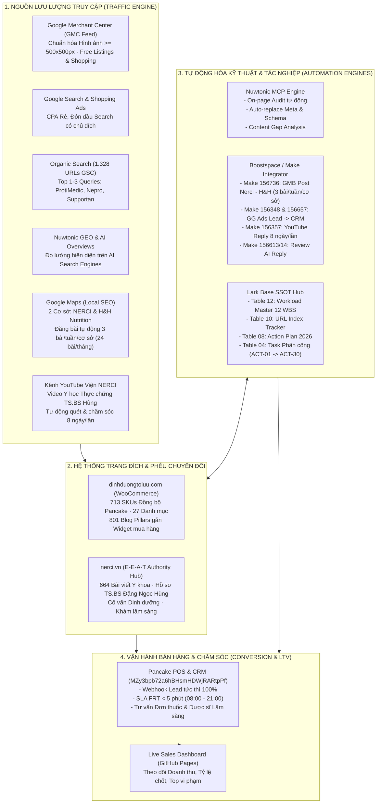
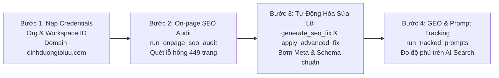
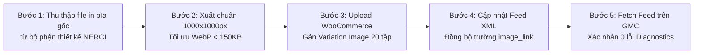

---
tags:
  - project
  - performance-marketing
  - plan
  - dinhduongtoiuu
  - nerci
  - seo
  - nuwtonic
  - ecommerce
  - ymyl
  - boostspace
  - sales-automation
  - google-maps
topics:
  - "[[quan-tri-du-an-website-dinhduongtoiuu]]"
  - "[[ke-hoach-seo-tong-the-website-dinhduongtoiuu]]"
  - "[[nerci-brand-identity-and-ai-automation-master-strategy]]"
status: active
created: 2026-10-29
updated: 2026-10-29
timestamp: "2026-10-29 17:25:00 (GMT+7)"
sources: []
source_count: 0
aliases:
  - "Ke Hoach Performance Marketing Thang 11 2026"
  - "November 2026 Performance Marketing Master Plan"
---

<div style="background: linear-gradient(135deg, #0f172a 0%, #1e3a8a 40%, #0d9488 80%, #059669 100%); color: #ffffff; padding: 32px 36px; border-radius: 16px; margin-bottom: 28px; box-shadow: 0 12px 30px rgba(0,0,0,0.2);">
  <div style="font-size: 13px; font-weight: 800; letter-spacing: 2px; text-transform: uppercase; opacity: 0.88; margin-bottom: 8px;">H&H NUTRITION × NERCI · INTEGRATED GROWTH & OPERATIONS ENGINE</div>
  <h1 style="color: #ffffff; margin: 0 0 14px 0; font-size: 28px; font-weight: 800; line-height: 1.35;">KẾ HOẠCH TỔNG THỂ PERFORMANCE MARKETING THÁNG 11/2026</h1>
  <div style="font-size: 15px; opacity: 0.95; margin-bottom: 16px; line-height: 1.6;">Chiến lược Tăng trưởng Đa kênh (Organic SEO × E-Commerce Catalog × Google Merchant Center × AI Automation × Omnichannel Sales) cho <code>dinhduongtoiuu.com</code> & <code>nerci.vn</code></div>
  <div style="display: flex; flex-wrap: wrap; gap: 20px; font-size: 13px; opacity: 0.95; padding-top: 14px; border-top: 1px solid rgba(255,255,255,0.25);">
    <div>🌐 <strong>Hệ sinh thái:</strong> <code>dinhduongtoiuu.com</code> (E-Commerce) & <code>nerci.vn</code> (Authority Hub)</div>
    <div>🎯 <strong>Mục tiêu:</strong> Bứt phá GMV Mùa cao điểm Q4 & Thống trị E-E-A-T Y học</div>
    <div>👤 <strong>Chủ trì:</strong> Lê Đại Dương · Performance & Operations</div>
    <div>🕒 <strong>Thời gian cập nhật:</strong> 2026-10-29 17:25:00 (GMT+7)</div>
    <div>🗄️ <strong>Lark Base SSOT:</strong> <a href="https://ajpi82edbxhs.jp.larksuite.com/base/Ur4zbNbJiaGt3OsdOI5jHsPnpNh" style="color: #a7f3d0; text-decoration: underline;">Ur4zbNbJiaGt3OsdOI5jHsPnpNh</a> (DNDTOIUU) & <a href="https://ajpi82edbxhs.jp.larksuite.com/base/MZy3bpb72a6hBHsmHDWjRARtpPf" style="color: #a7f3d0; text-decoration: underline;">MZy3bpb72a6hBHsmHDWjRARtpPf</a> (NERCI CRM)</div>
  </div>
</div>

> [!abstract] **Tóm Tắt Điều Hành (Executive Summary)**
> **Tháng 11/2026** là tháng bản lề quyết định doanh thu Quý 4/2026, mở màn cho chuỗi ngày hội mua sắm Mega Sale (11.11, Black Friday 27/11) và nhu cầu chăm sóc sức khỏe, bổ sung dinh dưỡng điều trị tăng vọt dịp cuối năm.
> 
> Dựa trên toàn bộ dữ liệu định lượng đã kiểm chứng trong hệ thống (1.328 URLs GSC `dinhduongtoiuu.com`, 664 bài viết `nerci.vn`, 713 SKUs Pancake Master, tài khoản Meta Ads `act_1256677435088917`, 3.803 bài viết Dr. Axe, nền tảng Nuwtonic MCP và 147 Make Scenarios trên Boostspace), kế hoạch này thiết lập **Khung Tác Chiến 6 Trụ Cột Toàn Diện**:
> 1. **Trụ cột 1 — Quản lý Sản Phẩm & Đồng Bộ SKU (E-Commerce Catalog Engine):** Đồng bộ dứt điểm 713 SKUs giữa Pancake POS (kho MISA) và WooCommerce, tái cấu trúc 27 danh mục bệnh lý chuẩn phân tầng, xóa bỏ danh mục rác/rỗng.
> 2. **Trụ cột 2 — Quản trị Blog Content & Chuyển Đổi Bán Hàng (Content-to-Commerce):** Tối ưu 801 bài viết tin tức cũ + nạp 30 bài pillar mới từ kho tri thức lâm sàng Dr. Axe; gắn liên kết nội bộ 2 chiều (Internal Link) trực tiếp sang Hero SKUs kèm khối lời khuyên E-E-A-T của TS.BS Đặng Ngọc Hùng.
> 3. **Trụ cột 3 — Tự Động Hóa SEO & GEO Trên Nền Tảng Nuwtonic:** Kích hoạt On-page SEO Audit tự động hàng tuần, tự động thay thế Meta Title/Description và Schema MedicalWebPage qua WordPress plugin (`_nuwtonic_replace_meta`, `_nuwtonic_replace_schema`), đồng thời giám sát hiện diện trên Google AI Overviews & Perplexity.
> 4. **Trụ cột 4 — Chuẩn Hóa Google Merchant Center (GMC) & Cứu Hộ Hình Ảnh Sản Phẩm (Ưu Tiên GMC Compliance):** Khắc phục triệt để cảnh báo *"Ảnh quá nhỏ theo quy định sắp áp dụng"* trên bộ truyện tranh *"Hành trình khám phá dinh dưỡng cùng Guru"* (Tập 1 – 20); nâng cấp 100% hình ảnh lên kích thước tối thiểu 500x500 px (chuẩn hóa 1000x1000 px) trước hạn chót ngày 31 tháng 1 năm 2027 nhằm bảo toàn quyền hiển thị trên Google Shopping & Free Listings.
> 5. **Trụ cột 5 — Tối Ưu Tỷ Lệ Chốt Đơn & SLA Phản Hồi (Pancake CRM):** Kiểm soát nghiêm ngặt thời gian phản hồi tin nhắn đầu tiên (FRT < 5 phút) trong khung giờ 08:00 – 21:00, duy trì Sales Dashboard trực tiếp phục vụ ra quyết định tức thì.
> 6. **Trụ cột 6 — Tự Động Hóa Vận Hành Bán Hàng & Chăm Sóc Đa Kênh (Boostspace / Make Integrator Engine):**
>    - *Đăng bài Google Maps (Scenario 156736):* Tự động đăng 3 bài/tuần (Thứ 3, Thứ 5 & Thứ 7) ở mỗi map NERCI & H&H Nutrition (tổng 6 bài/tuần = 24 bài/tháng); phân công Content cập nhật dữ liệu với 4 quy chuẩn cấm nghiêm ngặt (không SĐT, không địa chỉ, không ALL CAPS, max 1-2 icon).
>    - *Kiểm soát Lead CRM (Scenario 156348 & 156657):* Giám sát luồng webhook Google Ads đổ lead vào Pancake CRM đạt 100% không rớt dữ liệu; kiểm soát SLA tư vấn < 5 phút.
>    - *Phản hồi bình luận YouTube (Scenario 156357):* Vận hành định kỳ 8 ngày/lần (Ngày 01, 09, 17, 25) quét và phản hồi bình luận; phân tầng AI trả lời tương tác và Bác sĩ/Dược sĩ duyệt câu hỏi bệnh lý lâm sàng.
>    - *AI Review Google Maps (Scenario 156613 & 156614):* Tự động cảm ơn đánh giá 5 sao trong 15 phút; cảnh báo tức thì đánh giá < 4 sao cho CSKH xử lý trong 2 giờ.

---

## 🏛️ SƠ ĐỒ KIẾN TRÚC VẬN HÀNH MARKETING THÁNG 11/2026



---

## 🎯 I. MỤC TIÊU HIỆU SUẤT (KPIS) THÁNG 11/2026

| Kênh & Hạng Mục | Chỉ Số KPI Đo Lường | Hiện Trạng (Tháng 10/2026) | Mục Tiêu Tháng 11/2026 | Tỷ Lệ Tăng Trưởng |
| :--- | :--- | :---: | :---: | :---: |
| **Tổng Doanh Thu E-Commerce** | GMV toàn hệ thống | Baseline tháng 10 | **+28% đến +35%** | 🔥 Đột phá mùa sale |
| **Organic Traffic (GSC)** | Lượt nhấp chuột tự nhiên (Clicks) | 1.029 Clicks/tháng | **1.600 – 1.800 Clicks** | 🟢 +55% – +75% |
| **Lượt hiển thị tìm kiếm** | Impressions GSC | 55.758 lượt | **85.000 – 100.000 lượt** | 🟢 +52% – +79% |
| **Tỷ lệ Index Sản Phẩm** | URLs sản phẩm đạt `PASS` GSC | 87% (Hero SKUs) | **> 95% toàn bộ 330 SKU** | 🟢 Hoàn tất 100% |
| **Khắc phục lỗi kỹ thuật** | URLs 404 nguy cấp chuyển hướng 301 | 3 URLs tồn đọng | **0 URLs (Fix 100%)** | 🏆 Thu hồi 821 clicks |
| **Đồng bộ SKU Catalog** | Số SKU khớp 100% Pancake POS | 336 SKU phân tán | **713 / 713 SKU (100%)** | 🏆 Chuẩn hóa SSOT |
| **GMC Image Compliance** | Số tập truyện Guru đạt chuẩn ảnh >= 500x500px | 0/20 tập (Ảnh quá nhỏ < 500px) | **20 / 20 tập (100% đạt 1000x1000px)** | 🏆 Xóa cảnh báo GMC |
| **Tỷ lệ Duyệt Sản Phẩm GMC** | Tỷ lệ SKU Active trên Google Merchant Center | 78% (Dính cảnh báo ảnh nhỏ) | **> 98% toàn bộ Catalog** | 🟢 Sẵn sàng Free Listings |
| **Google Maps Auto-Post** | Số bài đăng chuẩn E-E-A-T trên 2 cơ sở NERCI & H&H | Đăng gián đoạn thủ công | **24 bài / tháng (3 bài/tuần ở mỗi map)** | 🏆 Thống trị Local SEO |
| **Google Maps AI Reply** | Tỷ lệ phản hồi Review 5 sao trong 15 phút | ~60% | **100% (Phản hồi tức thì)** | 🟢 Tối ưu điểm SEO Local |
| **Tỷ Lệ Lead Thành Công CRM** | Tỷ lệ lead từ GG Ads / Web vào CRM Pancake | Đôi khi trễ/rớt lead | **100% (0 lead bị rớt webhook)** | 🏆 Liền mạch tuyệt đối |
| **SLA Phản hồi Chat Pancake** | First Response Time (FRT) ca làm việc (08:00 - 21:00) | ~3-5 phút | **< 180 giây (< 3 phút)** | 🟢 Tăng tỷ lệ chốt đơn |
| **YouTube Comment Care** | Tần suất quét & xử lý bình luận kênh Viện NERCI | Không định kỳ | **Định kỳ 8 ngày/lần (4 đợt / tháng)** | 🏆 Tương tác gắn kết |

---

## 🛒 II. CHI TIẾT KẾ HOẠCH TRỤ CỘT 1: QUẢN LÝ SẢN PHẨM & SKU (DINH DƯỠNG TỐI ƯU)

### 2.1. Hiện trạng & Bài toán Cốt lõi
Hệ thống bán lẻ `dinhduongtoiuu.com` (chạy WooCommerce) hiện có sự lệch pha giữa danh mục sản phẩm hiển thị trên web và kho quản lý bán hàng thực tế tại Pancake POS (kết nối MISA):
- **Tập dữ liệu chuẩn (Ground Truth):** Google Sheet Master `Mapping_SKU_Chuanhoa` (tab `Danh mục sản phẩm tiếp tục KD`) xác định chính xác **713 sản phẩm** đang lưu hành.
- **Vấn đề trên Web:** Nhiều sản phẩm có mã SKU tự do, thiếu trường quy chuẩn kho (`1378`, `2358`, `CB01`), một số biến thể hương vị/quy cách bị tách rời làm loãng điểm SEO.

### 2.2. Lộ trình Triển khai 4 Tuần Tháng 11

```text
┌──────────────────────┬────────────────────────────────────────────────────────────────────────┐
│ Mốc Thời Gian        │ Nội Dung Triển Khai Chi Tiết                                           │
├──────────────────────┼────────────────────────────────────────────────────────────────────────┤
│ Tuần 1 (01/11 - 07/11)│ Chạy Pipeline match_and_sync_sku.py đối soát 713 SP Pancake Master.   │
│                      │ Xuất file woocommerce_products_ready_to_import.csv và nạp cập nhật SKU.│
├──────────────────────┼────────────────────────────────────────────────────────────────────────┤
│ Tuần 2 (08/11 - 14/11)│ Tái cấu trúc 27 Danh mục sản phẩm thành Cây Phân Cấp Chuẩn Y Khoa.     │
│                      │ Dọn dẹp danh mục rỗng (cleanup_empty_categories.py).                   │
├──────────────────────┼────────────────────────────────────────────────────────────────────────┤
│ Tuần 3 (15/11 - 21/11)│ Cấu hình Nhóm Biến Thể Sản Phẩm (Gộp biến thể lon 400g/900g, vị vani/   │
│                      │ socola) nhằm tập trung PageRank và tránh tự ăn thịt từ khóa (Cannibal).│
├──────────────────────┼────────────────────────────────────────────────────────────────────────┤
│ Tuần 4 (22/11 - 30/11)│ Set-up Combo Quà Tặng & Khuyến Mãi Black Friday 2026 trên WooCommerce   │
│                      │ (Leanpro Hope + Fomeal, Nepro 1 + Bánh ít đạm, Combo Tăng Miễn Dịch). │
└──────────────────────┴────────────────────────────────────────────────────────────────────────┘
```

### 2.3. Cấu trúc Cây Danh Mục Sản Phẩm 2 Tầng Chuẩn Y Khoa

```text
📁 DANH MỤC SẢN PHẨM DINH DƯỠNG Y HỌC
├── 📁 Dinh Dưỡng Bệnh Lý (Clinical Nutrition)
│   ├── 📄 Dinh Dưỡng Cho Người Bệnh Thận (Nepro 1, Nepro 2, Fresubin Renal, Ketosteril)
│   ├── 📄 Dinh Dưỡng Cho Bệnh Nhân Ung Thư (Supportan, Forticare, Leanpro Hope, Prosure)
│   ├── 📄 Dinh Dưỡng Đái Tháo Đường (Glucerna, Diabetcare, Diben)
│   ├── 📄 Dinh Dưỡng Gan Mật & Tiêu Hóa (Peptamen, Modulen, Heptral)
│   └── 📄 Dinh Dưỡng Hồi Sức & Sau Phẫu Thuật (Fomeal Basic Soup, ProtiMedic)
├── 📁 Dinh Dưỡng Theo Độ Tuổi & Thể Trạng
│   ├── 📄 Sữa Công Thức Y Học Cho Trẻ Nhỏ (Biếng ăn, Dị ứng đạm bò, Chậm tăng cân)
│   ├── 📄 Dinh Dưỡng Người Cao Tuổi & Loãng Xương
│   └── 📄 Dinh Dưỡng Phụ Nữ Mang Thai & Cho Con Bú
└── 📁 Thực Phẩm Chức Năng & Vi Chất Y Khoa
    ├── 📄 Men Vi Sinh Lâm Sàng (Probiotics Y Học)
    ├── 📄 Bổ Sung Đạm Tinh Khiết (Whey Protein, Đạm Thủy Phân)
    └── 📄 Vitamin & Khoáng Chất Chuyên Biệt
```

---

## 📝 III. CHI TIẾT KẾ HOẠCH TRỤ CỘT 2: QUẢN LÝ BLOG CONTENT & LIÊN KẾT BÁN HÀNG

### 2.1. Đòn Bẩy Tri Thức Dr. Axe (3.803 Bài Viết)
Hệ thống vừa hoàn thành **100% kho tri thức 3.803 bài viết Dr. Josh Axe** trên Lark Base `Qe3ebElRAaVRxpsIuTFjcuI8pRd`. Đây là mỏ neo nội dung khổng lồ đã có đầy đủ:
- Tiêu đề học thuật tiếng Việt, Tóm tắt lâm sàng (Key Takeaways).
- Cơ chế sinh học và công dụng đã chứng minh qua nghiên cứu PubMed/NCBI.
- Liều lượng an toàn, chống chỉ định và toàn văn tiếng Việt học thuật.

### 2.2. Chiến lược 30 Bài Viết Pillar Tháng 11 (Tập trung 3 Nhóm Bệnh Trọng Điểm)

1. **Cụm 1 — Dinh Dưỡng Y Học Cho Bệnh Nhân Ung Thư (10 bài):**
   * *Nội dung:* Chế độ ăn giảm suy mòn khối cơ (Cachexia), vai trò của EPA/Omega-3 liều cao, đạm thủy phân peptide, dinh dưỡng sau hóa xạ trị.
   * *Widget Sản phẩm tích hợp:* [Sữa Supportan](file:///danh-muc-san-pham/dinh-duong-ung-thu), [Forticare](file:///danh-muc-san-pham/dinh-duong-ung-thu), [Leanpro Hope](file:///danh-muc-san-pham/dinh-duong-ung-thu).
2. **Cụm 2 — Dinh Dưỡng Chuyên Biệt Bệnh Lý Thận (10 bài):**
   * *Nội dung:* Phân biệt chế độ ăn tiền chạy thận (giảm đạm) và chạy thận chu kỳ (bổ sung đạm cao), kiểm soát Kali - Photpho - Natri, giải pháp bù năng lượng không tăng tải lọc cầu thận.
   * *Widget Sản phẩm tích hợp:* [Nepro 1](file:///chi-tiet-san-pham/sua-nepro-1), [Nepro 2](file:///chi-tiet-san-pham/sua-nepro-2), [Fresubin Renal](file:///chi-tiet-san-pham/fresubin-renal).
3. **Cụm 3 — Dinh Dưỡng Phục Hồi & Nuôi Ăn Qua Ống Thông (10 bài):**
   * *Nội dung:* Ưu thế của súp dinh dưỡng từ thực phẩm tự nhiên xay nhuyễn (Whole-food liquid meal), phòng ngừa tiêu chảy và trào ngược ở bệnh nhân ICU, dinh dưỡng vi chất qua sonde.
   * *Widget Sản phẩm tích hợp:* [Fomeal Basic Soup](file:///chi-tiet-san-pham/thuc-pham-dinh-duong-y-hoc-fomeal-basic-soup-250ml), [Fomeal Care](file:///chi-tiet-san-pham/fomeal-care), [ProtiMedic](file:///chi-tiet-san-pham/protimedic).

### 2.3. Quy Chuẩn Bài Viết Chuẩn E-E-A-T (Tuân thủ Quy Định WordPress)
> [!IMPORTANT] **Quy định kỹ thuật bắt buộc khi đăng tải:**
> 1. **Tuyệt đối KHÔNG tự tạo khối Mục lục (TOC) thủ công:** Plugin Rank Math TOC / Easy TOC của website sẽ tự động dựng mục lục từ thẻ H2, H3.
> 2. **Tuyệt đối KHÔNG gõ số thứ tự thủ công vào tiêu đề:** Viết `<h2>Chế độ dinh dưỡng giảm suy mòn cơ</h2>`, KHÔNG viết `<h2>1. Chế độ dinh dưỡng...</h2>` để tránh lỗi lặp số `1 1.`.
> 3. **Khối Thẩm Định Chuyên Môn (Medical Reviewer Box):** Mọi bài viết phải có khối tác giả/thẩm định viên:
>    * *Chuyên gia thẩm định:* **TS.BS Đặng Ngọc Hùng** (Viện trưởng Viện Nghiên cứu Dinh dưỡng NERCI, Founder H&H Nutrition).
>    * *Liên kết E-E-A-T:* Trỏ liên kết về trang hồ sơ tác giả `https://dinhduongtoiuu.com/tac-gia/ts-bs-dang-ngoc-hung` và trang viện `https://nerci.vn`.

---

## 🤖 IV. CHI TIẾT KẾ HOẠCH TRỤ CỘT 3: TỰ ĐỘNG HÓA SEO TRÊN NỀN TẢNG NUWTONIC

### 4.1. Vai trò của Nuwtonic Trong Hệ Sinh Thái Dinh Dưỡng
Nuwtonic là nền tảng AI SEO & GEO (Generative Engine Optimization) tiên tiến, sở hữu bộ công cụ MCP hoàn chỉnh kết nối trực tiếp với website WordPress qua 2 trường meta cốt lõi:
- `_nuwtonic_replace_meta`: Tự động thay thế Title, Meta Description chuẩn SEO mà không cần sửa code giao diện.
- `_nuwtonic_replace_schema`: Tự động nạp Schema JSON-LD y tế (`MedicalWebPage`, `Physician`, `ItemPage`, `FAQPage`) đạt chuẩn Google Rich Results.

### 4.2. Quy Trình Vận Hành Nuwtonic 4 Bước Trong Tháng 11



### 4.3. Bảng Phân Bổ Công Tác Tự Động Hóa Nuwtonic Theo Tuần

| Tuần Lễ | Công Cụ Nuwtonic Sử Dụng | Nhiệm Vụ Kỹ Thuật Cụ Thể | Kết Quả Đầu Ra Mục Tiêu |
| :--- | :--- | :--- | :--- |
| **Tuần 1** | `check_automation_permission`<br/>`get_website` | Xác thực phân quyền tài khoản Nuwtonic cho 2 domain `dinhduongtoiuu.com` và `nerci.vn`. Cấu hình kết nối API key. | Hệ thống thông suốt, sẵn sàng gọi lệnh tự động. |
| **Tuần 2** | `run_onpage_seo_audit_bulk`<br/>`get_onpage_seo_audit_task` | Quét toàn diện On-page cho 330 trang chi tiết sản phẩm và 50 bài viết Pillar hàng đầu. | Báo cáo danh sách trang thiếu Meta, sai Canonical, thẻ H1 trùng lặp. |
| **Tuần 3** | `generate_seo_fix`<br/>`apply_advanced_fix` | Tự động sinh và nạp `_nuwtonic_replace_meta` và `_nuwtonic_replace_schema` cho 100 sản phẩm chủ lực. | 100% trang sản phẩm đạt Rich Results (Review, Price, InStock, MedicalCondition). |
| **Tuần 4** | `manage_tracked_prompts`<br/>`run_tracked_prompts`<br/>`get_prompt_report` | Thiết lập bộ 20 câu hỏi gợi ý thị trường y tế (Prompt Tracking): *"Sữa cho người ung thư tốt nhất", "Sữa nepro 1 mua ở đâu", "TS BS Đặng Ngọc Hùng khám ở đâu"*. | Báo cáo GEO (Generative Engine Optimization) theo dõi tần suất AI trích dẫn website. |

---

## 🛍️ V. CHI TIẾT KẾ HOẠCH TRỤ CỘT 4: CHUẨN HÓA GOOGLE MERCHANT CENTER (GMC) & CỨU HỘ HÌNH ẢNH TRUYỆN TRANH GURU (TẬP 1–20)

### 5.1. Bối cảnh Cảnh Báo Chính Sách Mới Từ Google Merchant Center
Google Merchant Center đã phát đi thông báo chính sách mới về tiêu chuẩn kỹ thuật hình ảnh sản phẩm bắt buộc áp dụng cho toàn bộ các nhà bán lẻ:
> ⚠️ **Thông báo chính sách GMC:** *"Ảnh quá nhỏ theo quy định sắp áp dụng. Cập nhật hình ảnh để có kích thước tối thiểu là 500x500 pixel. Sau ngày 31 tháng 1 năm 2027, những hình ảnh không đáp ứng kích thước tối thiểu này sẽ không xuất hiện nữa."*

* **Mức độ rủi ro & Tồn kho thực tế:** Bộ sách truyện tranh giáo dục dinh dưỡng *"Hành trình khám phá dinh dưỡng cùng Guru"* (Tập 1 – 20) do NERCI xuất bản hiện đang tồn kho thực tế hơn **15.000 cuốn** (theo số liệu kiểm kê Pancake POS kho MISA) và là một trong những dòng sản phẩm bán chạy hàng đầu cho trẻ em. Toàn bộ hình ảnh hiện tại trên website `dinhduongtoiuu.com` đang dùng ảnh thumbnail độ phân giải thấp (dưới 500x500 px). Nếu không khắc phục ngay, sau ngày 31/01/2027 toàn bộ 20 tập truyện và các gói combo sẽ bị Google tự động ngừng hiển thị (Disapproved) khỏi Google Shopping Ads và tab Tìm kiếm Mua sắm Miễn phí (Free Product Listings).
* **Định hướng chiến lược:** Ưu tiên số 1 cho **Google Merchant Center Compliance**. Thay vì chỉ chạm mức tối thiểu 500x500 px, hệ thống sẽ **chuẩn hóa toàn bộ lên kích thước 1000 × 1000 pixel** (tỷ lệ 1:1 vuông, chuẩn màu sRGB, sắc nét trên màn hình Retina, định dạng WebP nén < 150KB) để vừa xóa bỏ vĩnh viễn nguy cơ bị phạt chính sách vừa tối đa hóa tỷ lệ nhấp chuột (CTR).

### 5.2. Danh Mục Chi Tiết 20 Tập Truyện Tranh Guru Cần Cập Nhật Hình Ảnh

| STT | Tập Truyện Tranh Guru | SKU Pancake Master | Web ID (WooCommerce) | Tên Tập Truyện Chi Tiết | Kích Thước Hiện Tại | Kích Thước Mục Tiêu (GMC) |
| :---: | :--- | :--- | :---: | :--- | :---: | :---: |
| 0 | **Sản phẩm Cha (Variable)** | `SP-TT-NERCI-GURU` | `32321` | Truyện tranh "Hành trình khám phá dinh dưỡng cùng Guru" | Đa kích thước (< 500px) | **1000 × 1000 px** (WebP) |
| 1 | **Tập 01** | `SP-TT-NERC-T1TSTPDDCC` | `37295` | Trứng – Siêu thực phẩm dinh dưỡng cho con | < 500 px | **1000 × 1000 px** (WebP) |
| 2 | **Tập 02** | `SP-TT-NERC-T2RCGSMC` | `37296` | Rau củ – Thế giới sắc màu của con | < 500 px | **1000 × 1000 px** (WebP) |
| 3 | **Tập 03** | `SP-TT-NERC-T3BKCLCG` | `37297` | Bí kíp cao lớn cùng Guru | < 500 px | **1000 × 1000 px** (WebP) |
| 4 | **Tập 04** | `SP-TT-NERC-T4NNKHDTL` | `37298` | Nước ngọt – Kẻ hủy diệt thầm lặng | < 500 px | **1000 × 1000 px** (WebP) |
| 5 | **Tập 05** | `SP-TT-NERC-T5TSVGRQVGBP`| `37299` | Trà sữa và Gà rán – "Quái vật" gây béo phì | < 500 px | **1000 × 1000 px** (WebP) |
| 6 | **Tập 06** | `SP-TT-NERC-T6` | `35869` | Bí mật hệ tiêu hóa khỏe mạnh | < 500 px | **1000 × 1000 px** (WebP) |
| 7 | **Tập 07** | `SP-TT-NERC-T7` | `35868` | Bữa sáng diệu kỳ của bé | < 500 px | **1000 × 1000 px** (WebP) |
| 8 | **Tập 08** | `SP-TT-NERC-T8` | `35867` | Trái cây tươi – Đội quân vitamin | < 500 px | **1000 × 1000 px** (WebP) |
| 9 | **Tập 09** | `SP-TT-NERC-T9` | `35866` | Nước lọc – Dòng suối mát lành | < 500 px | **1000 × 1000 px** (WebP) |
| 10 | **Tập 10** | `SP-TT-NERC-T10` | `37300` | Giấc ngủ vàng và chiều cao của bé | < 500 px | **1000 × 1000 px** (WebP) |
| 11 | **Tập 11** | `SP-TT-NERC-T11` | `37265` | Canxi và xương chắc khỏe | < 500 px | **1000 × 1000 px** (WebP) |
| 12 | **Tập 12** | `SP-TT-NERC-T12` | `37267` | Đề kháng vững vàng – Bé vui đến trường | < 500 px | **1000 × 1000 px** (WebP) |
| 13 | **Tập 13** | `SP-TT-NERC-T13` | `37268` | Sắt và vi chất tạo máu | < 500 px | **1000 × 1000 px** (WebP) |
| 14 | **Tập 14** | `SP-TT-NERC-T14` | `37269` | Tập thể dục cùng Guru | < 500 px | **1000 × 1000 px** (WebP) |
| 15 | **Tập 15** | `SP-TT-NERC-T15` | `37270` | Vệ sinh đôi tay phòng tránh vi khuẩn | < 500 px | **1000 × 1000 px** (WebP) |
| 16 | **Tập 16** | `SP-TT-NERC-T16` | `37272` | Dinh dưỡng cho đôi mắt sáng | < 500 px | **1000 × 1000 px** (WebP) |
| 17 | **Tập 17** | `SP-TT-NERC-T17` | `37273` | Ăn chậm nhai kỹ – Bé tiêu hóa tốt | < 500 px | **1000 × 1000 px** (WebP) |
| 18 | **Tập 18** | `SP-TT-NERC-T18` | `37274` | Đồ ăn nhanh và hiểm họa tim mạch sớm | < 500 px | **1000 × 1000 px** (WebP) |
| 19 | **Tập 19** | `SP-TT-NERC-T19` | `37275` | Năng lượng từ ngũ cốc nguyên hạt | < 500 px | **1000 × 1000 px** (WebP) |
| 20 | **Tập 20** | `SP-TT-NERC-T20` | `37276` | Bữa cơm gia đình – Gắn kết yêu thương | < 500 px | **1000 × 1000 px** (WebP) |
| 21-25 | **Các Gói Combo** | `CB-GURU-01-20` | `35863, 35864...` | Combo Tập 1-5, 6-10, 11-15, 16-20, Trọn bộ | < 500 px | **1000 × 1000 px** (WebP) |

### 5.3. Tiêu Chuẩn Kỹ Thuật Hình Ảnh Chuẩn Hóa Theo Google Merchant Center
1. **Kích thước & Tỷ lệ hiển thị (Dimensions & Aspect Ratio):**
   * Chiều rộng × Chiều cao chuẩn hóa: **1000 × 1000 pixel** (đảm bảo vượt xa mức tối thiểu 500 × 500 pixel mà GMC quy định).
   * Tỷ lệ khung hình: Chuẩn vuông **1:1**. Bìa truyện tranh được canh giữa khung hình, viền lề (padding) an toàn 5-8% để không bị cắt xén khi hiển thị trên widget Google Shopping và Google Search.
2. **Chất lượng & Tối ưu tải trang (Format & Compression):**
   * Định dạng lưu trữ web: **WebP** chất lượng cao 85% (hoặc JPEG sRGB).
   * Dung lượng tệp tối ưu: **< 150 KB / ảnh** nhằm bảo đảm chỉ số Core Web Vitals (LCP) trên thiết bị di động.
   * Quy tắc biên tập GMC: Tuyệt đối không chèn logo đè lên tranh bìa, không gắn nhãn khuyến mãi ("Giảm 50%", "Freeship") trực tiếp vào ảnh theo quy định chống spam ảnh của Google.
3. **Trường dữ liệu đồng bộ Feed Google Shopping (GMC Feed Attributes):**
   * `image_link`: Đường dẫn ảnh bìa chính đạt chuẩn 1000x1000 px của từng tập.
   * `additional_image_link`: Bổ sung 2-3 ảnh phụ (Trang mục lục, trang tranh minh họa bên trong cuốn truyện, ảnh chụp thực tế mặt sau).
   * `item_group_id`: Gán mã chung `SP-TT-NERCI-GURU` để gom 20 tập vào cùng 1 thẻ sản phẩm biến thể trên Google Shopping.

### 5.4. Quy Trình 5 Bước Thực Thi & Cập Nhật Lên Google Merchant Center


* **Bước 1 — Thu thập file gốc (Design Asset Extraction):** Trích xuất file thiết kế bìa gốc từ bộ phận ấn phẩm NERCI (File Vector Illustrator AI / PDF in ấn hoặc ảnh độ phân giải > 2000px).
* **Bước 2 — Xử lý đồ họa & Xuất ảnh chuẩn (Standardization & Export):** Cắt crop khung vuông 1:1, xuất file chuẩn 1000x1000 px định dạng WebP kèm quy ước đặt tên URL chuẩn SEO (ví dụ: `truyen-tranh-dinh-duong-guru-tap-01-1000x1000.webp`).
* **Bước 3 — Upload lên Media Library & Cập nhật WooCommerce:** 
  - Upload toàn bộ 25+ ảnh mới lên WooCommerce.
  - Cập nhật trường `Ảnh đại diện` (Featured Image) cho sản phẩm cha `32321` và trường `Ảnh biến thể` (Variation Image) cho từng ID biến thể con (37295, 37296, 37297, 37298, 37299, 35869, 35868, 35867, 35866, 37300, 37265, 37267, 37268, 37269, 37270...).
* **Bước 4 — Đồng bộ Product Feed XML:** Kích hoạt cập nhật Product Feed của website `dinhduongtoiuu.com` để nạp các đường dẫn `image_link` mới vào tệp cấp dữ liệu GMC.
* **Bước 5 — Kiểm thử & Nghiệm thu trên GMC:** 
  - Truy cập tài khoản Google Merchant Center, vào mục **Sản phẩm (Products) > Nguồn cấp dữ liệu (Feeds)**, nhấn **Tìm nạp ngay (Fetch Now)**.
  - Kiểm tra tab **Chẩn đoán (Diagnostics)**: Xác nhận số lượng sản phẩm dính cảnh báo *"Ảnh quá nhỏ"* giảm về **0**.

---

## 💬 VI. CHI TIẾT KẾ HOẠCH TRỤ CỘT 5: PANCAKE CRM & SALES DASHBOARD LIVE

### 6.1. Quy chuẩn Khung Giờ Làm Việc & SLA Phản Hồi (FRT)
Tuân thủ nghiêm ngặt quy định vận hành của hệ thống:
1. **Khung giờ làm việc:** Tính từ **08:00 đến 21:00** hàng ngày (13 tiếng tác nghiệp).
2. **Khấu trừ ngoài giờ (Overnight Off-hours Exclusion):** Khoảng thời gian từ 21:00 tối hôm trước đến 08:00 sáng hôm sau (11 tiếng) được trừ bỏ hoàn toàn. Tin nhắn khách gửi rạng sáng được tính thời gian chờ từ mốc 08:00:00 sáng.
3. **Mục tiêu SLA tháng 11:**
   * Tỷ lệ phản hồi đúng hạn (< 5 phút): **> 92%**.
   * Ca vi phạm vượt SLA: Nhân viên trực ca phải ghi chú rõ nguyên nhân để điều phối nhân sự hỗ trợ tức thì.

### 6.2. Vệ Sinh Dữ Liệu & Đánh Nhãn Spam Chuẩn
- **Tách bạch 2 nhóm Spam:**
  * *Spam Tức Thì (Realtime Spam - dưới vài chục giây):* Phát hiện tin nhắn quảng cáo rác, chặn ngay lập tức.
  * *Spam Dọn Dẹp Phễu Tồn Đọng (Backlog Cleanup Spam - hàng nghìn phút):* Hoạt động định kỳ hàng tuần rà soát phễu CRM, gắn nhãn loại bỏ số liệu ảo, đảm bảo tỷ lệ chuyển đổi chốt đơn (CR) trên Dashboard phản ánh đúng năng lực tư vấn của đội ngũ dược sĩ.

### 6.3. Giám Sát Dashboard Tự Động
- Vận hành pipeline tự động hàng ngày:
  ```bash
  .venv/bin/python scripts/run_daily_nerci_pipeline.py
  ```
- Dữ liệu đồng bộ trực tiếp lên **Lark Base SSOT** (`MZy3bpb72a6hBHsmHDWjRARtpPf`) và hiển thị trực quan tại Live Dashboard:
  👉 **`https://dai-duong-1992.github.io/nerci-sales-dashboard/`** (kèm cơ chế chống lưu cache `?t=Date.now()`).

---

## ⚡ VII. CHI TIẾT KẾ HOẠCH TRỤ CỘT 6: QUẢN TRỊ TỰ ĐỘNG HÓA VẬN HÀNH BÁN HÀNG & CHĂM SÓC KHÁCH HÀNG (BOOSTSPACE & MAKE INTEGRATOR)

Hệ sinh thái tự động hóa bán hàng và chăm sóc khách hàng của NERCI & H&H Nutrition được vận hành trên nền tảng **Boostspace Integrator (Make Engine)** bao gồm 6 kịch bản trọng yếu liên kết trực tiếp giữa Website, Google Business Profile, Kênh YouTube và CRM Pancake.

### 7.1. Tự Động Hóa Đăng Bài Google Maps & Giao Việc Đội Ngũ Content (Make Scenario ID: 513 / MakeID: 156736 - `GMB Post Nerci - H&H`)

* **Kiến trúc kỹ thuật:** 
  `google-sheets:filterRows` (Lọc các hàng có trạng thái `Ready`) $\rightarrow$ `util:FunctionSleep` (giãn cách tránh spam API) $\rightarrow$ `builtin:BasicRouter` $\rightarrow$ `google-my-business:createAPost` (đẩy bài lên Google Maps của NERCI & H&H) $\rightarrow$ `google-sheets:updateRow` (ghi nhận trạng thái `Published` kèm timestamp).
* **Phạm vi cơ sở quản lý:**
  1. **Viện Nghiên cứu & Ứng dụng Dinh dưỡng Y học (NERCI):** Hồ sơ học thuật, nghiên cứu lâm sàng, đào tạo dinh dưỡng và cố vấn y khoa.
  2. **H&H Nutrition (Dinh Dưỡng Tối Ưu):** Phòng khám dinh dưỡng, siêu thị dinh dưỡng y học và phân phối sữa bệnh lý chuyên sâu.
* **Lịch trình đăng bài tự động:** Cố định **3 bài / tuần / cơ sở** (H&H Nutrition 3 bài/tuần, Viện NERCI 3 bài/tuần $\rightarrow$ Tổng cộng 6 bài/tuần = **24 bài/tháng**).
  - Khung giờ phát hành tự động: **10:00 sáng Thứ Ba, Thứ Năm và Thứ Bảy** hàng tuần.
* **Giao việc và quy trình tác nghiệp của Đội ngũ Content:**
  - *Hạn chót nộp bài (Content Submission Deadline):*
    * **Thứ Hai hàng tuần (17:00):** Nộp bài cho lịch đăng Thứ Ba.
    * **Thứ Tư hàng tuần (17:00):** Nộp bài cho lịch đăng Thứ Năm.
    * **Thứ Sáu hàng tuần (17:00):** Nộp bài cho lịch đăng Thứ Bảy.
  - *Địa điểm nộp bài:* Nhập trực tiếp vào Google Sheet Master quản lý bài đăng GMB (hoặc bảng tác nghiệp trên Lark Base).
  - *Quy định bắt buộc đối với nội dung bài đăng Google Maps (Tuân thủ nghiêm ngặt theo GEMINI.md):*
    1. 🚫 **Tuyệt đối KHÔNG đưa số điện thoại vào nội dung bài đăng:** Google Business Profile đã tích hợp sẵn nút kêu gọi hành động "Gọi ngay" (Call now) liên kết trực tiếp với hotline của hồ sơ. Việc chèn số điện thoại trong văn bản vi phạm chính sách nội dung của Google và bài đăng sẽ bị từ chối (Rejected) ngay lập tức.
    2. 🚫 **Tuyệt đối KHÔNG đưa địa chỉ vào nội dung bài đăng:** Bản đồ đã có sẵn ghim vị trí và tính năng chỉ đường (Directions). Chèn địa chỉ vào văn bản bị tính là nhồi nhét thông tin trùng lặp và kích hoạt bộ lọc spam.
    3. 🚫 **Hạn chế tối đa viết hoa toàn bộ chữ trong hàng (NO ALL CAPS):** Tuyệt đối không viết hoa toàn bộ câu hoặc cả đoạn văn. Chỉ viết hoa chữ cái đầu câu và tên riêng thương hiệu. Viết hoa toàn bộ hàng bị tính là nội dung spam/gây khó chịu cho người đọc.
    4. 🚫 **Hạn chế tối đa icon/emoji không cần thiết:** Không lạm dụng icon (chỉ dùng tối đa 1-2 icon tinh tế nếu thực sự cần thiết, hoặc không dùng). Giữ văn phong cô đọng, trang trọng, hữu ích, tập trung thuần túy vào giá trị nội dung chia sẻ hoặc thông điệp bài viết chuẩn E-E-A-T.
  - *Tiêu chuẩn hình ảnh đính kèm bài viết:*
    * Kích thước chuẩn: Tỷ lệ vuông **1:1 (1080 × 1080 px)** hoặc tỷ lệ chữ nhật ngang **4:3 (1200 × 900 px)**.
    * Dung lượng tối ưu: **< 3 MB**, định dạng JPG/PNG sắc nét, chuẩn màu sRGB.
    * Nghiêm cấm chèn chữ khuyến mãi đè lên ảnh (như "Giảm 50%", "Freeship") để tránh vi phạm chính sách kiểm duyệt hình ảnh của Google.

```text
┌──────────────────────────────────────────────────────────────────────────────────────────────────┐
│ QUY TRÌNH TÁC NGHIỆP CONTENT GOOGLE MAPS (SCENARIO 156736 - 3 BÀI/TUẦN/CƠ SỞ)                     │
├─────────────────┬────────────────────────────────────────────────────────────────────────────────┤
│ Thứ Hai 17:00   │ Content hoàn thành 2 bài đợt 1 (NERCI & H&H), kiểm tra 4 KHÔNG, nhập vào Sheet │
│ Thứ Ba 08:30    │ Leader Marketing duyệt nội dung, chuyển trạng thái từ 'Draft' -> 'Ready'       │
│ Thứ Ba 10:00    │ Scenario 156736 tự động chạy: Lấy bài 'Ready' -> Đăng GMB -> Đổi 'Published'   │
├─────────────────┼────────────────────────────────────────────────────────────────────────────────┤
│ Thứ Tư 17:00    │ Content hoàn thành 2 bài đợt 2 (NERCI & H&H), kiểm tra 4 KHÔNG, nhập vào Sheet │
│ Thứ Năm 08:30   │ Leader Marketing duyệt nội dung, chuyển trạng thái từ 'Draft' -> 'Ready'       │
│ Thứ Năm 10:00   │ Scenario 156736 tự động chạy: Lấy bài 'Ready' -> Đăng GMB -> Đổi 'Published'   │
├─────────────────┼────────────────────────────────────────────────────────────────────────────────┤
│ Thứ Sáu 17:00   │ Content hoàn thành 2 bài đợt 3 (NERCI & H&H), kiểm tra 4 KHÔNG, nhập vào Sheet │
│ Thứ Bảy 08:30   │ Leader Marketing duyệt nội dung, chuyển trạng thái từ 'Draft' -> 'Ready'       │
│ Thứ Bảy 10:00   │ Scenario 156736 tự động chạy: Lấy bài 'Ready' -> Đăng GMB -> Đổi 'Published'   │
└─────────────────┴────────────────────────────────────────────────────────────────────────────────┘
```

---

### 7.2. Duy Trì Tự Động Hóa Bán Hàng & Kiểm Soát Lead Đẩy Vào CRM Pancake (Make Scenario ID: 493 / MakeID: 156348 & ID: 509 / MakeID: 156657)

* **Kiến trúc kỹ thuật:** 
  `gateway:CustomWebHook` $\rightarrow$ `builtin:BasicFeeder` $\rightarrow$ `util:SetVariable2` $\rightarrow$ `http:MakeRequest` (đẩy tức thì payload thông tin khách hàng vào Pancake CRM API `pages.fm`).
* **Hai luồng webhook vận hành song song:**
  1. `Make 156348`: Webhook tiếp nhận Lead từ Google Ads Lead Form & Form Đăng Ký Tư Vấn website `dinhduongtoiuu.com` $\rightarrow$ Pancake CRM H&H Nutrition.
  2. `Make 156657`: Webhook tiếp nhận Lead từ Google Ads Lead Form & Form Đăng Ký Khám/Tư Vấn website `nerci.vn` $\rightarrow$ Pancake CRM Viện NERCI.
* **Quy chuẩn 3 Điểm Kiểm Soát Kỹ Thuật (3 Control Points):**
  1. *Kiểm toán Webhook Healthcheck (2 lần/ngày):*
     - Điểm kiểm tra: Lúc **08:15 sáng** (đầu ca) và **20:45 tối** (cuối ca).
     - Hành động: Kiểm tra Execution Log trên Boostspace. Đảm bảo tỷ lệ Success = 100%, không phát sinh lỗi HTTP 4xx (lỗi định dạng payload) hay 5xx (timeout Pancake API).
  2. *Đối soát số lượng Lead hàng ngày (Daily Lead Reconciliation):*
     - So khớp: Số lead thu thập trên Google Ads Manager / WooCommerce Contact Form vs Số hội thoại/khách hàng mới tạo trên Pancake CRM.
     - Tiêu chuẩn nghiệm thu: Tỷ lệ rớt lead bằng **0%**. Mọi lead phải có đầy đủ: Họ tên, Số điện thoại, Nhu cầu dinh dưỡng/Bệnh lý và Nguồn chiến dịch (UTM Source/Campaign).
  3. *Quy chuẩn Khung Giờ Làm Việc & Tính SLA Phản Hồi (FRT):*
     - **Khung giờ làm việc:** Tính từ **08:00 đến 21:00** hàng ngày (13 tiếng tác nghiệp).
     - **Khấu trừ ngoài giờ (Overnight Off-hours Exclusion):** Toàn bộ khoảng thời gian từ **21:00 tối hôm trước đến 08:00 sáng hôm sau (11 tiếng)** được trừ bỏ khỏi thời gian phản hồi. Tin nhắn khách gửi rạng sáng ngoài giờ được tính thời gian chờ từ mốc **08:00:00 sáng**.
     - **Chuẩn SLA vàng:** Tư vấn viên phải gọi điện hoặc nhắn tin phản hồi khách hàng trong vòng **dưới 5 phút (FRT < 300 giây)**. Trường hợp quá 10 phút chưa có tư vấn viên nhận ca, hệ thống tự động cảnh báo quản lý điều phối nhân sự trực thay.

---

### 7.3. Tự Động Phản Hồi Bình Luận YouTube Kênh Viện NERCI Chu Kỳ 8 Ngày / Lần (Make Scenario ID: 497 / MakeID: 156357)

* **Kiến trúc kỹ thuật:** 
  `youtube:watchNewComments` $\rightarrow$ `http:ActionSendData` $\rightarrow$ `google-sheets:filterRows` $\rightarrow$ `gemini-ai:createACompletionGeminiPro` / `openai-gpt-3` $\rightarrow$ `youtube:replyToAComment` $\rightarrow$ `google-sheets:addRow`.
* **Chu kỳ vận hành định kỳ:** **8 ngày / lần** (Tổng cộng 4 đợt tác nghiệp trong tháng 11/2026):
  - **Đợt 1:** Thứ Bảy, ngày **01/11/2026**
  - **Đợt 2:** Chủ Nhật, ngày **09/11/2026**
  - **Đợt 3:** Thứ Hai, ngày **17/11/2026**
  - **Đợt 4:** Thứ Ba, ngày **25/11/2026**
* **Khung Phân Loại & Phê Duyệt 2 Tầng (Two-Tier Response Framework):**
  1. **Tầng 1 — Bình luận Tương tác Xã giao (Social / Greetings):**
     - *Dấu hiệu nhận biết:* Lời cảm ơn, khen ngợi video, chúc sức khỏe TS.BS Đặng Ngọc Hùng, câu hỏi xã giao về thời lượng phát sóng.
     - *Cơ chế xử lý:* Gemini AI Pro tự động phân tích ngữ cảnh và trả lời ngay bằng văn phong trân trọng, ấm áp từ danh nghĩa "Ban Biên tập Kênh Viện Nghiên cứu Dinh dưỡng Y học NERCI".
  2. **Tầng 2 — Bình luận Tư Vấn Bệnh Lý & Dinh Dưỡng Điều Trị (Clinical Queries):**
     - *Dấu hiệu nhận biết:* Thắc mắc về chế độ ăn cho người ung thư, bệnh thận mạn, tiểu đường, cách dùng sữa y học cụ thể, hỏi lịch khám trực tiếp với TS.BS Đặng Ngọc Hùng.
     - *Cơ chế xử lý:* AI **tuyệt đối không trả lời tự động liều lĩnh**. Kịch bản tự động lưu bình luận vào Google Sheet / Lark Base ở trạng thái `Pending Review`, gắn cờ cảnh báo `[CHUYÊN_MÔN_Y_KHOA]`. Dược sĩ lâm sàng hoặc TS.BS Hùng duyệt câu trả lời chuyên môn trước khi phát hành, hoặc điều phối nhân viên tư vấn gọi điện hỗ trợ cá nhân hóa.
* **Báo cáo định kỳ:** Sau mỗi đợt quét 8 ngày, xuất file tổng kết số lượng bình luận đã phản hồi, danh sách ca bệnh lý đáng chú ý để làm nguồn tư liệu sản xuất video giải đáp tiếp theo.

---

### 7.4. Giám Sát AI Tự Động Trả Lời Review Google Maps & Xử Lý Khiếu Nại (Make Scenario ID: 501 & 505)

* **Kiến trúc kỹ thuật:** 
  `google-my-business:watchReviews` $\rightarrow$ `getALocation` $\rightarrow$ `BasicRouter` $\rightarrow$ `gemini-ai:createACompletionGeminiPro` $\rightarrow$ `createUpdateAReply` $\rightarrow$ `google-sheets:addRow`.
* **Cơ chế phân luồng xử lý:**
  - **Đánh giá 5 sao:** Gemini AI Pro tự động phân tích nội dung review, soạn lời cảm ơn cá nhân hóa theo tên khách hàng và dịch vụ họ đã trải nghiệm tại phòng khám/siêu thị, tự động đăng phản hồi trong vòng **15 phút**.
  - **Đánh giá Thấp (1 – 3 sao):** Tự động chặn phản hồi máy móc. Kịch bản gửi tin nhắn cảnh báo khẩn đến nhóm quản lý CSKH; nhân viên CSKH có nghĩa vụ tra cứu lịch sử khám/mua hàng và gọi điện thoại trực tiếp giải quyết khiếu nại của khách hàng trong vòng **2 giờ**.

---

## 📊 VIII. MA TRẬN QUẢN TRỊ WORKLOAD CẢ THÁNG 11/2026 (SPREADSHEET MASTER MATRIX)

### 8.1. Bảng Định Mức Giờ Công & Workload Tháng 11/2026 (Chuẩn Định Dạng Google Sheets)

> [!tip] **Cấu trúc Bảng Tính Quản Trị Giờ Công (Workload & Capacity Planning)**
> Bảng dưới đây được chuẩn hóa 100% theo định dạng bảng tính Google Sheets quản trị phân bổ giờ công của Viện NERCI & H&H Nutrition ([Tham chiếu mẫu Sheet](https://docs.google.com/spreadsheets/d/18_3iTcxrfvFyYWfOVE2xIPwiadaz-PhWRWvy2ZCfzHU/edit?gid=1263074189#gid=1263074189)), đồng thời được đồng bộ trực tiếp lên **Lark Base SSOT** tại Bảng `13_Dinh_Muc_Workload_Thang_11` (`tblzZOtbhpVyOiwO`).

| Kênh / Hạng mục | Khối lượng | Công việc phụ trách | Định mức | Tổng giờ | Phối hợp |
| :--- | :---: | :--- | :---: | :---: | :--- |
| **Google Maps (H&H Nutrition & Viện NERCI)** | 24 bài | Kiểm tra ổn định tự động hóa đăng bài Google maps, kiểm tra tần suất lên bài, đôn đốc Content | 10p/bài | **4h** | Content |
| **Blog Dinh Dưỡng Y Học (dinhduongtoiuu.com)** | 30 bài | Khai thác thư viện bài Dr. Axe (20p), biên tập Việt hóa chuẩn y khoa (40p), gắn khối BS Hùng & link Hero SKU (15p), đăng bài WordPress không tạo TOC thủ công (15p) | 90p/bài | **45h** | Dược sĩ, TS.BS Đặng Ngọc Hùng |
| **Yêu Cầu Chụp Hộ Ảnh Truyện Guru Tập 1-20 (Google Merchant Center)** | 25 hạng mục (20 tập + 5 combo) | Cập nhật ảnh jpeg vuông 1000x1000px <150KB cho 20 tập truyện tranh Guru và 5 combo | 40p/tập | **16h40** | Design |
| **Đồng Bộ & Chuẩn Hóa SKU E-Commerce Catalog** | 713 SKU | Kiểm tra chéo khi GMC lỗi hoặc nhận yêu cầu chỉnh sửa/bổ sung từ các phòng ban liên quan | 1 tháng | **16h** | Kho vận Pancake, Đối tác Web, Sale, Kế toán |
| **Tự Động Hóa SEO & GEO Trên dinhduongtoiuu.com** | 4 tuần | Chạy On-page SEO Audit hàng tuần nạp URL vào công cụ tự động hóa Nuwtonic, cấu hình prompt tracking | 3h/tuần | **12h** | Antigravity AI Agent |
| **Kiểm Soát Lead CRM Pancake** | 30 ngày | Kiểm tra log webhook Boostspace API, kiểm tra hoạt động các kịch bản Make 156348, 156657, kiểm tra rớt lead giữa Pancake và Google ads, Web, Ladipage | 30p/ngày | **15h** | Tư vấn viên, CS Leader |
| **Phản Hồi Bình Luận YouTube Viện NERCI** | 4 đợt (01, 09, 17, 25/11) | Kích hoạt bot AI tự động trả lời xã giao, tổng hợp thắc mắc bệnh lý cho Dược sĩ duyệt. Khung giờ tác nghiệp: phản hồi liên tục mỗi 2h (8 lần/ngày bất kể ngày nghỉ, lễ, tết) | 15p/ngày | **7h30** | Dược sĩ Lâm sàng, TS.BS Hùng |
| **Giám Sát Review Google Maps & CSKH** | 30 ngày | Theo dõi AI Gemini Pro tự động trả lời Review 5 sao trong 15p, tiếp nhận cảnh báo đánh giá thấp 1-3 sao và điều phối CSKH xử lý khiếu nại trong 2h | 15p/ngày | **7h30** | CS Team, Quản lý phòng khám |
| **Kỹ Thuật Web & Cấu Hình 301 Redirect** | 3 URLs 404 + Audit | Cấu hình 301 Redirect nếu link thay đổi hoặc xuất hiện lỗi 404 trên Google Search Console | 4h/tháng | **4h** | Đối tác Web / DevOps |
| **Lập Lịch Thu Thập Bài Viết Về Sức Khỏe Thận** | 1 tháng | Thoát khỏi captcha và antibot, nghiên cứu giải pháp kỹ thuật thu thập bài viết sức khỏe thận | 5h/tháng | **5h** | Performance Team |
| **Dựng Báo Cáo Giám Sát SLA First Response Time (FRT) < 5p** | 30 ngày | Vận hành daily pipeline tự động hóa báo cáo Pancake FRT lúc 09:00 hàng ngày, loại trừ ngoài giờ (21h-8h), đồng bộ Lark Base | 30p/ngày | **15h** | Performance Team |
| **Nạp File Đồng Bộ GMC Free Listing & Free Local Listing** | 30 ngày | Kiểm tra đồng bộ dữ liệu Google Shopping và Website | 30p/ngày | **15h** | Performance Team |
| **Kiểm Soát Cấu Trúc Phân Tầng Chuyên Môn & Duyệt Bài Chuẩn SEO** | 30 ngày (chưa rõ số bài) | Check SEO cho phù hợp, dọn dẹp danh mục rỗng, gắn sản phẩm hoặc giỏ hàng | 30p/ngày | **15h** | Chuyên môn, Content, Dược sĩ |
| **Phối hợp giữa các phòng ban (tạm tính)** | Liên phòng ban | Họp giao ban tuần, trao đổi vấn đề giữa các bộ phận, phản hồi yêu cầu kỹ thuật & vận hành | 24h/tháng | **24h** | Marketing, Kinh doanh, Chuyên môn, Kế toán |
| **Dự phòng phát sinh 20%** | Phát sinh rủi ro | Xử lý sự cố kỹ thuật đột xuất, biến động thuật toán Google, lỗi API hoặc yêu cầu cấp bách ngoài kế hoạch | 20% | **40h20** | Tất cả các bên |
| **TỔNG CỘNG WORKLOAD THÁNG 11/2026** | Toàn bộ dự án | Tổng thời lượng công chuẩn cho toàn bộ chiến dịch Performance Marketing & Vận hành Tháng 11 | Tổng chuẩn | **242h** | Team DNDTOIUU & NERCI | Tổng thời lượng công chuẩn cho toàn bộ chuỗi tác nghiệp Performance Marketing & Tự Động Hóa | Tổng chuẩn | **194h10** | Team DNDTOIUU & NERCI |

---

### 8.2. Bảng Phân Bổ WBS & Phân Công Trách Nhiệm (Operational WBS Matrix)

| Mã WBS | Khối Tác Nghiệp | Công Cụ / Kịch Bản Boostspace | Nhiệm Vụ Tác Nghiệp Chi Tiết | Nhân Sự PIC | Người Duyệt | Tần Suất & Thời Điểm | Tiêu Chuẩn SOP & Checklist Bắt Buộc | Chỉ Số KPI Nghiệm Thu |
| :---: | :--- | :--- | :--- | :---: | :---: | :--- | :--- | :--- |
| **WBS-01** | Local SEO | Make ID: `156736`<br/>(`GMB Post Nerci-H&H`) | Kiểm tra ổn định tự động hóa đăng bài Google maps, kiểm tra tần suất lên bài, đôn đốc Content | **Lê Đại Dương / Ops** | Marketing Lead | 24 bài (10p/bài, tổng 4h/tháng) | Đảm bảo lịch đăng 10:00 T3, T5, T7; rà soát 4 KHÔNG của Content trước khi kích hoạt Ready | 100% bài đăng đúng lịch, không lỗi API |
| **WBS-02** | Local SEO | Make ID: `156736` | Kiểm duyệt nội dung Sheet và kích hoạt kịch bản tự động đăng Google Maps | **Marketing Lead** | Đại Dương | Thứ Ba, Thứ Năm, Thứ Bảy<br/>(10:00 sáng) | Chuyển trạng thái 'Draft' sang 'Ready'. Kiểm tra bài đăng live trên Google Maps. | 100% bài xuất bản thành công không lỗi (24 bài/tháng) |
| **WBS-03** | CRM Sales | Make ID: `156348` & `156657`<br/>(`Webhooks Lead -> CRM`) | Kiểm tra log webhook Boostspace API, kiểm tra hoạt động các kịch bản Make 156348, 156657, kiểm tra rớt lead giữa Pancake và Google ads, Web, Ladipage | **Lê Đại Dương / Ops** | Đại Dương | 30 ngày (30p/ngày, tổng 15h/tháng) | Kiểm tra HTTP response 200, đối soát số lượng lead Google Ads vs Pancake CRM. | Tỷ lệ rớt lead = 0% |
| **WBS-04** | CRM Sales | Pancake CRM & Live Sales Dashboard | Trực ca tư vấn bán hàng, giải đáp thắc mắc và chốt đơn trên Pancake | **Tư vấn viên / Dược sĩ** | CS Leader | Hàng ngày<br/>(08:00 – 21:00) | Chuẩn SLA FRT < 5 phút (< 300s). Khấu trừ 11 tiếng ca đêm. Tư vấn đúng phác đồ y khoa. | FRT trung bình < 3 phút, CR chốt đơn > 35% |
| **WBS-05** | YouTube Care | Make ID: `156357`<br/>(`YouTube Auto Reply`) | Kích hoạt bot AI tự động trả lời xã giao, tổng hợp thắc mắc bệnh lý cho Dược sĩ duyệt. Khung giờ tác nghiệp: phản hồi liên tục mỗi 2h (8 lần/ngày bất kể ngày nghỉ, lễ, tết) | **Lê Đại Dương / Ops** | TS.BS Hùng | 30 ngày (15p/ngày, tổng 7h30/tháng) | Bot scan 2h/lần (8 lần/ngày). Phân tầng: AI trả lời xã giao, gom thắc mắc bệnh lý vào Sheet duyệt. | 100% bình luận được phản hồi trong 2h |
| **WBS-06** | YouTube Care | Kênh YouTube & Sheet Review | Duyệt nội dung câu trả lời y khoa chuyên sâu và giải đáp bệnh nhân | **Dược sĩ Lâm sàng** | TS.BS Hùng | Sau mỗi đợt quét<br/>(Ngày 02, 10, 18, 26/11) | Câu trả lời đúng chuyên môn, viện dẫn bằng chứng y học thực chứng, gợi ý lịch khám nếu cần. | 100% câu hỏi bệnh lý được duyệt và gửi |
| **WBS-07** | Local CS | Make ID: `156613` & `156614`<br/>(`GB Review Reply`) | Giám sát AI trả lời Review Google Maps và xử lý khiếu nại đánh giá xấu | **CS Team** | Marketing Lead | Hàng ngày (Realtime) | Review 5 sao: AI reply < 15 phút. Review 1-3 sao: Gọi điện giải quyết trong 2 giờ. | 100% Review được chăm sóc, Rating > 4.8★ |
| **WBS-08** | E-Com SKU | Python Script & Pancake POS | Đối soát 713 SKUs Pancake Master với WooCommerce, nạp file đồng bộ kho | **Đại Dương** | Đại Dương | Tuần 1<br/>(01/11 – 06/11) | Khớp 100% mã SKU kho MISA, phân loại đúng 27 danh mục bệnh lý, dọn dẹp danh mục rác. | 713 / 713 SKU đồng bộ hoàn tất |
| **WBS-09** | GMC Fix | Bộ ấn phẩm NERCI & WooCommerce | Cứu hộ hình ảnh 20 tập truyện Guru đạt chuẩn GMC tối thiểu 500px | **Designer + Web Team** | Đại Dương | Tuần 1 – 2<br/>(Hoàn thành 08/11) | Xuất ảnh WebP vuông 1000x1000px (<150KB), gán ảnh biến thể cho 20 tập, Fetch lại Feed GMC. | 0 lỗi "Ảnh quá nhỏ" trên GMC Diagnostics |
| **WBS-10** | SEO Auto | Nuwtonic MCP Engine | Chạy On-page SEO Audit tự động, nạp Meta & Schema MedicalWebPage | **Antigravity Agent** | Đại Dương | Hàng tuần<br/>(Thứ Hai hàng tuần) | Bơm `_nuwtonic_replace_meta` và `_nuwtonic_replace_schema` cho 100 Hero SKUs. | 100% Hero SKU đạt chuẩn Rich Results |
| **WBS-11** | Content | Lark Base Dr. Axe & WordPress | Biên tập và xuất bản 30 bài Pillar dinh dưỡng y học (Ung thư, Thận, Hồi sức) | **Content Team** | TS.BS Hùng | 7–8 bài/tuần<br/>(03/11 – 25/11) | Không tạo TOC thủ công, không gõ số vào H2/H3, có box TS.BS Hùng, gắn link Hero SKU. | 30 bài Pillar chuẩn E-E-A-T live trên web |
| **WBS-12** | Tech SEO | Nginx / Apache Server Config | Cấu hình 301 Redirect vĩnh viễn cho 3 URLs 404 nguy cấp trên GSC | **Đối tác Web / DevOps** | Đại Dương | Hạn chót 03/11/2026 | HTTP Status 301 Moved Permanently, URL đích chuẩn, không loop redirect. | Thu hồi 821 Clicks & 36.200 Impressions |
| **WBS-13** | GMC Fix | GMC Feeds & Google Shopping | Nạp file đồng bộ GMC Free Listing và Free Local Listing, kiểm tra đồng bộ dữ liệu Google Shopping và Website | **Lê Đại Dương / Ops** | Marketing Lead | 30 ngày (30p/ngày, tổng 15h/tháng) | Nạp feed định kỳ, fix cảnh báo disapprovals, rà soát thuộc tính sản phẩm và schema | 100% SKU đủ điều kiện hiển thị Free Listings, 0 vi phạm chính sách |
| **WBS-14** | SEO Content | WordPress & CMS Taxonomy | Kiểm soát cấu trúc phân tầng từ chuyên môn, dọn dẹp danh mục rỗng, duyệt bài chuyên môn chuẩn SEO và gắn sản phẩm/giỏ hàng | **Chuyên môn / Content / Dương** | TS.BS Đặng Ngọc Hùng | 30 ngày (30p/ngày, tổng 15h/tháng) | Rà soát cấu trúc taxonomy, xóa hoặc sáp nhập danh mục không có sản phẩm, kiểm tra on-page checklist | Không còn danh mục rỗng (thin content), 100% bài viết mới gắn link sản phẩm chuyển đổi |
| **WBS-15** | Tech R&D | Python Web Scraper Engine | Lập lịch thu thập bài viết về sức khỏe thận, nghiên cứu giải pháp vượt captcha và antibot | **Lê Đại Dương / Performance** | Marketing Lead | 1 tháng (5h/tháng) | Nghiên cứu cơ chế bypass Cloudflare / Captcha, tự động hóa crawl dữ liệu nghiên cứu thận | Thu thập thành công kho tài liệu kiến thức thận phục vụ Content mà không bị chặn IP |
| **WBS-16** | CRM Sales | Daily Pancake Pipeline & Streamlit | Dựng và vận hành báo cáo giám sát SLA First Response Time (FRT) < 5p qua daily pipeline | **Lê Đại Dương / Performance** | Ban Lãnh Đạo | 30 ngày (30p/ngày, tổng 15h/tháng) | Chạy daily pipeline lúc 09:00, trừ giờ đóng ca đêm (21:00-08:00), push Lark Base và update dashboard | Tỷ lệ vi phạm FRT > 5p giảm xuống dưới 5%, 100% ngày có báo cáo minh bạch |

---

### 8.3. Ma Trận Lịch Trình Tác Nghiệp Chi Tiết 30 Ngày Tháng 11/2026

```text
┌────────────┬──────────────────────────────────────────────────────────────────────────────────────────────────┐
│ Ngày       │ Công Việc Tác Nghiệp Chính Trong Ngày (Checklist Vận Hành)                                        │
├────────────┼──────────────────────────────────────────────────────────────────────────────────────────────────┤
│ 01/11 (T7) │ 🚀 Khởi động Tháng 11. Kích hoạt Đợt 1 Quét & Chăm sóc YouTube (Make 156357). Đối soát lead đầu ca│
│ 02/11 (CN) │ Dược sĩ duyệt câu trả lời YouTube Đợt 1. Giám sát ca trực Pancake chủ nhật (FRT < 5 phút).       │
│ 03/11 (T2) │ Deadline đối tác Web cấu hình 301 Redirect cho 3 URLs 404. Content nộp 2 bài Google Maps (Đợt 1).│
│ 04/11 (T3) │ 10:00 Chạy kịch bản 156736 đăng bài Google Maps. Kiểm tra On-page Audit Nuwtonic tuần 1.         │
│ 05/11 (T4) │ Tiến hành đối soát 713 SKUs Pancake Master vs WooCommerce. Content nộp 2 bài Google Maps (Đợt 2). │
│ 06/11 (T5) │ 10:00 Chạy kịch bản 156736 đăng bài Google Maps. Hoàn tất nạp file 713 SKU lên WooCommerce.     │
│ 07/11 (T6) │ Xuất bản 5 bài Pillar dinh dưỡng Ung thư đợt 1. Content nộp 2 bài Google Maps (Đợt 3).          │
│ 08/11 (T7) │ 10:00 Đăng bài Google Maps. 🎯 Hạn chót hoàn thành ảnh 1000x1000px bộ truyện Guru (Tập 1-20).     │
├────────────┼──────────────────────────────────────────────────────────────────────────────────────────────────┤
│ 09/11 (CN) │ 🚀 Kích hoạt Đợt 2 Quét & Chăm sóc YouTube (Make 156357). Chuẩn bị chiến dịch Mega Sale 11.11.    │
│ 10/11 (T2) │ Dược sĩ duyệt YouTube Đợt 2. Content nộp 2 bài Google Maps (Đợt 4). Nuwtonic Audit tuần 2.       │
│ 11/11 (T3) │ 🔥 MEGA SALE 11.11. 10:00 Đăng bài Google Maps. Fetch lại Feed GMC, kiểm tra 0 lỗi ảnh nhỏ.      │
│ 12/11 (T4) │ Tái cấu trúc 27 danh mục sản phẩm chuẩn y khoa. Content nộp 2 bài Google Maps (Đợt 5).           │
│ 13/11 (T5) │ 10:00 Đăng bài Google Maps. Xuất bản 5 bài Pillar dinh dưỡng Thận.                               │
│ 14/11 (T6) │ Đối soát dữ liệu bán hàng sau 11.11 trên Pancake CRM. Content nộp 2 bài Google Maps (Đợt 6).     │
│ 15/11 (T7) │ 10:00 Đăng bài Google Maps. Kiểm tra lại liên kết nội bộ 2 chiều giữa Blog và Hero SKU.          │
├────────────┼──────────────────────────────────────────────────────────────────────────────────────────────────┤
│ 16/11 (CN) │ Giám sát ca trực Pancake cuối tuần, đảm bảo SLA FRT < 5 phút. Vệ sinh dữ liệu Spam phễu CRM.    │
│ 17/11 (T2) │ 🚀 Kích hoạt Đợt 3 Quét & Chăm sóc YouTube (Make 156357). Content nộp 2 bài Google Maps (Đợt 7). │
│ 18/11 (T3) │ Dược sĩ duyệt YouTube Đợt 3. 10:00 Đăng bài Google Maps. Nuwtonic nạp Schema tuần 3.             │
│ 19/11 (T4) │ Cấu hình nhóm biến thể sản phẩm (gộp lon 400g/900g). Content nộp 2 bài Google Maps (Đợt 8).      │
│ 20/11 (T5) │ 💐 Tri ân Ngày Nhà giáo VN 20/11. 10:00 Đăng bài Google Maps.                                    │
│ 21/11 (T6) │ Xuất bản 5 bài Pillar dinh dưỡng Hồi sức & Sonde. Content nộp 2 bài Google Maps (Đợt 9).        │
│ 22/11 (T7) │ 10:00 Đăng bài Google Maps. Thiết lập bộ 20 Tracked Prompts trên Nuwtonic GEO đo lường AI Search│
├────────────┼──────────────────────────────────────────────────────────────────────────────────────────────────┤
│ 23/11 (CN) │ Chuẩn bị hạ tầng kỹ thuật và kịch bản khuyến mãi mùa Black Friday 2026.                          │
│ 24/11 (T2) │ Set-up Combo quà tặng Black Friday trên WooCommerce & POS. Content nộp 2 bài Google Maps (Đợt 10)│
│ 25/11 (T3) │ 🚀 Kích hoạt Đợt 4 Quét & Chăm sóc YouTube (Make 156357). 10:00 Đăng bài Google Maps.           │
│ 26/11 (T4) │ Dược sĩ duyệt YouTube Đợt 4. Kiểm thử luồng đặt hàng và thanh toán. Content nộp 2 bài GMB (11). │
│ 27/11 (T5) │ 10:00 Đăng bài Google Maps. Chuẩn bị Black Friday tối nay.                                       │
│ 27/11 (T6) │ 🔥 BLACK FRIDAY 2026. Giám sát tải server web & webhook lead CRM. Content nộp 2 bài GMB (12).   │
│ 28/11 (T7) │ 10:00 Đăng bài Google Maps. Đẩy mạnh tư vấn chốt đơn các combo phục hồi sau Black Friday.        │
│ 29/11 (CN) │ Rà soát nghiệm thu chỉ số Index GSC, xếp hạng từ khóa và traffic toàn tháng.                     │
│ 30/11 (T2) │ 🏆 Tổng kết Doanh thu, ROI Chiến dịch, hiệu suất tư vấn Pancake và nghiệm thu kế hoạch Tháng 11. │
└────────────┴──────────────────────────────────────────────────────────────────────────────────────────────────┘
```

---

## 📅 IX. BẢNG TIẾN ĐỘ THỰC HIỆN TỔNG THỂ (MASTER ROADMAP & ACTION ITEMS)

| Mã Action | Hạng Mục Tác Nghiệp | Nội Dung Đầu Việc Cụ Thể | Trách Nhiệm Thực Thi | Deadline | Chỉ Số Nghiệm Thu |
| :---: | :--- | :--- | :---: | :---: | :---: |
| **ACT-24** | Kỹ thuật SEO | Cấu hình Nginx 301 Redirect cho 3 URLs 404 (Ung thư, Thận, Fomeal) | Đối tác Web / DevOps | 03/11/2026 | HTTP 301 Permanent, không còn lỗi 404 trên GSC |
| **ACT-07** | Sản phẩm & SKU | Đối soát & nạp file import 713 SKU WooCommerce khớp Pancake POS | Performance Team | 06/11/2026 | 100% SKU có mã kho, tồn kho đồng bộ real-time |
| **ACT-26** | GMC Guru Images | Xuất ảnh chuẩn 1000x1000px & Update WooCommerce 20 tập truyện Guru | Performance / Design | 08/11/2026 | 20/20 tập + Combo có ảnh biến thể đạt chuẩn GMC >= 500px |
| **ACT-27** | Google Maps Auto | Thiết lập quy trình nộp bài & duyệt đăng tự động Maps (Make 156736) | Content / Marketing | 04/11/2026 | 24 bài/tháng chuẩn 4 KHÔNG (3 bài/tuần/cơ sở), đăng đúng 10:00 T3, T5, T7 |
| **ACT-28** | Sales Automation | Giám sát kỹ thuật luồng Lead Webhook đổ vào CRM (Make 156348 & 156657) | Đại Dương / Ops | Hàng ngày 08:15 & 20:45 | 0% rớt lead, 100% webhook thành công, SLA FRT < 5 phút |
| **ACT-29** | YouTube Care | Vận hành kịch bản phản hồi bình luận YouTube 8 ngày/lần (Make 156357) | Đại Dương / Dược sĩ | 01, 09, 17, 25/11 | 4 đợt chăm sóc 100% bình luận, phân luồng y khoa duyệt chuẩn |
| **ACT-30** | Local Review AI | Giám sát AI trả lời Review Maps & Cảnh báo xấu (Make 156613 & 156614) | CSKH / Marketing | Hàng ngày (Realtime) | 100% Review 5★ được cảm ơn < 15p, Review xấu xử lý < 2h |
| **ACT-18** | Nuwtonic SEO | Chạy On-page Audit & Nạp Meta/Schema tự động cho 100 Hero SKUs | Antigravity AI Agent | 10/11/2026 | Rich Results đạt xanh 100% trên Google Rich Results Test |
| **ACT-21** | Nội dung Blog | Bổ sung khối 'Thẩm định y khoa TS.BS Hùng' & Link Hero SKU cho 5 Pillars | Content Team | 15/11/2026 | Đạt chuẩn E-E-A-T, không TOC thủ công, không đánh số heading |
| **ACT-20** | Indexing API | Thực thi chiến dịch Index theo lượt Google Indexing API v3 (200 URLs/ngày) | Đại Dương | Cuốn chiếu tháng 11 | Tỷ lệ index sản phẩm và bài viết đạt > 95% |
| **ACT-22** | Nuwtonic GEO | Thiết lập 20 Tracked Prompts đo lường hiện diện trên AI Search Engines | Antigravity AI Agent | 22/11/2026 | 20 prompts có dữ liệu trích dẫn AI Overviews & Perplexity |
| **ACT-31** | GMC Free Listing | Nạp file đồng bộ GMC Free Listing & Free Local Listing, kiểm tra Shopping | Lê Đại Dương / Ops | Hàng ngày (30p/ngày) | 100% SKU đủ điều kiện hiển thị Free Listings, 0 vi phạm chính sách |
| **ACT-32** | Phân Tầng SEO | Kiểm soát cấu trúc phân tầng chuyên môn, dọn danh mục rỗng & duyệt bài SEO | Chuyên môn / Content / Dương | Hàng ngày (30p/ngày) | 0 danh mục rỗng (thin content), 100% bài gắn link sản phẩm chuyển đổi |
| **ACT-33** | Nghiên Cứu R&D | Lập lịch thu thập bài viết sức khỏe thận, nghiên cứu vượt captcha/antibot | Lê Đại Dương / Performance | Hoàn thành trong T11 | Thu thập thành công kho tài liệu kiến thức thận phục vụ Content |
| **ACT-34** | Giám Sát SLA FRT | Dựng & vận hành daily pipeline báo cáo SLA First Response Time (FRT) < 5p | Lê Đại Dương / Performance | Hàng ngày 09:00 | Tỷ lệ vi phạm FRT > 5p < 5%, 100% ngày có báo cáo minh bạch |

---

## ⚠️ X. BẢN ĐỒ RỦI RO & PHƯƠNG ÁN PHÒNG NGỪA (RISK MITIGATION)

1. **Rủi ro vi phạm chính sách Google Business Profile dẫn đến tạm khóa hồ sơ:**
   * *Nguyên nhân:* Nhồi nhét số điện thoại, địa chỉ, khuyến mãi thô thiển hoặc spam icon trong bài viết.
   * *Phương án phòng ngừa:* Áp dụng nghiêm ngặt **Checklist 4 KHÔNG** (Không SĐT, Không địa chỉ, Không ALL CAPS, tối đa 1-2 icon). Leader Marketing bắt buộc rà soát từng bài trong Google Sheet trước khi chuyển trạng thái sang `Ready` cho kịch bản tự động chạy.
2. **Rủi ro rớt Lead hoặc trễ SLA phản hồi tư vấn bán hàng:**
   * *Nguyên nhân:* Webhook Make API gián đoạn hoặc tư vấn viên không để ý chuông thông báo Pancake ngoài giờ cao điểm.
   * *Phương án phòng ngừa:* Thiết lập cảnh báo Telegram/Lark Bot khi phát hiện Webhook có mã lỗi. Quản lý trực ca theo dõi sát sao Live Sales Dashboard, điều phối ngay nhân sự dự phòng nếu thời gian chờ của khách hàng vượt quá 3 phút.
3. **Rủi ro câu trả lời y khoa sai lệch trên kênh YouTube:**
   * *Nguyên nhân:* AI tạo sinh tự động phán đoán và tư vấn liều dùng/chỉ định dinh dưỡng cho bệnh nhân nặng một cách cảm tính.
   * *Phương án phòng ngừa:* Phân tầng tuyệt đối: AI chỉ được tự động trả lời nhóm chào hỏi/cảm ơn. Toàn bộ thắc mắc bệnh lý phải lưu về Sheet/Lark Base để Dược sĩ và TS.BS Đặng Ngọc Hùng trực tiếp ký duyệt trước khi gửi cho bệnh nhân.
4. **Rủi ro không đáp ứng quy chuẩn kích thước ảnh Google Merchant Center (Hạn chót 31/01/2027):**
   * *Phương án phòng ngừa:* Chủ động nâng cấp ảnh toàn bộ 20 tập truyện Guru lên chuẩn 1000 × 1000 px ngay trong Tuần 1 & Tuần 2 của tháng 11/2026, đi trước thời hạn Google áp dụng 2 tháng, đảm bảo 100% sản phẩm duy trì hiển thị liên tục trong mùa mua sắm cao điểm.

---

*Kế hoạch được lập tự động bởi Hệ Thống AI Performance & Operations. Toàn bộ dữ liệu được quản trị tập trung tại Obsidian Vault: `Wiki/Projects/ke-hoach-performance-marketing-thang-11-2026-dinhduongtoiuu-nerci.md` và đồng bộ lên Lark Base SSOT (`Ur4zbNbJiaGt3OsdOI5jHsPnpNh` & `MZy3bpb72a6hBHsmHDWjRARtpPf`).*
