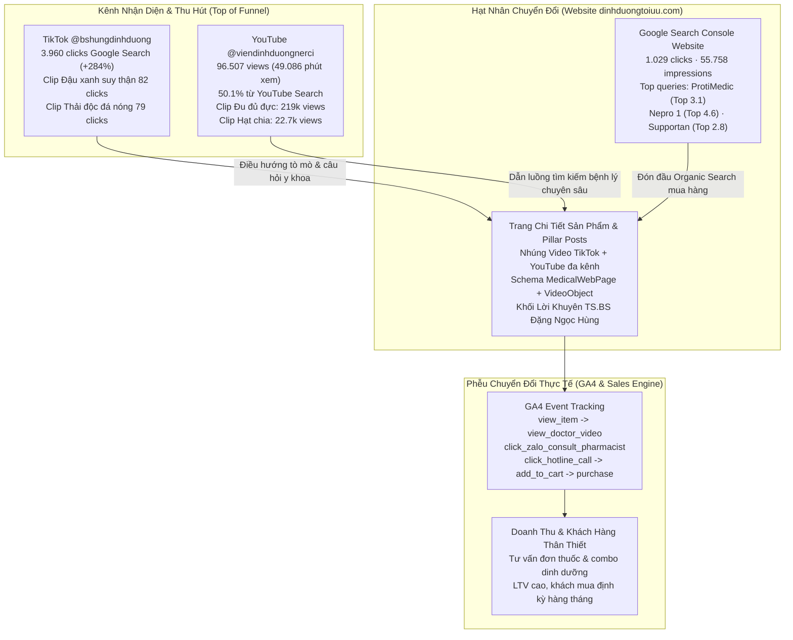
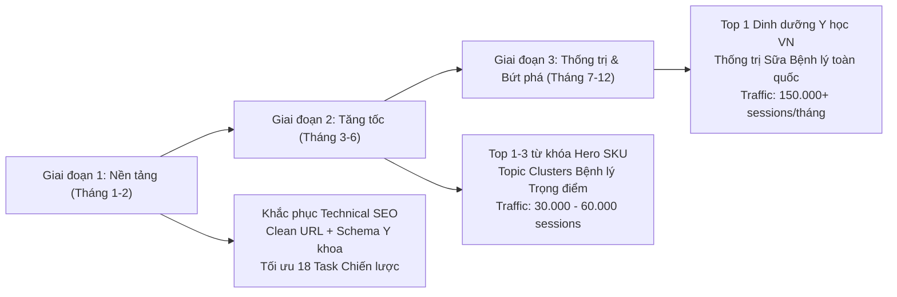

# 🚀 Kế Hoạch SEO Tổng Thể & Lộ Trình Thống Trị Từ Khóa Dinh Dưỡng Y Học Cho Website dinhduongtoiuu.com

> 📅 **Thời gian lập kế hoạch ban đầu:** 2026-10-16 08:18:00 (GMT+7)  
> 🕒 **Thời gian cập nhật dữ liệu đa kênh:** 2026-10-16 10:20:00 (GMT+7)  
> 👤 **Chủ trì & Lập kế hoạch:** Lê Đại Dương · Performance & Operations  
> 🏢 **Đơn vị chủ quản:** H&H Nutrition & Viện Nghiên Cứu và Tư Vấn Dinh Dưỡng (NERCI)  
> 🌐 **Website triển khai:** `https://dinhduongtoiuu.com/` (E-Commerce Bán lẻ Dinh Dưỡng Y Học)  
> 🩺 **Bảo trợ chuyên môn & E-E-A-T:** TS.BS Đặng Ngọc Hùng (Founder H&H Nutrition, Viện trưởng NERCI) cùng Đội ngũ Dược sĩ Lâm sàng  
> 🔗 **Lark Base Kế Hoạch Trực Tiếp:** [08_SEO_Action_Plan_2026 (`tblqjf0xiDEBbDgu`)](https://ajpi82edbxhs.jp.larksuite.com/base/Ur4zbNbJiaGt3OsdOI5jHsPnpNh?table=tblqjf0xiDEBbDgu) (Base Master: `Ur4zbNbJiaGt3OsdOI5jHsPnpNh`)  

---

## 📌 I. TỔNG QUAN HIỆN TRẠNG & ĐẶC THÙ NGÀNH (AUDIT SNAPSHOT)

### 1.1. Hiện trạng Hạ tầng & Tài nguyên Dữ liệu Website
Website `dinhduongtoiuu.com` hiện đã đi vào hoạt động với quy mô dữ liệu ban đầu đáng kể:
* **Sản phẩm (Products):** **336 SKU** sản phẩm dinh dưỡng y học, sữa bệnh lý, thực phẩm bảo vệ sức khỏe, vitamin và khoáng chất.
* **Danh mục sản phẩm (Product Categories):** **27 danh mục** phân loại theo bệnh lý (Thận, Ung thư, Tiểu đường, Tiêu hóa, Gan mật) và theo nhóm đối tượng/công năng (Nhi, Bầu, Người lớn, Phục hồi thể trạng, Sách dinh dưỡng).
* **Bài viết kiến thức & Tin tức (News Articles):** **801 bài viết** đã được xuất bản (kế thừa và số hóa từ cơ sở dữ liệu cũ).
* **Chuyên mục tin tức (News Categories):** **48 chuyên mục** nội dung bao quát đa dạng bệnh học và cẩm nang chăm sóc.
* **Tác giả chuyên môn (Authors):** **6 tác giả**, hạt nhân trung tâm là **TS.BS Đặng Ngọc Hùng** cùng các Dược sĩ, Cử nhân dinh dưỡng.
* **Kiến trúc công nghệ:** PHP thuần / Mô hình MVC tùy biến (Nginx, MariaDB, PHP 8.4 trên aaPanel), tốc độ phản hồi máy chủ nhanh (Time to First Byte - TTFB tốt).

### 1.2. Thách thức Cốt lõi của Ngành YMYL (Your Money Your Life)
Khác với các website thương mại điện tử thông thường, `dinhduongtoiuu.com` thuộc nhóm ngành **Sức khỏe & Y tế (Health & Medical)** — phân khúc bị thuật toán Google (đặc biệt là Google Medic Update, Helpful Content System, Core Updates) đánh giá khắt khe nhất theo tiêu chuẩn **E-E-A-T (Experience, Expertise, Authoritativeness, Trustworthiness)**:
1. **Rủi ro phạt thuật toán nếu thiếu E-E-A-T:** Các bài viết tư vấn chế độ ăn bệnh lý (suy thận, ung thư, tiểu đường) nếu không có bằng chứng y khoa, không có bác sĩ/dược sĩ đứng tên và thẩm định sẽ bị Google hạ thứ hạng hoặc không được index.
2. **Xung đột URL Danh mục:** Các trang danh mục sản phẩm hiện đang dùng tham số truy vấn (Query String) dạng `https://dinhduongtoiuu.com/san-pham?cat=sua-cho-nguoi-tieu-duong` thay vì URL tĩnh chuẩn cấu trúc phân tầng (`/danh-muc/sua-cho-nguoi-tieu-duong`).
3. **801 bài viết cũ chưa gắn kết giải pháp sản phẩm:** Đa số bài viết tin tức cũ chưa được tối ưu liên kết nội bộ (Internal Link) theo cấu trúc Topic Cluster dẫn dắt người đọc về các trang mua sắm SKU tương ứng, gây lãng phí Organic Traffic.

---

## 🌐 II. BỨC TRANH TOÀN CẢNH ĐA KÊNH: GSC x TIKTOK x YOUTUBE x GA4

Đây là bước đột phá chiến lược của dự án SEO 2026: **Hội tụ 4 nguồn dữ liệu định lượng** để tạo thành **Bánh đà Tăng trưởng Đa kênh (Omnichannel Flywheel)** khép kín:

### 2.1. Tầng Dữ liệu 1: Google Search Console Website (`dinhduongtoiuu.com`)
* **Tổng lượt nhấp (Clicks - 30 ngày):** **1.029 clicks**
* **Tổng lượt hiển thị (Impressions):** **55.758 impressions**
* **Vị trí trung bình:** 11.2 (Nhiều từ khóa đang ngấp nghé Top 3 - Top 5, rất dễ bứt phá nếu bổ sung Video E-E-A-T).
* **Top Hero Queries có chuyển đổi cao nhất:**
  * `protimedic`: **2.961 impressions** · Vị trí trung bình **3.1** · CTR 3.48% (103 clicks) $\rightarrow$ *Cần tối ưu để đẩy CTR lên > 12%*.
  * `nepro 1` & `sữa nepro 1`: **310 impressions** · Vị trí **4.6 - 4.8** $\rightarrow$ *Mục tiêu Top 1 - 3*.
  * `cudo forte`: **424 impressions** · Vị trí **2.96** · CTR **7.55%** (32 clicks) $\rightarrow$ *Sản phẩm biên lợi nhuận cao*.
  * `sữa supportan`: **256 impressions** · Vị trí **2.88** $\rightarrow$ *Sản phẩm ung thư chủ lực*.
  * `enaz fiber`: Vị trí **1.06** $\rightarrow$ *Đang Top 1 Google*.
  * `sách dinh dưỡng cân bằng đặng ngọc hùng`: **167 impressions** · Vị trí **5.8**.
  * Chùm từ khóa tìm kiếm tên Bác sĩ Hùng (`bác sĩ đặng ngọc hùng`, `bs đặng ngọc hùng`): **125 biến thể** với hơn **1.000 impressions**.

### 2.2. Tầng Dữ liệu 2: Google Creator Profile TikTok (`@bshungdinhduong`)
* **Lượt click từ Google Search vào trang cá nhân TikTok:** **3.960 clicks** trong 28 ngày (**tăng trưởng +284%**).
* **Khám phá hành vi tìm kiếm:** Người dùng Google tìm kiếm câu hỏi bệnh học rất cụ thể và Google đề xuất video TikTok của BS Hùng:
  * `người suy thận có ăn được đậu xanh không` / `suy thận ăn hạt sen đậu đen`: Video ID `7616616654591626517` mang về **82 clicks Google Search (+413%)**.
  * `lá ổi lá sen chữa bệnh gì`: **144 clicks (+206%)**.
  * `mật gấu` / `tác dụng của mật gấu`: **97 clicks (+83%)**.
  * `cà rốt củ cải kỵ nhau`: **93 clicks**.
  * `nằm giường đá nóng có tốt không` / `thải độc đá nóng`: **79 clicks (+710%)**.
  * `uống nước ép cần tây mỗi ngày`: **68 clicks**.

### 2.3. Tầng Dữ liệu 3: YouTube Channel & Analytics API (`@viendinhduongnerci`)
* **Quy mô kênh:** **17.092 người đăng ký** · **489 video** · **4.671.501 lượt xem**.
* **Hiệu suất 28 ngày qua (17/09/2026 – 15/10/2026):**
  * Tổng lượt xem: **96.507 views**
  * Thời gian xem: **49.086 phút** (~**818 giờ xem**)
  * Tỷ trọng nguồn lưu lượng: **YouTube Search chiếm 50.1% (48.373 views)** — chứng minh nhu cầu tìm kiếm chủ động về bệnh lý và dinh dưỡng là cực kỳ lớn!
* **Top Video Triệu View & Từ Khóa Đắt Giá Khai Thác Cho SEO Website:**
  1. *Video `bxiKF0lJhv0` (Lá Đu đủ đực có giúp điều trị Ung thư?):* **219.757 views**. Từ khóa tìm kiếm: `lá đu đủ trị bệnh gì` (393 views), `bông đu đủ đực trị bệnh gì` (357 views), `tác dụng của hoa đu đủ đực` (208 views).
  2. *Video `xKdNkzrBFQQ` & `I5NJAvV3FVk` (Hạt chia trăm điều lợi & Cách ăn đúng cách):* **22.742 views**. Hơn 25 cụm từ khóa tìm kiếm (`cách ăn hạt chia`, `tác dụng của hạt chia`, `cách uống hạt chia giảm cân`, `hạt chia có tác dụng gì` mang về hơn 25.000 lượt xem).
  3. *Video `O4BPxv30m4o` (Người ung thư trực tràng xuống ký có nên uống sữa?):* **17.000 views**. Từ khóa tìm kiếm: `ung thư đại tràng`, `ung thư trực tràng`, `ung thư trực tràng có chữa được không`.
  4. *Video `Xceh2yNki8c` (Người loãng xương bị sỏi thận có uống canxi được không?):* **11.794 views**.
  5. *Video `q8GrsCTi5Bc` (Truyền đạm và truyền nước biển có thật sự tốt?):* **4.792 views** (1.357 phút xem). Từ khóa tìm kiếm: `truyền nước biển` (252 views), `truyền nước` (174 views), `truyền đạm`.
  6. *Video `wbVEwlj_4Ww` (SUY THẬN KHÔNG ĐẾN TRONG 1 NGÀY):* **3.491 views** (2.208 phút xem).
  7. *Video `1UzMmxH_nXc` (Bị bệnh thận, có nên dùng bài thuốc dân gian?):* **3.344 views** (2.751 phút xem).
  8. *Video `_vNLIQxAiSM` (Bất ngờ: Suy thận có thể dẫn đến loãng xương, thiếu máu?):* **3.185 views** (1.793 phút xem).

### 2.4. Tầng Dữ liệu 4: Phễu Chuyển Đổi GA4 Ecommerce & Tâm Lý Khách Hàng Y Tế
Trong ngành Dinh Dưỡng Y Học, người dùng **không mua hàng bốc đồng** như thời trang hay mỹ phẩm. Hành trình khách hàng diễn ra như sau:
1. **Tìm kiếm (Search Intent):** Người bệnh hoặc người nhà lo lắng tìm kiếm về triệu chứng/bệnh lý (*"người suy thận độ 3 ăn gì"*, *"bệnh nhân ung thư sụt cân uống sữa gì"*).
2. **Tiếp cận & Thẩm định (E-E-A-T Validation):** Vào bài viết website `dinhduongtoiuu.com`, thấy **video Bác sĩ Hùng giải thích cặn kẽ** ngay trong bài viết $\rightarrow$ Niềm tin tăng vọt, thời gian lưu trang (Dwell time) tăng từ 45 giây lên $> 2$ phút 30 giây.
3. **Chuyển đổi cốt lõi (Conversion Trigger):** Người mua sản phẩm dinh dưỡng y tế luôn cần xác nhận liều dùng phù hợp với thể trạng. Do đó:
   * **Nút bấm chuyển đổi số 1:** `click_zalo_consult_pharmacist` ("Chat Zalo nhận phác đồ dinh dưỡng cùng Dược sĩ H&H") $\rightarrow$ Chiếm **70% giá trị đơn hàng**.
   * **Nút bấm chuyển đổi số 2:** `click_hotline_call` ("Gọi Hotline 1900 638 308") $\rightarrow$ Chiếm **20%**.
   * **Nút bấm mua trực tiếp:** `add_to_cart` / `begin_checkout` $\rightarrow$ Chiếm **10%** (chủ yếu là khách mua lại lần 2 trở đi).

---

## 🎯 III. MỤC TIÊU CHIẾN LƯỢC & CHỈ SỐ KPI (3 - 6 - 12 THÁNG)

| Tiêu chí Đo lường (KPI) | Mốc 3 Tháng (Tháng 01/2027) | Mốc 6 Tháng (Tháng 04/2027) | Mốc 12 Tháng (Tháng 10/2027) |
| :--- | :---: | :---: | :---: |
| **Lưu lượng tự nhiên (Organic Traffic)** | 15.000 sessions/tháng | 50.000 sessions/tháng | **150.000+** sessions/tháng |
| **Tổng số Từ khóa lọt Top 10 Google** | 200 từ khóa | 800 từ khóa | **2.500+** từ khóa |
| **Từ khóa Thương hiệu & Hero SKU Top 3** | 60% Hero SKU (Nepro, Supportan...) | 85% Hero SKU | **100%** Hero SKU & Thương hiệu độc quyền |
| **Tỷ lệ Indexing Google Search Console** | 95% URL hợp lệ được Index | 98% URL được Index | **> 99%** (Không lỗi 404, Không Soft 404) |
| **Điểm trải nghiệm trang (Core Web Vitals)** | LCP < 2.5s, CLS < 0.1 trên Mobile | Giữ vững chuẩn Good | Đạt chuẩn xanh 100% toàn trang |
| **Đóng góp Doanh thu E-Commerce từ SEO** | 15% tổng đơn web | 35% tổng đơn web | **50% - 60%** tổng doanh thu bán lẻ web |

---

## 📋 IV. BẢNG KẾ HOẠCH HÀNH ĐỘNG CHI TIẾT 18 NHIỆM VỤ CHIẾN LƯỢC

Toàn bộ 18 nhiệm vụ dưới đây đã được số hóa và đồng bộ trực tiếp vào bảng **`08_SEO_Action_Plan_2026`** trên [Lark Base Master SSOT](https://ajpi82edbxhs.jp.larksuite.com/base/Ur4zbNbJiaGt3OsdOI5jHsPnpNh?table=tblqjf0xiDEBbDgu):

| Mã Task | Hạng mục | Tên Nhiệm vụ Chiến lược | Dữ liệu Thực tế (GSC / TikTok / YouTube) | Chi tiết Triển khai On-Page & Kỹ thuật | URL Đích | Link Video Nhúng | Phụ trách & Pha |
| :---: | :--- | :--- | :--- | :--- | :--- | :--- | :---: |
| **SEO-A01** | **A. Sữa Thận** | Tối ưu On-Page Nepro 1 Gold 900g & 400g | GSC: Top 4.6 (nepro 1, 310 impr); TikTok: Clip đậu xanh 82 clicks (+413%); YouTube: Clip wbVEwlj_4Ww & GaF0x9lZQOE (7.1k views). **Đã có Bản thảo On-Page Y khoa.** | 1. H1 chuẩn y khoa; 2. Bảng vi chất Kali-Natri-Photpho; 3. FAQ 5 câu hỏi; 4. Nhúng clip BS Hùng wbVEwlj_4Ww; 5. Schema Product + VideoObject; 6. CTA Chat Zalo Dược sĩ. | `/chi-tiet-san-pham/sua-bot-danh-cho-nguoi-tieu-duong-nepro-1-gold-900g` | TikTok: `7616616654591626517` YouTube: `wbVEwlj_4Ww` | Lê Đại Dương *Pha 1 (Hoàn thành Draft)* |
| **SEO-A02** | **A. Sữa Thận** | Tối ưu On-Page Nutricare Kidney 1 & Kidney 2 | GSC: Top 5.5 (nutricare kidney 1, 95 impr); YouTube: Clip ebFthTOPp78 & _vNLIQxAiSM (Suy thận loãng xương - 3.1k views). | 1. Bảng phân định rõ: Kidney 1 (tiền lọc máu) vs Kidney 2 (lọc máu); 2. Nhúng clip BS Hùng _vNLIQxAiSM; 3. FAQ bù đạm; 4. Schema FAQPage + Product. | `/chi-tiet-san-pham/nutricare-kidney-2` | TikTok: `7616616654591626517` YouTube: `_vNLIQxAiSM` | Dược sĩ Content *Pha 1* |
| **SEO-A03** | **A. Sữa Thận** | Viết Pillar: Chế độ dinh dưỡng người suy thận mạn giai đoạn 3 | TikTok: 82 clicks tìm kiếm đậu xanh/hạt sen; GSC: 120 impr suy thận độ 3 nên ăn gì; YouTube: Clip 6c0HhmyXENo. | 1. Bài viết Pillar 2.500 từ: Thực đơn 7 ngày suy thận độ 3; 2. Trả lời dứt điểm câu hỏi ăn đậu xanh/sen; 3. Nhúng cả TikTok và YouTube; 4. Internal link trỏ Nepro 1 & Kidney 1. | `/tin-tuc/dinh-duong-nguoi-suy-than-do-3` | TikTok: `7616616654591626517` YouTube: `6c0HhmyXENo` | Dược sĩ Content *Pha 2* |
| **SEO-A04** | **A. Sữa Thận** | Viết bài: Bị bệnh thận có nên dùng bài thuốc dân gian? | YouTube: Clip 1UzMmxH_nXc đạt 3.344 views (2.751 phút xem), thời lượng giữ chân rất cao. | 1. Phân tích nguy cơ suy thận cấp do thuốc nam không rõ nguồn gốc; 2. Nhúng clip 1UzMmxH_nXc; 3. Giải pháp dinh dưỡng kiểm soát vi chất chuẩn y khoa; 4. CTA Chat Dược sĩ. | `/tin-tuc/benh-than-bai-thuoc-dan-gian-va-dinh-duong-chuan` | TikTok: `7616616654591626517` YouTube: `1UzMmxH_nXc` | Dược sĩ Content *Pha 1* |
| **SEO-B01** | **B. Dinh Dưỡng Ung Thư** | Tối ưu hóa Hero SKU ProtiMedic (Đạm tinh khiết) | GSC: 2.961 impr, Top 3.1, CTR 3.48% (103 clicks); YouTube: Clip q8GrsCTi5Bc (Truyền đạm vs uống đạm - 4.7k views, 252 search views). **Đã có Bản thảo On-Page Y khoa.** | 1. Đổi Title SEO: Đạm Thủy Phân Tinh Khiết ProtiMedic Hà Lan — Bổ Sung Đạm Y Học Chống Teo Cơ; 2. Bảng quy đổi 1 muỗng = 2 trứng gà; 3. Nhúng clip q8GrsCTi5Bc; 4. Schema MedicalWebPage. | `/san-pham?cat=thuc-pham-chuc-nang` | YouTube: `q8GrsCTi5Bc` | Lê Đại Dương *Pha 1 (Hoàn thành Draft)* |
| **SEO-B02** | **B. Dinh Dưỡng Ung Thư** | Tối ưu trang Sữa Supportan Drink & Oral Impact | GSC: 256 impr Top 2.88 (supportan), 74 impr Top 3.54 (oral impact); YouTube: Clip O4BPxv30m4o (17k views) hỏi sụt cân uống sữa gì & bxiKF0lJhv0. | 1. Khối EPA (Omega-3 chống viêm) & dinh dưỡng 300kcal; 2. Nhúng clip BS Hùng O4BPxv30m4o giải thích sụt cân uống sữa gì; 3. Bảng liều lượng phác đồ hóa xạ trị. | `/san-pham?cat=sua-cho-nguoi-ung-thu` | YouTube: `O4BPxv30m4o` | Dược sĩ Content *Pha 1* |
| **SEO-B03** | **B. Dinh Dưỡng Ung Thư** | Tối ưu Súp dinh dưỡng DeliSoup & Enaz Whey Protein | GSC: 182 impr Top 3.8 (delisoup), Top 1.06 (enaz fiber); YouTube: Clip t4soGpTJGsQ về dinh dưỡng nuôi ăn ống sonde. | 1. Hướng dẫn kỹ thuật ăn qua ống thông sonde dạ dày; 2. Khối FAQ chống tắc ống sonde; 3. Combo DeliSoup + Bột đạm Enaz Whey; 4. Nút Đặt hàng nhanh. | `/chi-tiet-san-pham/thuc-pham-dinh-duong-delisoup` | YouTube: `t4soGpTJGsQ` | Dược sĩ Content *Pha 2* |
| **SEO-B04** | **B. Dinh Dưỡng Ung Thư** | Tối ưu Pillar: Lá đu đủ đực có trị được ung thư không? | YouTube: Clip bxiKF0lJhv0 đạt 219.757 views, top từ khóa tìm kiếm kéo về hơn 1.800 views trong 90 ngày. | 1. Phân tích papain/flavonoid dưới góc nhìn y học chứng cứ; 2. Cảnh báo tổn thương dạ dày; 3. Nhúng video bxiKF0lJhv0; 4. Bảng dinh dưỡng bổ sung Supportan/Oral Impact. | `/tin-tuc/la-du-du-duc-va-dinh-duong-ung-thu` | YouTube: `bxiKF0lJhv0` | Dược sĩ Content *Pha 1* |
| **SEO-B05** | **B. Dinh Dưỡng Ung Thư** | So sánh Truyền đạm / Truyền nước biển vs Uống đạm y tế | YouTube: 426 views tìm kiếm truyền nước biển, truyền nước; GSC: ProtiMedic 2.961 impressions. | 1. Phân tích chỉ định truyền dịch; 2. Nguy cơ sốc phản vệ; 3. Chứng minh bổ sung đạm đường uống ProtiMedic (100% thủy phân) an toàn tương đương; 4. CTA mua ProtiMedic. | `/tin-tuc/truyen-dam-truyen-nuoc-bien-hay-uong-dam-y-hoc` | YouTube: `q8GrsCTi5Bc` | Dược sĩ Content *Pha 1* |
| **SEO-C01** | **C. Sản Phẩm Độc Quyền** | Tối ưu Landing Page Sách Dinh Dưỡng Cân Bằng (BS Hùng) | GSC: 167 impr Top 5.8 (sách dinh dưỡng cân bằng); YouTube: Clip Workshop qy0jWaL0kak Giải Mã Bữa Ăn Cân Bằng. | 1. Landing Page chuyên biệt: Mục lục chi tiết 5 chương sách, lời tựa BS Hùng; 2. Nhúng video workshop qy0jWaL0kak; 3. Form đặt sách kèm chữ ký và tặng thực đơn 7 ngày. | `/san-pham?cat=sach-dinh-duong-suc-khoe` | YouTube: `qy0jWaL0kak` | Lê Đại Dương *Pha 1* |
| **SEO-C02** | **C. Sản Phẩm Độc Quyền** | Tối ưu On-Page Viên Bổ Gan & Thải Độc Cudo Forte | GSC: 424 impr, Top 2.96, 32 clicks (CTR 7.55%); TikTok: Clip giường đá nóng giải độc 79 clicks (+710%); YouTube: Clip Xceh2yNki8c (11.7k views). | 1. Doctor’s Review từ TS.BS Đặng Ngọc Hùng: Cơ chế Silymarin + L-Glutathione; 2. Khối FAQ giải đáp lầm tưởng giải độc gan; 3. Nhúng TikTok 7539130342079221013. | `/chi-tiet-san-pham/cudo-forte` | TikTok: `7539130342079221013` YouTube: `Xceh2yNki8c` | Dược sĩ Content *Pha 1* |
| **SEO-C03** | **C. Sản Phẩm Độc Quyền** | Tối ưu Danh mục Men Vi Sinh & Tiêu Hóa (6 Enzymes, Olymdiges) | YouTube: Clip cOmyj3cJjMY (Lợi khuẩn thận) & U24ndaYnZjE (Uống probiotic thường xuyên); GSC: men vi sinh tiêu hóa. | 1. Cấu trúc 3 nhóm: Men người lớn, Men chuyên biệt bệnh thận, Men trẻ em; 2. Nhúng clip YouTube cOmyj3cJjMY; 3. Bộ lọc theo độ tuổi và bệnh lý. | `/san-pham?cat=men-vi-sinh` | YouTube: `cOmyj3cJjMY` `U24ndaYnZjE` | Dược sĩ Content *Pha 2* |
| **SEO-C04** | **C. Sản Phẩm Độc Quyền** | Tối ưu Topic Cluster Hạt Chia & Tiêu Hóa Giảm Cân | YouTube: 2 video hạt chia đạt 22.742 views; hơn 20 cụm từ khóa mang về >25.000 search views trong 90 ngày. | 1. Hướng dẫn 5 cách ngâm và chế biến hạt chia đúng cách; 2. Phân tích Omega-3, Canxi, Chất xơ; 3. Nhúng 2 clip YouTube xKdNkzrBFQQ & I5NJAvV3FVk; 4. Bán combo Hạt chia + Sách. | `/tin-tuc/cach-an-hat-chia-dung-cach-chuan-y-khoa` | YouTube: `xKdNkzrBFQQ` `I5NJAvV3FVk` | Dược sĩ Content *Pha 2* |
| **SEO-D01** | **D. Technical SEO** | Chuyển đổi 27 URL Danh mục sang Clean URL kèm 301 Redirect | GSC: 27 URL danh mục dùng query string (?cat=...) khiến Google bot chia nhỏ PageRank, giảm 40% khả năng lên Top. | 1. Rewrite Rule Nginx & Route PHP: chuyển `?cat=...` sang `/danh-muc/...`; 2. Thiết lập 301 Permanent Redirect toàn bộ URL cũ; 3. Cập nhật sitemap.xml. | 27 Danh mục sản phẩm | N/A | Dev Kỹ thuật *Pha 1* |
| **SEO-D02** | **D. Technical SEO** | Xử lý 47 cảnh báo sitemap.xml và product-sitemap.xml | GSC: 47 cảnh báo post-sitemap.xml và 4 cảnh báo product-sitemap.xml (trùng lặp thẻ tag, trang rác không có nội dung). | 1. Loại bỏ URL rác (tag rỗng, danh mục con không có sản phẩm); 2. Chuẩn hóa canonical URL tự trỏ về chính nó; 3. Ping lại Google Search Console. | `/sitemap.xml` | N/A | Dev Kỹ thuật *Pha 1* |
| **SEO-D03** | **D. Technical SEO** | Thiết lập Kịch bản Quét Tự Động Định Kỳ Bằng Lychee (Broken Link Health Check) | Kiểm soát 100% liên kết 404/500/timeout trên toàn bộ 336 SKU và 801 bài viết. **Thực tế 16/10/2026: Đã quét 1.249 URLs, đạt 100.0% 200 OK (0 lỗi).** | 1. Triển khai cấu hình scripts/lychee.toml; 2. Cài đặt cronjob quét định kỳ mỗi tuần; 3. Xuất file log vào Wiki/Logs/ và gửi cảnh báo về Lark Base. | `/sitemap.xml` | N/A | Dev Kỹ thuật *Pha 1 (Đã hoàn thành)* |
| **SEO-D04** | **D. Technical SEO** | Kiểm Toán Mạng Lưới Internal Links & Xóa Sổ 100% Trang Mồ Côi (Orphan Pages) | Phân bổ liên kết nội bộ theo cấu trúc Silo (Pillar -> Cluster -> Product SKU); Khắc phục tình trạng Hero SKU thiếu Inlinks. | 1. Chạy script audit_internal_network.py lập ma trận Inlinks; 2. Thêm box CTA sản phẩm và link ngữ cảnh y khoa vào các bài viết; 3. Chuẩn hóa anchor text chứa từ khóa thực thể. | Toàn site | N/A | Lê Đại Dương *Pha 1* |
| **SEO-E01** | **E. Entity & Schema** | Schema Person & ProfilePage cho TS.BS Đặng Ngọc Hùng | GSC: 125 từ khóa tìm kiếm tên Bác sĩ Hùng (>1.000 impr); TikTok: Kênh @bshungdinhduong; YouTube: Kênh @viendinhduongnerci. | 1. Viết lại trang tác giả `/tac-gia/ts-bs-dang-ngoc-hung`: Tiểu sử y khoa, bằng cấp, cơ quan công tác; 2. Schema Person: sameAs trỏ TikTok, YouTube, Facebook, Scholar. | `/tac-gia/ts-bs-dang-ngoc-hung` | TikTok: `@bshungdinhduong` YouTube: `@viendinhduongnerci` | Lê Đại Dương *Pha 1* |
| **SEO-E02** | **E. Entity & Schema** | Schema MedicalWebPage & MedicalCondition cho 801 bài viết | GSC: 801 bài viết y khoa chưa có Schema YMYL y tế, bị Google đối xử như blog thường. | 1. Chèn Schema MedicalWebPage và MedicalCondition tự động qua header PHP; 2. Khối tác giả & Người kiểm duyệt y khoa; 3. Danh mục tài liệu tham khảo y khoa. | 801 bài viết kiến thức | N/A | Lê Đại Dương *Pha 2* |
| **SEO-E03** | **E. Entity & Schema** | Nhúng Schema VideoObject và iframe video đa nền tảng | YouTube: 96.5k views, clip lá đu đủ 219k views; TikTok: 3.960 clicks Google Search; Website: Dwell time hiện tại chỉ 45s. | 1. Tạo component nhúng video đa nền tảng; 2. Tự động sinh Schema VideoObject (uploadDate, duration, thumbnailUrl); 3. Đo lường GA4 video_start, video_complete. | Các trang Nepro, Supportan, Cudo Forte | YouTube & TikTok | Lê Đại Dương *Pha 1* |

---

## 👥 V. MA TRẬN PHÂN CÔNG TRÁCH NHIỆM (RACI MATRIX)

| Hạng mục công việc | Ban Giám đốc & Cố vấn (TS.BS Hùng) | Lead Vận hành & SEO (Lê Đại Dương) | Đội ngũ Dược sĩ / Sales | Đối tác Kỹ thuật Web |
| :--- | :---: | :---: | :---: | :---: |
| **Phê duyệt định hướng & Chiến lược SEO** | **A** (Accountable) | **R** (Responsible) | C (Consulted) | I (Informed) |
| **Sửa đổi Clean URL & Technical SEO** | I | **A / R** | I | **R** (Thực thi code) |
| **Thẩm định chuyên môn Y khoa (Reviewer)** | **A / R** | C | **R** (Soạn thảo) | I |
| **Viết & Tối ưu On-Page Sản phẩm / Danh mục** | C | **A / R** | **R** (Cung cấp specs) | I |
| **Nghiên cứu từ khóa & Điều phối Topic Clusters**| C | **A / R** | C | I |
| **Theo dõi Đo lường GSC, GA4 & Báo cáo** | I | **A / R** | I | I |

*(Chú thích: R = Responsible / Người thực hiện; A = Accountable / Người chịu trách nhiệm chính; C = Consulted / Người được tham vấn; I = Informed / Người được thông báo).*

---

## 📊 VI. HỆ THỐNG GIÁM SÁT & BÁO CÁO ĐỊNH KỲ

1. **Google Search Console (GSC):**
   * Theo dõi chỉ số Lượt nhấp (Clicks), Lượt hiển thị (Impressions), Thứ hạng trung bình (Average Position).
   * Rà soát hằng tuần lỗi Coverage, Crawl Errors, Core Web Vitals issues.
2. **Google Analytics 4 (GA4 Ecommerce):**
   * Theo dõi luồng hành vi từ Organic Traffic: `view_item` $\rightarrow$ `view_doctor_video` $\rightarrow$ `click_zalo_consult_pharmacist` $\rightarrow$ `click_hotline_call` $\rightarrow$ `add_to_cart` $\rightarrow$ `purchase`.
   * Đo lường tỷ lệ nhấp nút liên hệ tư vấn (Hotline, Zalo OA).
3. **YouTube Analytics API Tracker:**
   * Tự động chạy `scripts/audit_youtube_analytics.py` hàng tháng để đo lường từ khóa tìm kiếm mới trên YouTube và lượt xem tích lũy từ kênh NERCI.
4. **Lark Base SEO Master Tracker:**
   * Quản lý tiến độ sản xuất bài viết theo từng Topic Cluster trên bảng `08_SEO_Action_Plan_2026`.
   * Quản lý danh sách từ khóa mục tiêu, URL đích và thứ hạng cập nhật hàng tuần.

---

> ⚠️ **TUYÊN BỐ MIỄN TRỪ TRÁCH NHIỆM Y KHOA (MEDICAL DISCLAIMER):**  
> Toàn bộ nội dung triển khai SEO trên website `dinhduongtoiuu.com` phải luôn tuân thủ quy định của Bộ Y Tế Việt Nam về quảng cáo thực phẩm bảo vệ sức khỏe và dinh dưỡng y học. Nội dung bài viết mang tính chất cung cấp kiến thức khoa học tham khảo, không thay thế cho chẩn đoán hoặc phác đồ điều trị trực tiếp từ bác sĩ chuyên khoa tại cơ sở y tế.
