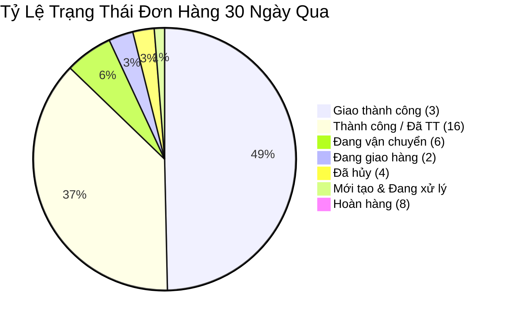

---
tags:
  - "log"
  - "pancake"
  - "pos"
  - "nerci"
  - "hh-nutrition"
  - "sales-report"
  - "revenue-audit"
topics:
  - "[[quan-tri-du-an-website-dinhduongtoiuu]]"
status: completed
created: 2026-10-22
updated: 2026-10-22
timestamp: "2026-10-22 15:16:00 (GMT+7)"
sources: []
source_count: 0
aliases:
  - "Báo Cáo Doanh Thu Bán Hàng Pancake POS 30 Ngày NERCI"
---

# Báo Cáo Kiểm Toán Doanh Thu & Bán Hàng Pancake POS 30 Ngày: Shop Nerci

> **Thời gian cập nhật:** 2026-10-22 15:16:00 (GMT+7)  
> **Cơ sở dữ liệu:** Pancake POS API · Shop ID: `1022021128` (Nerci / H&H Nutrition)  
> **Kỳ phân tích:** 30 ngày gần nhất (22/09/2026 ➔ 22/10/2026)  
> **Phụ trách:** Lê Đại Dương · Performance & Operations  
> **Đơn vị:** Viện Nghiên Cứu & Tư Vấn Dinh Dưỡng (NERCI) & H&H Nutrition

---

  

    PANCAKE POS ENTERPRISE RETAIL & OMNICHANNEL AUDIT
  

  <h1 style="margin: 6px 0 12px 0; color: white; border: none; padding: 0; font-size: 26px; font-weight: 800; line-height: 1.3;">
    🎯 BÁO CÁO TOÀN DIỆN DOANH SỐ BÁN HÀNG PANCAKE POS (30 NGÀY QUA)
  </h1>
  

    Tổng hợp trực tiếp từ <strong>1.029 đơn hàng thực tế</strong> phát sinh từ ngày 22/09 đến 22/10/2026 qua hệ thống Pancake POS Shop Nerci.
  

  

    📦 <strong>Tổng Đơn Hàng:</strong> 1.029 đơn (~34 đơn/ngày)
    💰 <strong>Tổng Doanh Thu:</strong> 1,270,953,835 VNĐ (~1.27 Tỷ Đồng)
    ✅ <strong>Đơn Thành Công:</strong> 894 đơn (86.88%)
    💎 <strong>Doanh Thu Thực Nhận:</strong> 1,125,147,986 VNĐ (~1.13 Tỷ Đồng)
    📊 <strong>Giá Trị Trung Bình Đơn (AOV):</strong> 1,235,135 VNĐ/đơn
  

---

## 📌 I. TỔNG QUAN CHỈ SỐ KINH DOANH CỐT LÕI (30 NGÀY QUA)

| Chỉ Số Đo Lường (KPIs) | Giá Trị Thực Tế Từ Pancake POS | Tỷ Lệ / Nhận Định Hiệu Năng |
| :--- | :---: | :--- |
| **Tổng Số Đơn Hàng Khởi Tạo** | **1,029 Đơn** | Trung bình ~34.3 đơn hàng/ngày |
| **Tổng Doanh Thu Niêm Yết** | **1,270,953,835 VNĐ** | Đạt trung bình ~42.36 triệu VNĐ/ngày |
| **Đơn Giao Thành Công / Thanh Toán** | **894 Đơn** | **Tỷ lệ thành công vượt trội: 86.88%** |
| **Doanh Thu Thực Nhận (Thành Công)** | **1,125,147,986 VNĐ** | Đóng góp 88.5% tổng doanh số toàn shop |
| **Giá Trị Trung Bình Một Đơn (AOV)** | **1,235,135 VNĐ** | Thuộc phân khúc dinh dưỡng y học giá trị cao |
| **Đơn Hàng Bị Hủy (Cancelled)** | **27 Đơn** | Tỷ lệ hủy rất thấp: **2.62%** |
| **Đơn Hoàn Hàng (Returned)** | **4 Đơn** | Tỷ lệ hoàn hàng cực thấp: **0.39%** |
| **Thanh Toán Trả Trước (Chuyển khoản)** | **806,075,682 VNĐ** | **Chiếm 63.42%** (Khách hàng tin tưởng thanh toán trước) |
| **Thu Hộ Khi Giao Hàng (COD)** | **463,115,133 VNĐ** | Chiếm 36.58% |
| **Tổng Tiền Chiết Khấu / Giảm Giá** | **14,258,476 VNĐ** | Chiếm chỉ 1.12% tổng doanh thu |

---

## 🚦 II. BẢNG PHÂN BỔ TRẠNG THÁI ĐƠN HÀNG CHI TIẾT

| Trạng Thái Xử Lý (Status) | Mã Trạng Thái | Số Lượng Đơn | Tỷ Lệ Đơn (%) | Doanh Thu Tương Ứng (VNĐ) | Tỷ Trọng Doanh Thu |
| :--- | :---: | :---: | :---: | :---: | :---: |
| 🏆 **Giao thành công (Delivered)** | `3` | **509 đơn** | 49.47% | 547,274,044đ | 43.06% |
| 💳 **Thành công / Đã thanh toán (Succeeded)** | `16` | **385 đơn** | 37.41% | 577,873,942đ | 45.47% |
| 🚚 **Đang vận chuyển (In Transit)** | `6` | **60 đơn** | 5.83% | 71,091,464đ | 5.59% |
| 🛵 **Đang giao hàng (Out for Delivery)** | `2` | **31 đơn** | 3.01% | 18,671,642đ | 1.47% |
| ❌ **Đã hủy đơn (Cancelled)** | `4` | **27 đơn** | 2.62% | 22,001,651đ | 1.73% |
| 🆕 **Mới tạo (New)** | `1` | **10 đơn** | 0.97% | 22,673,100đ | 1.78% |
| 🔄 **Đã hoàn hàng về kho (Returned)** | `8` | **4 đơn** | 0.39% | 2,742,992đ | 0.22% |
| 📦 **Chờ lấy hàng (Packing)** | `5` | **2 đơn** | 0.19% | 2,325,000đ | 0.18% |
| 📝 **Nháp (Draft)** | `0` | **1 đơn** | 0.10% | 6,300,000đ | 0.50% |
| **TỔNG CỘNG** | — | **1,029 đơn** | **100%** | **1,270,953,835đ** | **100%** |

---

## 👩‍💼 III. BẢNG XẾP HẠNG HIỆU SUẤT TƯ VẤN VIÊN (STAFF LEADERBOARD)

| Hạng | Tên Nhân Viên / Tư Vấn Viên | Tổng Đơn Tạo | Tổng Doanh Thu (VNĐ) | Đơn Thành Công | Doanh Thu Thành Công (VNĐ) | Tỷ Lệ Thành Công | Tỷ Trọng Doanh Thu |
| :---: | :--- | :---: | :---: | :---: | :---: | :---: | :---: |
| 🥇 | **Hồ Dương Xuân Diệu** | **387 đơn** | **781,414,574đ** | **369 đơn** | **737,409,154đ** | **95.35%** | **61.48%** |
| 🥈 | **Nguyễn Thị Hồng Yến** | **160 đơn** | **221,546,750đ** | **129 đơn** | **180,532,000đ** | **80.62%** | **17.43%** |
| 🥉 | **Nguyễn Vũ Bảo Như** | **140 đơn** | **170,212,400đ** | **117 đơn** | **141,115,400đ** | **83.57%** | **13.39%** |
| 4 | **nguyenngocthaomy9c** | **282 đơn** | **76,389,662đ** | **240 đơn** | **58,978,634đ** | **85.11%** | **6.01%** |
| 5 | **Hữu Nhã** | **30 đơn** | **6,118,875đ** | **27 đơn** | **5,302,338đ** | **90.00%** | **0.48%** |
| 6 | **Đặng Hoàng Anh Thư** | 2 đơn | 2,297,750đ | 1 đơn | 232,750đ | 50.00% | 0.18% |
| 7 | **Nguyễn Phương Uyên** | 1 đơn | 700,000đ | 0 đơn | 0đ | 0.00% | 0.05% |
| 8 | **Chưa phân công / Khác** | 27 đơn | 12,273,824đ | 11 đơn | 1,577,710đ | 40.74% | 0.97% |

> [!abstract] **Nhận Xét Năng Lực Đội Ngũ Bán Hàng:**
> 1. **Nhân tố gánh vác doanh số số 1:** **Hồ Dương Xuân Diệu** là nhân sự xuất sắc nhất toàn hệ thống, tạo ra **781.4 triệu VNĐ doanh số** (chiếm hơn 61% tổng doanh thu), tỷ lệ đơn thành công đạt tới **95.35%**.
> 2. **Bộ ba trụ cột tư vấn:** **Hồ Dương Xuân Diệu + Nguyễn Thị Hồng Yến + Nguyễn Vũ Bảo Như** đóng góp **1.173 Tỷ Đồng (92.3% tổng doanh số)** của Viện và H&H Nutrition.
> 3. **Nhân sự chuyên trách đơn nhỏ/sách:** **nguyenngocthaomy9c** phụ trách số lượng đơn lớn thứ 2 (282 đơn) chuyên về các dòng sách dinh dưỡng, truyện tranh thiếu nhi và đơn bán lẻ phổ thông.

---

## 🛍️ IV. TOP 15 SẢN PHẨM & DỊCH VỤ BÁN CHẠY NHẤT TRÊN POS

| STT | Tên Sản Phẩm / Dịch Vụ | Số Lượng Đã Bán | Phân Khúc / Công Dụng Điều Trị |
| :-: | :--- | :---: | :--- |
| 1 | **Fomeal Leisure Kidney 1** | **125 hộp** | Dinh dưỡng chuyên biệt cho bệnh nhân suy thận trước lọc máu |
| 2 | **Men vi sinh Cudoforte** | **105 hộp** | Men vi sinh thải độc thận và bảo vệ hàng rào tiêu hóa |
| 3 | **Truyện tranh Guru** | **69 cuốn** | Truyện tranh giáo dục dinh dưỡng cho trẻ em |
| 4 | **Delical Boisson HP HC Edulcorée Vanille** | **68 chai** | Dinh dưỡng cao năng lượng nhập khẩu Pháp |
| 5 | **Proti Medic Neutral** | **60 gói** | Đạm cô đặc thủy phân y học (Hero SKU đạm) |
| 6 | **Nutridream Powder** | **55 hộp** | Bột dinh dưỡng tăng cường thể lực và đề kháng |
| 7 | **NutriDream Vanilla Flavor** | **52 chai** | Dinh dưỡng dạng nước tiện lợi hương vani |
| 8 | **Sách "Dinh Dưỡng Cân Bằng – Ăn trong tỉnh thức"** | **43 cuốn** | Sách chuyên môn của Bác sĩ Đặng Ngọc Hùng |
| 9 | **truyen-combo1 (Truyện tranh dinh dưỡng)** | **41 bộ** | Combo truyện tranh dinh dưỡng Guru cho bé |
| 10 | **Fomeal Peptide** | **40 hộp** | Dinh dưỡng peptide thủy phân cho người kém hấp thu |
| 11 | **Ensure Plus Advance 1.5Kcal** | **29 chai** | Sữa phục hồi cơ bắp và chống teo cơ |
| 12 | **Supportan Drink Cappuccino** | **25 chai** | Dinh dưỡng chuyên biệt cho bệnh nhân ung thư |
| 13 | **Sách "Từ Đối Đầu Sang Hoà Hợp - Bệnh Thận Mạn"** | **21 cuốn** | Cẩm nang chăm sóc và dinh dưỡng cho bệnh nhân thận |
| 14 | **full - Truyện tranh Guru** | **17 bộ** | Trọn bộ truyện tranh dinh dưỡng |
| 15 | **Fomeal Leisure Cerna** | **15 hộp** | Dinh dưỡng cho bệnh nhân đái tháo đường |

---

## 🌐 V. DOANH SỐ THEO KÊNH / FANPAGE TIẾP NHẬN

| Kênh Bán Hàng / Fanpage Nguồn | Số Lượng Đơn | Doanh Thu (VNĐ) | Tỷ Trọng Doanh Thu |
| :--- | :---: | :---: | :---: |
| 🔵 **HH Nutrition** | **259 đơn** | **538,453,862đ** | **42.37%** |
| 🏬 **Khác / Trực tiếp (Showroom & Hotline)** | **319 đơn** | **375,161,840đ** | **29.52%** |
| 🌿 **H&H Nutrition - Sản phẩm dinh dưỡng y học** | **52 đơn** | **141,366,000đ** | **11.12%** |
| 🩺 **H&H - Dinh dưỡng tối ưu** | **60 đơn** | **126,284,772đ** | **9.94%** |
| 🏛️ **H&H Nutrition - NERCI** | **290 đơn** | **51,093,941đ** | **4.02%** |
| 💙 **H&H Nutrition (Secondary)** | **47 đơn** | **37,388,420đ** | **2.94%** |
| 📅 **Đặt Lịch - Viện Dinh Dưỡng Nerci** | 1 đơn | 700,000đ | 0.06% |
| 👨‍⚕️ **BS Hùng Dinh Dưỡng - NERCI** | 1 đơn | 505,000đ | 0.04% |
| **TỔNG CỘNG** | **1,029 đơn** | **1,270,953,835đ** | **100%** |
