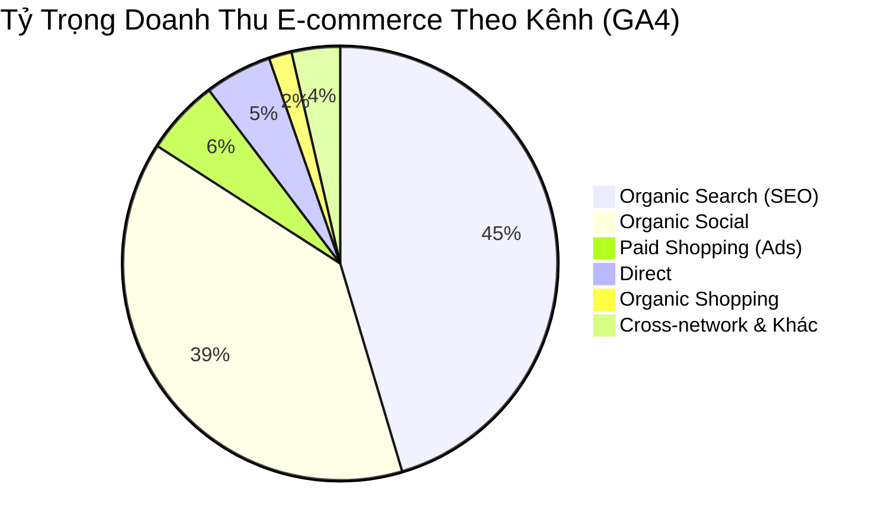

---
tags:
  - "log"
  - "ga4"
  - "gsc"
  - "seo"
  - "ecommerce"
  - "dinhduongtoiuu"
  - "nerci"
topics:
  - "[[ke-hoach-seo-tong-the-website-dinhduongtoiuu]]"
  - "[[quan-tri-du-an-website-dinhduongtoiuu]]"
status: active
created: 2026-10-22
updated: 2026-10-22
timestamp: "2026-10-22 15:05:00 (GMT+7)"
sources: []
source_count: 0
aliases:
  - "Báo Cáo Hợp Nhất GA4 & GSC dinhduongtoiuu.com"
---

# Báo Cáo Hiệu Suất Hợp Nhất GA4 & Google Search Console: dinhduongtoiuu.com

> **Thời gian cập nhật:** 2026-10-22 15:05:00 (GMT+7)  
> **Thuộc tính GA4:** Property ID `370513333` (H&H Nutrition / Dinh Dưỡng Tối Ưu)  
> **Thuộc tính Search Console:** `https://dinhduongtoiuu.com/`  
> **Chu kỳ phân tích:** 30 ngày gần nhất (22/09/2026 – 22/10/2026)  
> **Phụ trách:** Lê Đại Dương · Performance & Operations

---

## 📊 I. TỔNG QUAN HIỆU SUẤT ĐO LƯỜNG (30 NGÀY GẦN NHẤT)

| Chỉ số Đo lường | Nguồn Dữ liệu | Giá trị Thực tế | Đánh giá & Xu hướng |
| :--- | :---: | :---: | :--- |
| **Tổng Lưu lượng Phiên (Sessions)** | GA4 | **15,868 Sessions** | Duy trì mức ổn định cao ~530 phiên/ngày |
| **Người dùng Hoạt động (Active Users)** | GA4 | **12,501 Users** | Lượng người dùng mới tiếp cận rất lớn |
| **Tỷ lệ Thoát (Bounce Rate)** | GA4 | **17.1%** | Rất thấp (người dùng đọc sâu nội dung & sản phẩm) |
| **Sự kiện Then chốt / Chuyển đổi (Key Events)** | GA4 | **34,310 Sự kiện** | Tương tác form, hotline, giỏ hàng, xem chi tiết |
| **Doanh thu E-commerce Trực tiếp** | GA4 | **47,721,300 VNĐ** | Ghi nhận đơn hàng thanh toán trên website |
| **Lượt Nhấp Tìm kiếm Tự nhiên (Clicks)** | GSC | **1,978 Clicks** | Tăng trưởng đều đặn từ SEO Organic |
| **Lượt Hiển thị Google Tìm kiếm (Impressions)** | GSC | **63,051 Lượt** | Độ phủ thương hiệu và sản phẩm trên Google |
| **Tỷ lệ Nhấp Tự nhiên (CTR)** | GSC | **3.14%** | Chuẩn ngành Y Dược & Thực phẩm chức năng |
| **Vị trí Xếp hạng Trung bình** | GSC | **Top 5.8** | Nằm vững chắc trong trang 1 Google |

---

## 🛒 II. PHÂN TÍCH LƯU LƯỢNG & DOANH THU THEO KÊNH (GA4 CHANNEL BREAKDOWN)

| Nhóm Kênh (Default Channel Group) | Lượt Phiên (Sessions) | Người Dùng (Users) | Tỷ lệ Thoát | Chuyển Đổi (Key Events) | Doanh Thu Ghi Nhận (VNĐ) | Tỷ Trọng Doanh Thu |
| :--- | :---: | :---: | :---: | :---: | :---: | :---: |
| 🟢 **Organic Search (SEO Tự nhiên)** | **6,494** | **5,198** | 16.2% | **15,937** | **21,677,800đ** | **45.4%** |
| 🟣 **Organic Social (Mạng xã hội)** | **2,632** | **2,266** | **13.6%** | **5,903** | **18,449,500đ** | **38.7%** |
| 🔵 **Cross-network (Google PMax/Display)** | 2,961 | 2,646 | 19.5% | 4,751 | 745,000đ | 1.6% |
| ⚪ **Direct (Truy cập trực tiếp)** | 1,936 | 1,709 | 22.0% | 3,920 | 2,383,000đ | 5.0% |
| 🟡 **Paid Shopping (Google Shopping)** | 623 | 535 | 21.0% | 937 | 2,688,000đ | 5.6% |
| 🔗 **Referral (Website giới thiệu)** | 581 | 222 | 13.8% | 2,236 | 585,000đ | 1.2% |
| 🛍️ **Organic Shopping** | 95 | 86 | 16.8% | 228 | 800,000đ | 1.7% |
| 🎯 **Paid Search (Từ khóa Google Ads)** | 89 | 45 | 25.8% | 162 | 130,000đ | 0.3% |
| 🤖 **AI Assistant** | 27 | 24 | 18.5% | 64 | 275,000đ | 0.6% |
| ⚠️ **Unassigned & Khác** | 457 | 357 | 17.5% | 1,141 | 480,000đ | 1.0% |

> [!abstract] **Nhận Xét Chiến Lược Về Cơ Cấu Doanh Thu:**
> * **Organic Search (SEO) và Organic Social là 2 cột trụ nuôi sống sàn:** Hai nguồn này chiếm tới **84.1% tổng doanh thu** của `dinhduongtoiuu.com` mà không tốn thêm chi phí cho từng lượt click trực tiếp.
> * **Organic Social có tỷ lệ thoát thấp nhất (13.6%):** Khách hàng đi từ video/bài viết chuyên môn của Bác sĩ Hùng và các kênh mạng xã hội vào website có độ tin cậy và thời gian lưu lại rất cao.
> * **Sự xuất hiện của kênh `AI Assistant`:** Đã bắt đầu có 27 sessions và mang về 275,000đ doanh thu từ các trợ lý AI thế hệ mới (ChatGPT Search, Gemini, Perplexity).

---

## 🔍 III. PHÂN TÍCH TỪ KHÓA TỰ NHIÊN GOOGLE SEARCH CONSOLE (GSC)

### 1. Top 15 Từ Khóa "Xương Sống" Kéo Clicks Nhiều Nhất (Hero Queries)
| STT | Từ khóa (Query) | Lượt Nhấp (Clicks) | Lượt Hiển Thị (Impr) | CTR (%) | Vị Trí Trung Bình | Nhóm Nhu Cầu |
| :-: | :--- | :---: | :---: | :---: | :---: | :--- |
| 1 | **h&h nutrition** | **93** | 195 | **47.69%** | **1.2** | Thương hiệu độc quyền |
| 2 | **protimedic** | **72** | 2,436 | 2.96% | 3.5 | Sữa đạm cô đặc y học |
| 3 | **centrum** | **41** | 1,817 | 2.26% | 2.9 | Vitamin tổng hợp |
| 4 | **hh nutrition** | **39** | 54 | **72.22%** | **1.6** | Thương hiệu viết tắt |
| 5 | **cudo forte** | **26** | 395 | 6.58% | 3.5 | Bổ thận chuyên sâu |
| 6 | **sữa supportan** | **21** | 254 | 8.27% | 4.4 | Dinh dưỡng ung thư |
| 7 | **oral impact** | **17** | 157 | 10.83% | 2.4 | Dinh dưỡng miễn dịch phẫu thuật |
| 8 | **sữa oral impact** | **16** | 66 | 24.24% | 3.3 | Dinh dưỡng miễn dịch phẫu thuật |
| 9 | **canxi citrate** | **14** | 3,032 | 0.46% | 4.2 | Khoáng chất hấp thu cao |
| 10 | **enaz fiber** | **14** | 32 | 43.75% | 1.2 | Dinh dưỡng bổ sung chất xơ |
| 11 | **enzymax kids** | **11** | 592 | 1.86% | 4.3 | Men vi sinh/tiêu hóa trẻ em |
| 12 | **sữa delical** | **10** | 479 | 2.09% | 4.5 | Dinh dưỡng giàu năng lượng |
| 13 | **ensure plus advance** | **9** | 483 | 1.86% | 6.3 | Sữa phục hồi cơ người lớn |
| 14 | **loại kẽm nào tốt cho đàn ông** | **6** | 456 | 1.32% | 8.1 | Bài viết tư vấn sinh lý nam |
| 15 | **thực đơn giảm cân cho người 60kg** | **6** | 276 | 2.17% | 6.7 | Kiến thức dinh dưỡng giảm cân |

---

### 2. Top "Cơ Hội Vàng" — Từ Khóa Lượt Tìm Kiếm Khủng Đang Cận Top (Vị Trí 4.0 – 9.0)
*Đây là nhóm từ khóa có nhu cầu cực lớn (>1.000 tìm kiếm/tháng). Website đã vào trang 1 nhưng chưa lọt Top 3. Tối ưu nhẹ là bùng nổ traffic ngay lập tức:*

* **`canxi citrate`:** 3,032 hiển thị (Top 4.2) ➔ Cần tối ưu thêm đoạn FAQ và thẻ H2 về sự khác biệt giữa Canxi Citrate và Canxi Carbonate.
* **`glucerna`:** 1,460 hiển thị (Top 9.8) ➔ Sữa tiểu đường quốc dân, cần đẩy internal link từ các bài viết tiểu đường về trang sản phẩm Glucerna.
* **`sữa ensure gold`:** 1,446 hiển thị (Top 9.2).
* **`sắt ferrolip bầu`:** 1,339 hiển thị (Top 9.3) ➔ Dòng sắt sinh học cho mẹ bầu, nhu cầu tìm kiếm rất cao.
* **`prosure` & `sữa prosure`:** Gần 2,000 hiển thị (Top 5.0 – 7.8) ➔ Dòng sữa cho bệnh nhân ung thư.
* **`sữa nepro 1` & `nepro 1 gold`:** Gần 1,000 hiển thị (Top 4.7 – 8.2) ➔ Sữa cho bệnh nhân suy thận trước lọc máu.

---

## 🎯 IV. ĐỀ XUẤT HÀNH ĐỘNG CẢI THIỆN THỨ HẠNG & CHUYỂN ĐỔI

1. **On-Page SEO bứt phá Top 3:**
   * Tập trung tối ưu 5 URL sản phẩm: *Canxi Citrate, ProtiMedic, Supportan, Glucerna, Ferrolip Bầu*. Bổ sung đánh giá schema Product, câu hỏi thường gặp (FAQ schema) và bảng thông tin dinh dưỡng chi tiết.
2. **Khai thác tệp Organic Social:**
   * Kênh Organic Social đang đem lại hơn 18.4 triệu VNĐ doanh thu E-com. Cần tiếp tục gắn UTM tracking chuẩn (`utm_source=facebook&utm_medium=video&utm_campaign=bshung`) vào phần mô tả video để bóc tách chính xác video nào mang lại đơn hàng nhiều nhất.
3. **Kiểm tra sơ đồ trang web (Sitemap):**
   * Rà soát lại cảnh báo chuyển hướng trong Search Console đối với `sitemap_index.xml` và `post-sitemap.xml` để đảm bảo Googlebot lập chỉ mục 100% các bài viết dinh dưỡng mới của NERCI.
