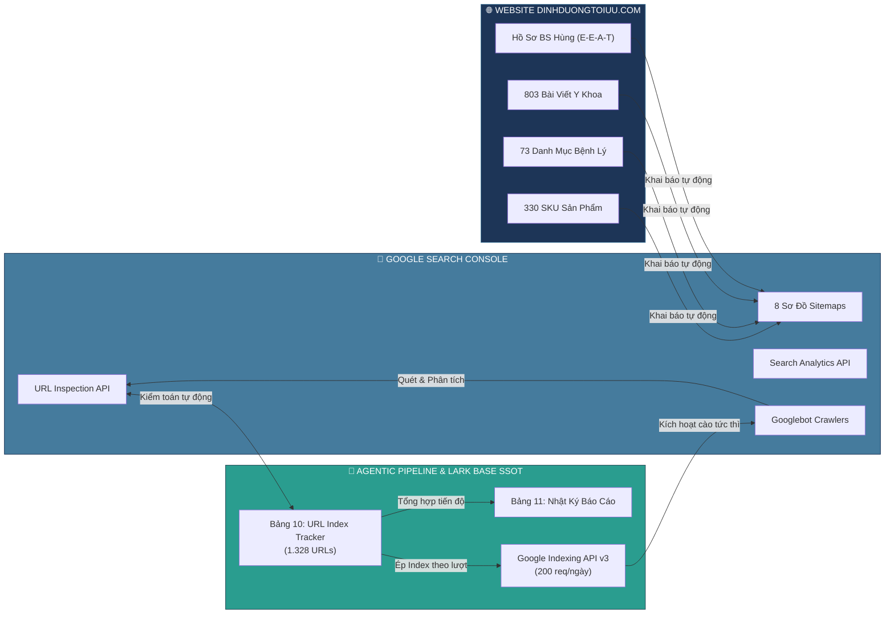

# 🚀 Dự Án Quản Trị Lập Chỉ Mục Google Search Console (GSC) & SEO dinhduongtoiuu.com
> *Cổng thông tin kiểm toán lập chỉ mục, điều phối Google Indexing API v3, giám sát tỷ lệ phủ Googlebot và kết nối dữ liệu thời gian thực giữa Website `dinhduongtoiuu.com` và Lark Base Quản Trị SSOT.*

---

## 🗄️ HỆ THỐNG LIÊN KẾT TRỰC TIẾP LARK BASE SSOT

Toàn bộ **1.328 URLs** và kế hoạch SEO được quản trị tập trung tại Lark Base. Nhấp vào các liên kết bên dưới để truy cập trực tiếp vào hệ thống:

| Tên Bảng Quản Trị Lark Base | Mô Tả & Quy Mô Dữ Liệu | Liên Kết Trực Tiếp (Clickable) |
| :--- | :--- | :---: |
| 🗄️ **Base Tổng Thể Dự Án** | `[NERCI x H&H] Quản Trị Dự Án Website dinhduongtoiuu.com` | [👉 Mở Base Tổng Thể](https://ajpi82edbxhs.jp.larksuite.com/base/Ur4zbNbJiaGt3OsdOI5jHsPnpNh) |
| 📊 **10_GSC_URL_Index_Tracker** | **1.328 URLs** toàn website (330 SKU, 73 danh mục, 803 tin tức, E-E-A-T). Cập nhật trạng thái PASS / Discovered / Unknown thời gian thực. | [👉 Mở Bảng URL Tracker](https://ajpi82edbxhs.jp.larksuite.com/base/Ur4zbNbJiaGt3OsdOI5jHsPnpNh?table=tblgSApnFCmnJ343&view=vewvPnOS2g) |
| 📁 **11_Nhat_Ky_Bao_Cao_SEO_GSC** | Nhật ký báo cáo kiểm toán định kỳ, đính kèm file markdown gốc và tổng hợp chỉ số biến động qua từng ngày. | [👉 Mở Bảng Nhật Ký Báo Cáo](https://ajpi82edbxhs.jp.larksuite.com/base/Ur4zbNbJiaGt3OsdOI5jHsPnpNh?table=tblOCBQxQsBwmlyJ&view=vewWFMppxz) |
| 🎯 **08_SEO_Action_Plan_2026** | 26 Kế hoạch hành động SEO đa kênh (Tối ưu On-page Nepro, Nutricare, Cudo Forte; nhúng clip TikTok BS Hùng & YouTube). | [👉 Mở Bảng Kế Hoạch SEO](https://ajpi82edbxhs.jp.larksuite.com/base/Ur4zbNbJiaGt3OsdOI5jHsPnpNh?table=tblqjf0xiDEBbDgu&view=vewUdlTS9S) |
| ⚡ **04_Action_Items** | Danh mục phân công công việc kỹ thuật, đôn đốc đối tác Web fix lỗi 301/404 (`ACT-24`) và chiến dịch Index theo lượt (`ACT-20`). | [👉 Mở Bảng Action Items](https://ajpi82edbxhs.jp.larksuite.com/base/Ur4zbNbJiaGt3OsdOI5jHsPnpNh?table=tbluGWSS3Kh9Pqi3&view=vewL2g706w) |

---

## 📊 CHỈ SỐ LẬP CHỈ MỤC THỜI GIAN THỰC (Cập nhật 26/10/2026)

- 🟢 **Đã Lập Chỉ Mục (PASS / Indexed):** **733 / 1.317 URLs (55.7%)** 🔥 *(Tăng +40 URLs so với ngày 24/10)*
- 🟡 **Đang Chờ Quét (Discovered):** **368 URLs**
- 🔴 **Đã Quét Chưa Index (Crawled):** **1 URL**
- ⚪ **Chưa Từng Quét (Unknown):** **215 URLs**
- 🏆 **Tỷ Lệ Index Hero SKUs:** **13 / 15 Hero SKUs (86.7%)**
- ⚡ **Tiến Độ Batch Indexing API v3:** **400 / 400 URLs gửi thành công** *(Lượt 1: 200 URLs ngày 24/10 • Lượt 2: 200 URLs ngày 26/10)*

---

### 🔄 Kiến Trúc Luồng Dữ Liệu Đồng Bộ & Lập Chỉ Mục

---

## 📑 DANH MỤC TÀI LIỆU & BÁO CÁO DỰ ÁN

### 1. ⚡ Báo Cáo Kiểm Toán & Thực Thi "Index Theo Lượt" (Indexing API)
- 📄 **[[gsc-indexing/2026-10-26-DinhDuongToiUu-GSC-Index-Action-Report|Báo Cáo Tự Động Hóa Lập Chỉ Mục Google Search Console dinhduongtoiuu.com]]** 🚨 *(Mới nhất)*
- 📄 **[[gsc-indexing/2026-10-24-DinhDuongToiUu-GSC-Index-Action-Report|Báo Cáo Tự Động Hóa Lập Chỉ Mục Google Search Console dinhduongtoiuu.com]]** 
- 📄 **[[gsc-indexing/2026-10-24-Bao-Cao-Toan-Dien-Du-An-SEO-GSC-DinhDuongToiUu|Báo Cáo Toàn Diện: Chiến Dịch Lập Chỉ Mục Tự Động Hóa & SEO Kỹ Thuật Website DinhDuongToiUu.com]]** 
- 📄 **[[gsc-indexing/2026-10-23-DinhDuongToiUu-GSC-Index-Action-Report|Báo Cáo Tự Động Hóa Lập Chỉ Mục Google Search Console dinhduongtoiuu.com]]** 
- 📄 **[[gsc-indexing/2026-10-22-DinhDuongToiUu-GA4-GSC-Unified-Report|Báo Cáo Hiệu Suất Hợp Nhất GA4 & Google Search Console: dinhduongtoiuu.com]]** 
- 📄 **[[gsc-indexing/2026-10-16-DinhDuongToiUu-Internal-Link-and-Broken-Links-Audit|Báo Cáo Kiểm Toán Broken Links & Mạng Lưới Liên Kết Nội Bộ dinhduongtoiuu.com (2026-10-16)]]** 
- 📄 **[[gsc-indexing/2026-10-16-DinhDuongToiUu-GSC-Performance-Audit|Báo Cáo Sức Khỏe Lập Chỉ Mục & Cơ Hội Từ Khóa Thực Tế Từ Google Search Console — dinhduongtoiuu.com]]** 
- 📄 **[[gsc-indexing/2026-10-16-DinhDuongToiUu-Deep-Broken-Links-Audit|Báo Cáo Kiểm Toán Toàn Diện Broken Links Website dinhduongtoiuu.com (2026-10-16)]]** 
- 📄 **[[gsc-indexing/2026-10-03-Omnichannel-Pancake-Google-Meta-GA4-GSC-Performance-Report|Báo Cáo Tổng Hợp Toàn Diện Hiệu Suất Đa Kênh: Pancake CRM, Google Ads, Meta Ads, GA4 & GSC (Kỳ Đối Soát Tháng 09 - Đầu Tháng 10/2026)]]** 
- 📄 **[[gsc-indexing/2026-09-15-Omnichannel-Facebook-Google-GA4-GSC-Performance-Report|Báo Cáo Phân Tích Chéo Hiệu Suất Đa Kênh: Meta Ads, Google Ads, GA4 & GSC (Ngày 15/09/2026)]]** 
- 📄 **[[gsc-indexing/2026-09-14-Omnichannel-Facebook-Google-GA4-GSC-Performance-Report|Báo Cáo Phân Tích Chéo Hiệu Suất Đa Kênh: Meta Ads, Google Ads, GA4 & GSC (Tháng 09/2026)]]** 
- 📄 **[[gsc-indexing/2026-09-05-Omnichannel-Facebook-Google-GA4-GSC-Performance-Report|Báo Cáo Đối Chứng Hiệu Suất Facebook Ads & Google Ads NERCI (Kỳ Báo Cáo 05/09/2026)]]** 
- 📄 **[[gsc-indexing/2026-09-02-Omnichannel-Facebook-Google-GA4-GSC-Performance-Report|Báo Cáo Hiệu Suất Tổng Thể Hệ Sinh Thái Google & Facebook Ads (Kỳ Báo Cáo 02/09/2026)]]** 
- 📄 **[[gsc-indexing/2026-08-28-Omnichannel-Facebook-Google-GA4-GSC-Performance-Report|Báo Cáo Hiệu Suất Tổng Thể Đa Kênh: Meta Ads, Google Ads, GA4 & Search Console]]** 

---

### 2. 📘 Kế Hoạch Chiến Lược & Đặc Tả Quản Trị
- 📘 **[[gsc-indexing/ke-hoach-lap-chi-muc-google-search-console-dinhduongtoiuu|Kế Hoạch Lập Chỉ Mục Google Search Console Toàn Diện Cho Website dinhduongtoiuu.com]]**
- 📘 **[[gsc-indexing/ke-hoach-seo-tong-the-website-dinhduongtoiuu|Kế Hoạch SEO Tổng Thể & Lộ Trình Thống Trị Từ Khóa Ngành Dinh Dưỡng Y Học Cho Website dinhduongtoiuu.com (H&H Nutrition)]]**
- 📘 **[[gsc-indexing/quan-tri-du-an-website-dinhduongtoiuu|Quản Trị Dự Án Website dinhduongtoiuu.com (H&H Nutrition) — Đã Xong / Chưa Xong]]**

---
*Cập nhật tự động bởi Antigravity AI Agent System kết nối Google Search Console API & Lark Base.*
